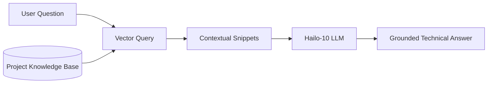

<!-- =============================================================================
HYDRA-UMC-DOCS-QA - Document search assistant
Copyright (C) JuanenRac (Electro Hobby 3D) <electrohobby3d@gmail.com>
GPL-3.0-or-later - see LICENSE
============================================================================= -->

<p align="center">
  
</p>

# 🔎 HYDRA-UMC-DOCS-QA

<p align="center">🇺🇸 <b>English</b> | <a href="README_spa.md">🇪🇸 Español</a> | <a href="README_fra.md">🇫🇷 Français</a> | <a href="README_ita.md">🇮🇹 Italiano</a> | <a href="README_deu.md">🇩🇪 Deutsch</a> | <a href="README_zho.md">🇨🇳 简体中文</a> | <a href="README_jpn.md">🇯🇵 日本語</a> | <a href="README_por.md">🇵🇹 Português</a></p>

### 🤖 RAG-Based AI Assistant for Hardware Maintenance & Documentation

<p align="center">
  
  
  
  
  
  
</p>

---

> **Safety and security status:** this ecosystem is not a certified safety system. There is no hardware E-STOP path, no firmware-enforced limits or interlocks and no verified motion command yet; firmware images are checked with CRC-32 and an Ed25519 signature, and a release build refuses the published development keys (the tool heads and expansion boards behind the relay still run URTC bootloaders, which take a shared-key HMAC-SHA256 instead of a signature); TLS and mutual TLS are optional and off by default; no custom board has been populated or tested yet. Read the [security baseline](https://github.com/JuanenRac/HYDRA-UMC-DOCS/blob/main/docs/SECURITY_BASELINE.md) and the [threat model](https://github.com/JuanenRac/HYDRA-UMC-DOCS/blob/main/docs/THREAT_MODEL.md) before relying on any statement here for the safety of a person.

---

## 📋 At a glance

| | |
|---|---|
| Version | `0.1.5` |
| Maturity | Functional |
| Tests | 109 (`python -m pytest -q tests`) |
| Stack | Python / TF-IDF lexical retrieval |
| Target | The Raspberry Pi CM5 of a HYDRA-UMC cell |
| On real hardware | Not yet: no run on real hardware is recorded for this version |

**Jump to:** [Overview](#-overview) · [Architecture](#-architecture) · [Features](#-features) · [Security & Safety](#-security--safety) · [Interfaces](#-interfaces) · [Configuration](#-configuration) · [Quick start](#-quick-start) · [Testing](#-testing) · [Troubleshooting](#-troubleshooting) · [Repository Structure](#-repository-structure) · [Related Projects](#-related-projects)

## 🚦 Project status

Each line is one part of this repository and the light says how far it is today. It is written from what the repository can show (tests, builds, runs), not from what is planned.

🟢 Done and verified · 🟡 Works, with known limits · 🟠 Partly done or not verified yet · 🔴 Not done or not working

| Area | State | What it means here |
|---|---|---|
| Software | 🟡 | Works for its main purpose; the honesty check above lists what is still missing |
| Tests | 🟢 | 109 automated tests, run on every change |
| Real hardware | 🔴 | Not yet: no run on real hardware is recorded for this version |
| Documentation | 🟢 | README in eight languages, checked against the manifest on every change |

## 🎯 Overview

**HYDRA-UMC-DOCS-QA** is a specialized Retrieval-Augmented Generation (RAG) assistant designed for on-site technicians and developers. It provides instant, grounded answers to technical questions about the HYDRA-UMC ecosystem.

It answers only from the Markdown documents it is given with `--docs`, locally and without an internet connection, and always cites the passage it used. Reading the manuals, schematic documentation and source code of the whole ecosystem for troubleshooting, pinout queries and firmware compilation is the goal, and is planned, not done.

## 🧩 Role in HYDRA-UMC

**HYDRA-UMC-DOCS-QA** answers a question about the ecosystem from its own documents: it finds the passages that match best and quotes them with their file and chunk number. It belongs to the Hailo-10 cognitive family, but today it is plain lexical retrieval (TF-IDF or BM25) with no language model, so what it returns is a citation, never a generated answer.

## 🏛️ Architecture

<p align="center">
  
</p>

<details>
<summary>Text version of the diagram (Mermaid)</summary>



</details>

**Why it is built this way**

This repository is a **child** of the Cognitive AI Node family - its
parent, [HYDRA-UMC-COGNITIVE-NODE](https://github.com/JuanenRac/HYDRA-UMC-COGNITIVE-NODE),
owns the shared HydraOS image and quantized model weights, and wires this
service into `docker-compose.yml` alongside its three siblings
(VLA-Engine, Voice-UI, Semantic-Planner):

* **Why this child has no hardware/firmware/`os/`/`models/` of its
  own.** It runs entirely on the CM5 + Hailo-10 M.2 module already owned
  by the parent - keeping model weights and the HydraOS image
  centralized in one place avoids four divergent multi-gigabyte copies
  across the family.
* **Why a `src/` layout.** Keeps the installable package
  (`hydra_umc_docs_qa`) separate from repo-root tooling
  (`bump_version.py`), matching the layout used by every other Python
  project across the ecosystem.
* **Why bare invocation (no subcommand) still only prints
  identity/version/role.** That was the original andamiaje (scaffolding)
  behavior, proving the package installs, compiles and imports cleanly
  before any real logic existed - it stays the default today as a quick
  "is this actually installed and working" smoke check, now alongside
  the real `query` (TF-IDF search) and `serve` (JSON/HTTP API)
  subcommands the scaffolding was a prerequisite for.
* **How this fits the rest of the ecosystem.** This assistant grounds
  its answers in the ecosystem's own documentation, giving its sibling
  HYDRA-UMC-SEMANTIC-PLANNER a technical-knowledge source it can query
  during reasoning, and offering on-site technicians hands-free
  troubleshooting support alongside HYDRA-UMC-VOICE-UI.
* **Why `index.py`'s retrieval is real TF-IDF, not an embedding model.**
  Embedding-based semantic search needs a real model dependency (and
  ideally the Hailo-10 this project's own README already targets) - a
  pure-stdlib TF-IDF/cosine-similarity index is real, testable, and
  needs nothing beyond Python itself, giving this project a working
  retrieval kernel today that a future embedding-based index can be
  swapped in behind the same `search()` contract without touching the
  CLI or the ingestion step.
* **Why an unmatched query returns an honest miss, not a fallback
  answer.** v0 has no LLM synthesis step - a question whose words don't
  overlap the ingested corpus gets `No relevant passages found`
  (see `main.py`), never a guessed or hallucinated response dressed up
  as a real retrieval result.
* **Why a disallowed `--docs` path is rejected, not silently skipped or
  silently ingested.** A QA assistant that's supposed to be "grounded in
  the ecosystem's own documentation" must not quietly read and cite
  whatever file a caller happens to point it at - a missing path or a
  non-Markdown file (a stray `.env`, a firmware binary) gets a real,
  distinct `REJECTED ... : <reason>` line (see `ingest.py`'s
  `validate_doc_path`) instead of an aggregate "found nothing" that
  hides *why*.
* **Why cosine similarity sorts the shared terms before summing them.**
  `dict.keys() & dict.keys()` is a set, and CPython's set iteration order
  depends on per-process string hash randomization - summing
  floating-point terms in that order would make a score depend on which
  process happened to run the query, not only on the corpus and query
  text. Sorting first makes the score a pure, reproducible function of
  its real inputs.
* **Why citations carry a `#index`, not just a filename.** A bare
  filename can't disambiguate two sections sharing a heading (or, later,
  two ingested files sharing a name) - `DocChunk.index` is each chunk's
  real ordinal position within its own source, giving every citation a
  stable key a caller can use to deterministically recover the exact
  passage again.

## ✨ Features

* 🔍 **Local Vector Search (v0):** Real, stdlib-only TF-IDF lexical retrieval over local Markdown docs. *(implemented as real lexical search - not yet embedding-based semantic search, and PDF ingestion is still future work; see Build & Release below)*
* 🔒 **Real document allowlist:** only existing `.md`/`.markdown` files are ever ingested and cited - every other `--docs` path (missing, or a disallowed file type) is rejected with a distinct, printed reason instead of being silently skipped or silently read as if it were real documentation. *(implemented)*
* 🔗 **Traceable citations:** every result cites `source#index` - a stable, disambiguating pointer back to the exact ingested passage, deterministically recoverable by re-parsing the same source. *(implemented)*
* 🎯 **Deterministic scoring:** ranking is a pure function of the corpus and query text, independent of the interpreter's per-process hash seed. *(implemented)*
* 🗄️ **Index cache that cannot run code:** the CLI `query` caches the built index in the user cache directory (`HYDRA_UMC_DOCS_QA_CACHE_DIR`, else `XDG_CACHE_HOME`, else `~/.cache/hydra-umc-docs-qa`), keyed by the path, size and modification time of every document. It is a validated JSON file now; it used to be a `pickle`, which runs whatever code the file carries, so any other process of the same user could plant a file there and have the next `query` execute it. A planted, truncated or wrongly shaped file is a plain cache miss. *(implemented)*
* 🌐 **Real JSON/HTTP API:** the `serve` subcommand runs the exact same TF-IDF search as a long-running local service (default `127.0.0.1:8110`) via `GET /query?q=...&top_k=N` and `GET /stats` - the corpus is ingested and indexed ONCE at startup instead of on every request. See [`docs/CLI_REFERENCE.md`](docs/CLI_REFERENCE.md) for real captured examples. *(implemented)*
* 📚 **Corpus manifest, BM25, "no answer", reload and citations you can check:** `--corpus FILE` (JSON: `roots`, `exclude` patterns, and `documents` pinned by SHA-256) replaces the free `--docs`: only the roots are read, a pinned document whose bytes changed is left out, and with pins a new file in a root is not quotable until somebody pins it. Every section carries the hash of its file, so a result cites `source#section@sha256`. `--scorer bm25`, `--stem` (a cautious suffix stripper) and `--heading-boost N` improve ranking on short texts (the defaults are what the index always was). The service can refuse to answer: `--min-score` and `--min-coverage` (the share of the words of the question that some section holds) make `GET /query` answer `answerable: false` with no context instead of a section that only shares a word with the question (a request may ask for more, never less). `POST /reload` (bearer token required; also SIGHUP) rebuilds the index from the disk without a restart and keeps the old one if the rebuild fails; `GET /stats` reports the number of chunks, when the index was built and the last reload error. *(tried on synthetic and real Markdown; the thresholds need tuning with real questions)*
* 🤖 **Grounded Reasoning:** Answers are strictly based on the provided project documentation.
* 🎙️ **Voice Integration:** Integrated with VOICE-UI for hands-free maintenance support.
* 🛠️ **Code Awareness:** Can explain firmware modules and CAN protocol specifics.
* 👨‍👩‍👧 **Cognitive AI Node Child:** Runs as one of four sibling services
  under [HYDRA-UMC-COGNITIVE-NODE](https://github.com/JuanenRac/HYDRA-UMC-COGNITIVE-NODE)
  (alongside VLA-Engine, Voice-UI and Semantic-Planner), sharing its
  parent's HydraOS image and model weights instead of keeping its own
  copies.
* 📦 **Explicit version bump:** The version in `pyproject.toml` is raised only by the explicit bump command (`python tools/hydra_project_tool.py bump`, which runs `bump_version.py`) - building never changes it.

## 🔒 Security & Safety

| Threat | Defence | Where |
|---|---|---|
| Anyone querying or reloading the corpus | An optional Bearer token of at least 16 characters (`--token-file` or `HYDRA_UMC_DOCS_QA_TOKEN`) guards `GET /query` and `POST /reload`; the service listens on `127.0.0.1:8110` by default | `access.py`, `main.py` |
| Giant documents, huge trees, hostile files | Only `.md` and `.markdown` are read, at most 4 MiB each, at most 5000 files expanded and 12 levels deep; the corpus manifest is at most 256 KiB and can pin each document by its SHA-256; a rejected path is reported, never silently ignored | `ingest.py`, `corpus.py` |
| Absurd results and a poisoned cache | `top_k` is at most 50; `--min-score` and `--min-coverage` (0 to 1) decide when a question counts as answered; the index cache keeps at most 20 entries | `api.py`, `cache.py` |

**What it never does:** no language model and no Hailo-10 run here: the label "Hailo-10" in the role is the hardware this family is meant for.

## 🔌 Interfaces

HTTP on `127.0.0.1:8110` by default and a command line. The full reference is `docs/CLI_REFERENCE.md`.

| Topic or route | What it carries |
|---|---|
| `GET /query?q=...&top_k=N` | the best passages, each cited as `file#chunk` |
| `GET /stats`, `POST /reload` | health and index size; reload the corpus (needs the token when one is set) |
| `query QUESTION` | `--docs`, `--top-k 5`, `--scorer tfidf\|bm25` (BM25 k1 1.5, b 0.75), `--stem`, `--heading-boost 1..10`, `--corpus MANIFEST` |
| `serve` | `--docs ... --addr 127.0.0.1 --port 8110 [--token-file FILE] [--min-score 0.0] [--min-coverage 0.0]` |

## ⚙️ Configuration

| Variable | Default | What it sets |
|---|---|---|
| `HYDRA_UMC_DOCS_QA_TOKEN`, `--token-file` | no token | the optional Bearer token, at least 16 characters |
| `HYDRA_UMC_DOCS_QA_CACHE_DIR` | the cache folder of the platform | where the index cache lives |
| `--corpus MANIFEST` | this repository's README and CHANGELOG | the corpus manifest: roots, excludes and documents pinned by SHA-256 |
| `--min-score`, `--min-coverage` | `0.0` | when a question counts as answered (0 to 1) |

## 🚀 Quick start

Requires Python >= 3.10.

```bash
# Linux / macOS / Git Bash
./build.sh   # creates .venv, installs the package (editable), verifies import
./run.sh     # runs the entry point

# Windows (cmd)
build.bat
run.bat
```

`build.sh`/`build.bat` never change the version (only `python tools/hydra_project_tool.py bump` raises it), and run the real test suite
(`pytest tests/`). Expected output of a bare `run.sh`:

```text
HYDRA-UMC-DOCS-QA v0.1.5
Docs-QA (Hailo-10) - retrieval-augmented technical assistant grounded in the ecosystem's own documentation.
```

The real `query` subcommand searches ingested Markdown - by default this
repo's own `README.md`/`CHANGELOG.md`, or any real files passed via
`--docs`:

```bash
./run.sh query "CAN bus wiring" --top-k 3
./run.sh query "vector search retrieval" --docs docs/manual.md docs/spec.md

# Windows
run.bat query "CAN bus wiring" --top-k 3
```

A question whose words don't overlap the ingested corpus prints an
honest `No relevant passages found` - v0 is real lexical retrieval, not
a generative answer.

Each result cites `source#index` (e.g. `manual.md#1`) - a stable,
traceable pointer to that exact chunk. A `--docs` path that's missing or
not `.md`/`.markdown` is rejected and reported, not silently ignored:

```text
$ ./run.sh query "firmware flashing" --docs manual.md ghost.md secret.env
REJECTED ghost.md: file not found (no source)
REJECTED secret.env: disallowed extension .env - only .markdown, .md are ingested
Top 1 passage(s) for: "firmware flashing"

1. [0.289] manual.md#1 - Firmware Flashing
   Flash URTC firmware over SWD or JTAG using URTC-FLASHER.
```

The same search is also reachable as a long-running JSON/HTTP API via `./run.sh serve --docs manual.md` (default `127.0.0.1:8110`). See [`docs/CLI_REFERENCE.md`](docs/CLI_REFERENCE.md) for the full command and endpoint reference, with every example captured from a real run.

## 🧪 Testing

109 automated tests run with `python -m pytest -q tests`. They cover ingestion, the TF-IDF and BM25 index, determinism, the cache, the corpus manifest, hostile inputs, the command line and the HTTP surface; no hardware and no outside network.

The CI runs `HYDRA_UMC_CI=1 python tools/ci_validate.py`, which checks the manifest, the documents, the eight READMEs and the pictures.

## 🏗️ Build & Release

There is nothing to compile for a release: `build.sh` / `build.bat` create the virtual environment, install the package in editable mode and run the tests, and `build-test` only checks. Building never changes the version; it is raised only by `python tools/hydra_project_tool.py bump`, which also moves the changelog. The version of the package, the manifest and the changelog must agree, and `ci_validate.py` fails when they do not.

## 🩺 Troubleshooting

* **`python: command not found` / build fails at step 1.** Requires
  Python >= 3.10 on `PATH`. On Windows, install from
  [python.org](https://python.org) and make sure "Add to PATH" was
  checked during setup; `python3` is the usual name on Linux/macOS.
* **`build.sh` fails to activate the venv.** `python3 -m venv .venv`
  lays out the activate script differently per platform:
  `.venv/bin/activate` on Linux/macOS, `.venv/Scripts/activate` on
  Windows (also true for a Windows Python venv used from Git Bash).
  `build.sh` already checks both paths - if it still fails, delete
  `.venv/` and re-run `./build.sh` to rebuild it from scratch.
* **`pip install -e .` fails.** Usually a stale `.venv/`. Delete the
  `.venv/` folder and re-run `./build.sh`/`build.bat` to recreate it.
* **`import OK` never prints.** Means `python -c "import
  hydra_umc_docs_qa"` itself failed - re-run with the venv active to
  see the real traceback.

## 📂 Repository Structure

<p align="center">
  
</p>

<details>
<summary>Text version of the tree</summary>

```text
HYDRA-UMC-DOCS-QA/
├── src/hydra_umc_docs_qa/
│   ├── ingest.py                                splits Markdown into heading-scoped chunks
│   ├── index.py                                 TF-IDF and BM25 retrieval
│   ├── corpus.py                                which documents may be answered from
│   ├── cache.py                                 on-disk index cache
│   ├── api.py access.py                         HTTP surface and the optional token
│   └── main.py highlight.py                     command line and match highlighting
├── tests/                                       100 tests
├── docs/                                        the command-line reference
├── systemd/                                     service unit for the CM5
├── tools/                                       build and test runner, version bump, CI validator, README and picture generators and checks
├── images/                                      banner and the pictures of the README
├── .github/                                     CI workflow and issue templates
├── pyproject.toml                               package metadata and dependencies
├── hydra-umc.project.json                       manifest: version, maturity, family
├── CHANGELOG.md                                 what changed in each version
├── build.sh build.bat                           build scripts (they never change the version)
├── build-test.sh build-test.bat                 build scripts (they never change the version)
├── test.sh test.bat                             run the tests
├── Dockerfile                                   container image
├── bump_version.py / bump_manifest_version.py   explicit version bump
├── run.sh run.bat                               start the service
└── SECURITY.md SUPPORT.md CONTRIBUTING.md CODE_OF_CONDUCT.md LICENSE LICENSE.md
```

</details>

## 🗺️ Roadmap & Known limits

**Known limits today**

* **Phase 1:** VLA engine deployment and multi-modal input processing on Hailo-10.
* **Phase 2:** Semantic planner integration with swarm behavioral models and long-term memory.
* **Phase 3:** Voice UI low-latency local execution and industrial noise cancellation.
* **Phase 4:** Interactive schematic visualization linked to QA answers and RAG optimization for edge devices.

## 🌍 Languages

This README and the documents of the repository exist in eight languages: English, Spanish, German, French, Italian, Japanese, Chinese and Portuguese (Portugal). They are written together and checked in the CI so that the eight files have the same sections and the same links. This repository has no screen or message catalogue of its own, so there are no interface strings to translate.

## 🔗 Related Projects

This project is part of the HYDRA-UMC robotics ecosystem by the same author (JuanenRac / Electro Hobby 3D). Worth knowing about, since a request might actually be about one of these rather than this repository.

**Parent Project**
- **[HYDRA-UMC-COGNITIVE-NODE](https://github.com/JuanenRac/HYDRA-UMC-COGNITIVE-NODE)** — integration hub for the Hailo-10 cognitive pipeline (LLM/VLA/voice orchestration); the parent this repo is one specific stage or consumer of, within its own cognitive pipeline.

**Sibling Projects** — the other stages/consumers of HYDRA-UMC-COGNITIVE-NODE's own Hailo-10 cognitive pipeline
- **[HYDRA-UMC-VOICE-UI](https://github.com/JuanenRac/HYDRA-UMC-VOICE-UI)** — real voice front-end (VAD + intent parser) with a bounded, confirmation-gated Watch relay.
- **[HYDRA-UMC-SEMANTIC-PLANNER](https://github.com/JuanenRac/HYDRA-UMC-SEMANTIC-PLANNER)** — real rule-based task decomposition and semantic error recovery over MCU error codes.
- **[HYDRA-UMC-VLA-ENGINE](https://github.com/JuanenRac/HYDRA-UMC-VLA-ENGINE)** — real action-token encoding/decoding and trajectory generation for a Vision-Language-Action model.
- **[HYDRA-UMC-LOCAL-TECHNICIAN](https://github.com/JuanenRac/HYDRA-UMC-LOCAL-TECHNICIAN)** — local, policy-gated AI maintenance technician for the ecosystem itself - observes, diagnoses and proposes fixes; the two highest risk levels are deliberately not implemented yet.

**Also Part of the Ecosystem**

*Core Hardware & Platform*
- **[HYDRA-UMC](https://github.com/JuanenRac/HYDRA-UMC)** — the robot-arm motherboard design: CM5 host + dual-core STM32H745, meant to orchestrate up to 8 tool arms over CAN-OTA/SPI-OTA (firmware at an early stage; no populated board yet).
- **[HYDRA-UMC-OS](https://github.com/JuanenRac/HYDRA-UMC-OS)** — reproducible Raspberry Pi OS product layer for the CM5: read-only agent, validated config/profiles, WiFi first-contact provisioning.
- **[HYDRA-UMC-SDK](https://github.com/JuanenRac/HYDRA-UMC-SDK)** — the shared JSON-Schema contract and software job-gate boundary every bridge validates its commands against (not a certified safety function).
- **[HYDRA-UMC-CONNECTOR-HUB](https://github.com/JuanenRac/HYDRA-UMC-CONNECTOR-HUB)** — declarative adapter-manifest registry and validator for external-machine connectors; extends the SDK's own contract idea to external machines without replacing the industrial-gateway projects.

*Core Backend & Clients*
- **[HYDRA-UMC-SERVER](https://github.com/JuanenRac/HYDRA-UMC-SERVER)** — the real headless backend (REST/WebSocket) every control client actually talks to.
- **[HYDRA-UMC-STUDIO](https://github.com/JuanenRac/HYDRA-UMC-STUDIO)** — web control dashboard with real-time multi-robot 3D visualization.
- **[HYDRA-UMC-SUITE](https://github.com/JuanenRac/HYDRA-UMC-SUITE)** — desktop (PySide6) swarm command center for multiple servers at once, packaged as a standalone executable.
- **[HYDRA-UMC-ANDROID-CONTROL](https://github.com/JuanenRac/HYDRA-UMC-ANDROID-CONTROL)** — native Android control app with biometric login and a paired Wear OS companion.
- **[HYDRA-UMC-IOS-CONTROL](https://github.com/JuanenRac/HYDRA-UMC-IOS-CONTROL)** — iOS/iPadOS control app (Flutter) with real-time WebSocket sync.
- **[HYDRA-UMC-DSI](https://github.com/JuanenRac/HYDRA-UMC-DSI)** — native touch UI for the onboard 7" DSI touchscreen, embedded on the CM5 itself.
- **[HYDRA-UMC-EDITOR-URDF](https://github.com/JuanenRac/HYDRA-UMC-EDITOR-URDF)** — desktop graphical URDF creator/editor that pushes finished models into STUDIO's own catalog.
- **[HYDRA-UMC-EDITOR-STL](https://github.com/JuanenRac/HYDRA-UMC-EDITOR-STL)** — desktop STL model editor, transforming/replacing/removing/adding real parts in the same model catalog HYDRA-UMC-EDITOR-URDF also edits.
- **[HYDRA-UMC-BRIDGE-AMR](https://github.com/JuanenRac/HYDRA-UMC-BRIDGE-AMR)** — coordination boundary for AGV/AMR fleets via a VDA 5050 MQTT publisher (tested against an emulated fleet only).
- **[HYDRA-UMC-BRIDGE-CNC](https://github.com/JuanenRac/HYDRA-UMC-BRIDGE-CNC)** — high-level CNC-cell coordinator with GRBL status/control-byte access (tested against an emulator only).
- **[HYDRA-UMC-BRIDGE-DROIDS](https://github.com/JuanenRac/HYDRA-UMC-BRIDGE-DROIDS)** — coordination boundary for legged/humanoid droids, with a Boston Dynamics Spot command sender (tested against an emulator only).
- **[HYDRA-UMC-BRIDGE-LASER](https://github.com/JuanenRac/HYDRA-UMC-BRIDGE-LASER)** — laser-cell coordinator reading 3 key/enclosure/interlock GPIO signals (tested against a fake chip only; it cannot arm or fire a laser).
- **[HYDRA-UMC-BRIDGE-OPENPNP](https://github.com/JuanenRac/HYDRA-UMC-BRIDGE-OPENPNP)** — safe high-level board-flow coordinator for OpenPnP pick-and-place.
- **[HYDRA-UMC-BRIDGE-PRINTER3D](https://github.com/JuanenRac/HYDRA-UMC-BRIDGE-PRINTER3D)** — safe coordination boundary for Moonraker/Klipper 3D printers, with real gated job commands.
- **[HYDRA-UMC-BRIDGE-ROS2](https://github.com/JuanenRac/HYDRA-UMC-BRIDGE-ROS2)** — coordinator with a lazily imported rclpy ROS 2 transport (not yet run against a ROS 2 installation).
- **[HYDRA-UMC-BRIDGE-UAV](https://github.com/JuanenRac/HYDRA-UMC-BRIDGE-UAV)** — coordination boundary for camera-equipped UAVs, with a MAVLink command sender (tested against an emulator only).

*URTC Tool Platform*
- **[URTC](https://github.com/JuanenRac/URTC)** — firmware for the physical Universal Robot Tool Controller PCB, 25+ tool profiles over CAN bus.
- **[URTC-FLASHER](https://github.com/JuanenRac/URTC-FLASHER)** — desktop GUI flashing tool for URTC boards, CAN-OTA plus full-chip SWD/JTAG.
- **[URTC-TESTER](https://github.com/JuanenRac/URTC-TESTER)** — desktop live CAN-bus diagnostic tool for URTC boards, one panel per tool profile.
- **[URTC-WEB-STUDIO](https://github.com/JuanenRac/URTC-WEB-STUDIO)** — browser-based alternative to URTC-TESTER via the Web Serial API, no local install needed.
- **[URTC-GATEWAY](https://github.com/JuanenRac/URTC-GATEWAY)** — gateway in front of the URTC CAN bus: an allowed list of identifiers, a rate limit and a session key; software tested on a computer, not yet on a real bus.

*Vision AI Node (Hailo-8)*
- **[HYDRA-UMC-VISION-NODE](https://github.com/JuanenRac/HYDRA-UMC-VISION-NODE)** — integration hub for the Hailo-8 vision pipeline, with a real per-stage hardware-readiness check.
- **[HYDRA-UMC-DETECTION-HEF](https://github.com/JuanenRac/HYDRA-UMC-DETECTION-HEF)** — real compiled-model registry with Hailo-architecture/checksum safe-load verification.
- **[HYDRA-UMC-VISION-STREAMER](https://github.com/JuanenRac/HYDRA-UMC-VISION-STREAMER)** — real GStreamer pipeline + MediaMTX config generator with a real HailoRT integration boundary.
- **[HYDRA-UMC-VISUAL-SERVOING-API](https://github.com/JuanenRac/HYDRA-UMC-VISUAL-SERVOING-API)** — Position-Based Visual Servoing correction law with authorisation gated on the zone state; no camera pose estimation yet.
- **[HYDRA-UMC-SAFETY-ZONES](https://github.com/JuanenRac/HYDRA-UMC-SAFETY-ZONES)** — v0 zone-breach, calibration-freshness and E-STOP-request logic that takes object positions from a file; no detector feeds it and no physical E-STOP is wired to it yet.

*Orchestration & Swarm*
- **[HYDRA-UMC-ORCHESTRATOR](https://github.com/JuanenRac/HYDRA-UMC-ORCHESTRATOR)** — integration hub with a real gRPC/Protobuf health-report contract and mission state machine.
- **[HYDRA-UMC-JOB-DISPATCHER](https://github.com/JuanenRac/HYDRA-UMC-JOB-DISPATCHER)** — real priority-based job queue with deduplication, over a real HTTP API.
- **[HYDRA-UMC-NODE-HEALING](https://github.com/JuanenRac/HYDRA-UMC-NODE-HEALING)** — real gRPC-based fleet health watchdog with retry/backoff and identity-mismatch detection.
- **[HYDRA-UMC-PATH-PLANNER-3D](https://github.com/JuanenRac/HYDRA-UMC-PATH-PLANNER-3D)** — real RRT-based 3D path planner with real obstacle/workspace collision validation.
- **[HYDRA-UMC-SWARM-SYNC](https://github.com/JuanenRac/HYDRA-UMC-SWARM-SYNC)** — real CRDT LWW-Element-Map state sync, property-tested for multi-cell convergence.

*Digital Twin & Simulation*
- **[HYDRA-UMC-TWIN](https://github.com/JuanenRac/HYDRA-UMC-TWIN)** — integration hub for the digital-twin engine, with a real version-compatibility sync contract.
- **[HYDRA-UMC-HIL-BRIDGE](https://github.com/JuanenRac/HYDRA-UMC-HIL-BRIDGE)** — hardware-in-the-loop router with a software collision interlock between simulation and real hardware (tested without real hardware).
- **[HYDRA-UMC-PHYSICS-REPLICA](https://github.com/JuanenRac/HYDRA-UMC-PHYSICS-REPLICA)** — real forward kinematics and joint-limit validation over a real URDF subset.
- **[HYDRA-UMC-SYNTHETIC-DATA-GEN](https://github.com/JuanenRac/HYDRA-UMC-SYNTHETIC-DATA-GEN)** — real procedural 2D scene generator with YOLO/COCO annotation export.

*Data & Analytics*
- **[HYDRA-UMC-DATALAKE](https://github.com/JuanenRac/HYDRA-UMC-DATALAKE)** — real sqlite3-backed time-series store with a real ingest/query HTTP API.
- **[HYDRA-UMC-ANOMALY-DETECTOR](https://github.com/JuanenRac/HYDRA-UMC-ANOMALY-DETECTOR)** — real FFT + statistical baseline anomaly detector with drift monitoring.
- **[HYDRA-UMC-PRODUCTION-REPORTS](https://github.com/JuanenRac/HYDRA-UMC-PRODUCTION-REPORTS)** — real OEE/availability calculation over DATALAKE history, with reproducible CSV export.
- **[HYDRA-UMC-TELEMETRY-COLLECTOR](https://github.com/JuanenRac/HYDRA-UMC-TELEMETRY-COLLECTOR)** — real CAN/WebSocket ingestion pipeline into DATALAKE, with sequence deduplication.

*Industrial Gateway*
- **[HYDRA-UMC-GATEWAY-INDUSTRIAL](https://github.com/JuanenRac/HYDRA-UMC-GATEWAY-INDUSTRIAL)** — integration hub relaying to industrial protocols, with a real command allowlist/backpressure layer.
- **[HYDRA-UMC-OPCUA-SERVER](https://github.com/JuanenRac/HYDRA-UMC-OPCUA-SERVER)** — real OPC-UA address space, verified with a real binary-protocol client session.
- **[HYDRA-UMC-MQTT-BROKER](https://github.com/JuanenRac/HYDRA-UMC-MQTT-BROKER)** — real MQTT broker with optional per-client authentication and topic ACLs.
- **[HYDRA-UMC-MTCONNECT-ADAPTER](https://github.com/JuanenRac/HYDRA-UMC-MTCONNECT-ADAPTER)** — real MTConnect `/probe` and `/current` XML endpoints with degraded-mode output.

*Complementary Tools & Ecosystem Operations*
- **[HYDRA-UMC-DASHBOARD-AI](https://github.com/JuanenRac/HYDRA-UMC-DASHBOARD-AI)** — Smart Summaries and Anomaly Highlighting panels over DATALAKE/ANOMALY-DETECTOR, with an honest statistical fallback.
- **[HYDRA-UMC-TOOL-CLI](https://github.com/JuanenRac/HYDRA-UMC-TOOL-CLI)** — fleet CLI with a real, stable exit-code contract, a genuine live client of HYDRA-UMC-SERVER's own API.
- **[HYDRA-UMC-WATCH](https://github.com/JuanenRac/HYDRA-UMC-WATCH)** — WearOS companion app with haptic alert patterns and a paired-phone voice relay (not yet run on a physical watch).
- **[URTC-SMART-RACK](https://github.com/JuanenRac/URTC-SMART-RACK)** — firmware for a board-mounting rack with real tool-ID decoding and Smart Idle pre-heating logic.
- **[URTC-VISION-TOOL](https://github.com/JuanenRac/URTC-VISION-TOOL)** — firmware plus a real Python vision companion for a thermal/RGB inspection tool head.
- **[HYDRA-UMC-UPDATER](https://github.com/JuanenRac/HYDRA-UMC-UPDATER)** — administrative desktop tool that discovers, clones and updates every repo in this ecosystem.
- **[HYDRA-UMC-OS-REBUILDER](https://github.com/JuanenRac/HYDRA-UMC-OS-REBUILDER)** — Windows/Linux desktop tool that builds a ready-to-flash CM5 image pre-loaded with the ecosystem's most current versions, with Raspberry-Pi-Imager-style first-boot Wi-Fi/user/SSH configuration.
- **[HYDRA-UMC-OPS-AGENT](https://github.com/JuanenRac/HYDRA-UMC-OPS-AGENT)** — maintenance-incident coordinator: a low-privilege edge role collects a sanitized inventory/health snapshot, a control-plane role renders it read-only and asks an AI provider to suggest a diagnosis - never applies a patch or deploys anything.
- **[HYDRA-UMC-DEV-SERVER](https://github.com/JuanenRac/HYDRA-UMC-DEV-SERVER)** — reproducible development host (Raspberry Pi 5 / CM5) that stores the ecosystem's source and runs bounded build/test tasks under a durable queue; a dedicated dev role, explicitly not an operational CM5.

## 📚 Documentation

Where to read more:

* [docs/CLI_REFERENCE.md](docs/CLI_REFERENCE.md) - every command and endpoint, with output captured from a real run
* [Security baseline of the ecosystem](https://github.com/JuanenRac/HYDRA-UMC-DOCS/blob/main/docs/SECURITY_BASELINE.md)
* [Threat model of the ecosystem](https://github.com/JuanenRac/HYDRA-UMC-DOCS/blob/main/docs/THREAT_MODEL.md)
* [Changelog of this repository](CHANGELOG.md)
* [License of this repository](LICENSE.md)

## 🤝 Contributing & Community

* Before a pull request run `HYDRA_UMC_CI=1 py -3 tools/ci_validate.py` (or `HYDRA_UMC_CI=1 python3 tools/ci_validate.py`): it must print `CI_VALIDATION=PASS`. Do not run `build.sh` or `build.bat` for this check; building is not a check.
* The eight READMEs are written from one source in HYDRA-UMC-DOCS; do not edit them by hand. Change the source and write them again with `tools/make_readmes.py`.
* Do not state in a README what has not run: say "simulated" or "not tried on hardware" where that is the truth.
* See [CONTRIBUTING.md](CONTRIBUTING.md), the [code of conduct](CODE_OF_CONDUCT.md), [SECURITY.md](SECURITY.md) and [SUPPORT.md](SUPPORT.md).

## 👤 AUTHOR

**JuanenRac (Electro Hobby 3D)** · electrohobby3d@gmail.com

## 📜 LICENSE

GPL-3.0-or-later - [LICENSE](LICENSE).
