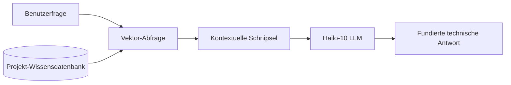

<!-- =============================================================================
HYDRA-UMC-DOCS-QA - Document search assistant
Copyright (C) JuanenRac (Electro Hobby 3D) <electrohobby3d@gmail.com>
GPL-3.0-or-later - see LICENSE
============================================================================= -->

<p align="center">
  
</p>

# 🔎 HYDRA-UMC-DOCS-QA

<p align="center"><a href="README.md">🇺🇸 English</a> | <a href="README_spa.md">🇪🇸 Español</a> | <a href="README_fra.md">🇫🇷 Français</a> | <a href="README_ita.md">🇮🇹 Italiano</a> | 🇩🇪 <b>Deutsch</b> | <a href="README_zho.md">🇨🇳 简体中文</a> | <a href="README_jpn.md">🇯🇵 日本語</a> | <a href="README_por.md">🇵🇹 Português</a></p>

### 🤖 RAG-basierter KI-Assistent für Hardware-Wartung & Dokumentation

<p align="center">
  
  
  
  
  
  
</p>

---

> **Stand von Sicherheit (Safety) und Security:** Dieses Ökosystem ist kein zertifiziertes Sicherheitssystem. Es gibt noch keinen Hardware-E-STOP-Pfad, keine von der Firmware durchgesetzten Grenzen oder Verriegelungen und keinen verifizierten Bewegungsbefehl; Firmware-Images werden mit CRC32 und einem HMAC-SHA256 mit gemeinsamem Schlüssel geprüft, nicht mit einer asymmetrischen Signatur; TLS und gegenseitiges TLS sind optional und standardmäßig aus; noch keine eigene Platine wurde bestückt oder getestet. Lesen Sie die [Sicherheitsbasis](https://github.com/JuanenRac/HYDRA-UMC-DOCS/blob/main/docs/SECURITY_BASELINE.md) und das [Bedrohungsmodell](https://github.com/JuanenRac/HYDRA-UMC-DOCS/blob/main/docs/THREAT_MODEL.md), bevor Sie sich für die Sicherheit einer Person auf eine Aussage hier verlassen.

---

## 📋 Auf einen Blick

| | |
|---|---|
| Version | `0.1.5` |
| Reifegrad | Funktionsfähig |
| Tests | 100 (`python -m pytest -q tests`) |
| Technik | Python / TF-IDF lexical retrieval |
| Ziel | Der Raspberry Pi CM5 einer HYDRA-UMC-Zelle |
| Auf echter Hardware | Noch nicht: für diese Version ist kein Lauf auf echter Hardware vermerkt |

**Springe zu:** [Überblick](#-überblick) · [Architektur](#-architektur) · [Funktionen](#-funktionen) · [Sicherheit und Schutz](#-sicherheit-und-schutz) · [Schnittstellen](#-schnittstellen) · [Konfiguration](#-konfiguration) · [Schnellstart](#-schnellstart) · [Tests](#-tests) · [Fehlerbehebung](#-fehlerbehebung) · [Struktur des Repositorys](#-struktur-des-repositorys) · [Verwandte Projekte](#-verwandte-projekte)

## 🚦 Projektstatus

Jede Zeile ist ein Teil dieses Repositorys, und die Ampel sagt, wie weit er heute ist. Sie beruht auf dem, was das Repository zeigen kann (Tests, Builds, Läufe), nicht auf dem, was geplant ist.

🟢 Fertig und überprüft · 🟡 Funktioniert, mit bekannten Grenzen · 🟠 Teilweise fertig oder noch nicht überprüft · 🔴 Nicht gemacht oder funktioniert nicht

| Bereich | Stand | Was das hier bedeutet |
|---|---|---|
| Software | 🟡 | Funktioniert für seinen Hauptzweck; die Ehrlichkeitsprüfung oben nennt, was noch fehlt |
| Tests | 🟢 | 100 automatische Tests, bei jeder Änderung ausgeführt |
| Echte Hardware | 🔴 | Noch nicht: für diese Version ist kein Lauf auf echter Hardware vermerkt |
| Dokumentation | 🟢 | README in acht Sprachen, bei jeder Änderung gegen das Manifest geprüft |

## 🎯 Überblick

**HYDRA-UMC-DOCS-QA** ist ein spezialisierter Retrieval-Augmented Generation (RAG) Assistent, der für Techniker und Entwickler vor Ort konzipiert wurde. Er liefert sofortige, fundierte Antworten auf technische Fragen zum HYDRA-UMC-Ökosystem.

Er antwortet nur aus den Markdown-Dokumenten, die ihm mit `--docs` übergeben werden, lokal und ohne Internetverbindung, und nennt immer die verwendete Textstelle. Alle Handbücher, Schaltdokumentationen und den Quellcode des gesamten Ökosystems für Fehlerbehebung, Pinout-Abfragen und Firmware-Kompilierung zu lesen, ist das Ziel und geplant, aber noch nicht erreicht.

## 🧩 Rolle in HYDRA-UMC

**HYDRA-UMC-DOCS-QA** beantwortet eine Frage zum Ökosystem aus dessen eigenen Dokumenten: Er findet die am besten passenden Abschnitte und zitiert sie mit Datei und Abschnittsnummer. Er gehört zur kognitiven Hailo-10-Familie, ist heute aber einfache lexikalische Suche (TF-IDF oder BM25) ohne Sprachmodell, liefert also ein Zitat und nie eine erzeugte Antwort.

## 🏛️ Architektur

<p align="center">
  
</p>

<details>
<summary>Textversion des Diagramms (Mermaid)</summary>



</details>

**Warum es so gebaut ist**

Dieses Repository ist ein **Kind** der Cognitive-AI-Node-Familie - sein
Elternprojekt, [HYDRA-UMC-COGNITIVE-NODE](https://github.com/JuanenRac/HYDRA-UMC-COGNITIVE-NODE),
besitzt das gemeinsam genutzte HydraOS-Image und die quantisierten
Modellgewichte und bindet diesen Dienst in der eigenen
`docker-compose.yml` neben seinen drei Geschwistern (VLA-Engine,
Voice-UI, Semantic-Planner) ein:

* **Warum dieses Kind keine eigene Hardware/Firmware/`os/`/`models/`
  hat.** Es läuft vollständig auf dem bereits vom Elternprojekt
  besessenen CM5 + Hailo-10-M.2-Modul - die Zentralisierung von
  Modellgewichten und HydraOS-Image an einem Ort vermeidet vier
  divergierende, mehrere Gigabyte große Kopien innerhalb der Familie.
* **Warum eine `src/`-Struktur.** Hält das installierbare Paket
  (`hydra_umc_docs_qa`) getrennt vom Tooling im Repo-Root
  (`bump_version.py`), passend zum Layout jedes anderen
  Python-Projekts im Ökosystem.
* **Warum der nackte Aufruf (ohne Unterbefehl) weiterhin nur
  Identität/Version/Rolle ausgibt.** Das war das ursprüngliche
  Andamiaje-Verhalten (Gerüstbau), das nachwies, dass das Paket sich
  korrekt installiert, kompiliert und importiert, bevor überhaupt echte
  Logik existierte - es bleibt heute der Standard als schneller
  "ist das wirklich installiert und funktioniert es"-Check, neben den
  echten Unterbefehlen `query` (TF-IDF-Suche) und `serve`
  (JSON/HTTP-API), für die dieses Gerüst eine Voraussetzung war.
* **Wie sich das ins restliche Ökosystem einfügt.** Dieser Assistent
  fundiert seine Antworten auf der eigenen Dokumentation des
  Ökosystems und gibt seinem Geschwisterprojekt
  HYDRA-UMC-SEMANTIC-PLANNER eine technische Wissensquelle, die es
  während des Reasonings abfragen kann, und bietet Technikern vor Ort
  freihändige Fehlerbehebungsunterstützung neben HYDRA-UMC-VOICE-UI.
* **Warum das Retrieval von `index.py` echtes TF-IDF ist, kein
  Embedding-Modell.** Embedding-basierte semantische Suche benötigt
  eine echte Modellabhängigkeit (idealerweise den eigenen Hailo-10, den
  dieses README bereits erwähnt) - ein reiner stdlib-TF-IDF-/
  Kosinus-Ähnlichkeits-Index ist echt, testbar und braucht nichts
  außer Python selbst, was diesem Projekt schon heute einen
  funktionierenden Retrieval-Kern gibt, den ein künftiger
  embedding-basierter Index hinter demselben `search()`-Vertrag
  ersetzen kann, ohne CLI oder Ingestion-Schritt anzufassen.
* **Warum eine Anfrage ohne Treffer einen ehrlichen Fehlschlag liefert,
  keine Ausweichantwort.** v0 hat keinen LLM-Syntheseschritt - eine
  Frage, deren Wörter sich nicht mit dem eingelesenen Korpus
  überschneiden, erhält `No relevant passages found` (siehe
  `main.py`), niemals eine erfundene oder halluzinierte Antwort,
  getarnt als echtes Retrieval-Ergebnis.
* **Warum ein nicht zulässiger `--docs`-Pfad abgelehnt wird, statt
  stillschweigend übersprungen oder eingelesen zu werden.** Ein
  QA-Assistent, der "auf der eigenen Dokumentation des Ökosystems
  fundiert" sein soll, darf nicht stillschweigend jede Datei lesen und
  zitieren, auf die ein Aufrufer zufällig zeigt - ein fehlender Pfad
  oder eine Nicht-Markdown-Datei (eine verirrte `.env`, eine
  Firmware-Binärdatei) erhält eine echte, eigene
  `REJECTED ... : <Grund>`-Zeile (siehe `validate_doc_path` in
  `ingest.py`) statt eines aggregierten "nichts gefunden", das
  verbirgt, *warum*.
* **Warum die Kosinus-Ähnlichkeit gemeinsame Terme vor der Summierung
  sortiert.** `dict.keys() & dict.keys()` ist ein Set, und die
  Iterationsreihenfolge von Sets in CPython hängt von der
  prozessweiten Zufälligkeit des String-Hashings ab - würde man
  Gleitkomma-Terme in dieser Reihenfolge summieren, hinge ein Score
  davon ab, welcher Prozess die Anfrage zufällig ausgeführt hat, nicht
  nur von Korpus und Anfrage-Text. Vorheriges Sortieren macht den
  Score zu einer reinen, reproduzierbaren Funktion seiner
  tatsächlichen Eingaben.
* **Warum Zitate ein `#index` tragen, nicht nur einen Dateinamen.** Ein
  bloßer Dateiname kann zwei Abschnitte mit gleicher Überschrift nicht
  unterscheiden (oder später zwei eingelesene Dateien mit gleichem
  Namen) - `DocChunk.index` ist die tatsächliche Ordinalposition jedes
  Chunks innerhalb seiner eigenen Quelle und gibt jedem Zitat einen
  stabilen Schlüssel, mit dem ein Aufrufer dieselbe Passage
  deterministisch wiederfinden kann.

## ✨ Funktionen

* 🔍 **Lokale Vektorsuche (v0):** Echtes, stdlib-basiertes TF-IDF-Lexik-Retrieval über lokale Markdown-Dokumente. *(implementiert als echte lexikalische Suche - noch keine embedding-basierte semantische Suche, PDF-Ingestion bleibt zukünftige Arbeit; siehe BUILD UND AUSFÜHRUNG unten)*
* 🔒 **Echte Dokument-Positivliste:** Es werden ausschließlich existierende `.md`/`.markdown`-Dateien eingelesen und zitiert - jeder andere `--docs`-Pfad (fehlend oder ein nicht zulässiger Dateityp) wird mit einem eigenen, ausgegebenen Grund abgelehnt, statt stillschweigend übersprungen oder wie echte Dokumentation gelesen zu werden. *(implementiert)*
* 🔗 **Nachvollziehbare Zitate:** Jedes Ergebnis zitiert `source#index` - einen stabilen, eindeutigen Verweis auf die exakte eingelesene Passage, deterministisch wiederherstellbar durch erneutes Parsen derselben Quelle. *(implementiert)*
* 🎯 **Deterministisches Scoring:** Das Ranking ist eine reine Funktion von Korpus und Anfrage-Text, unabhängig vom Hash-Seed des jeweiligen Interpreter-Prozesses. *(implementiert)*
* 🗄️ **Index-Cache, der keinen Code ausführen kann:** Das `query` der CLI legt den gebauten Index im Cache-Verzeichnis des Benutzers ab (`HYDRA_UMC_DOCS_QA_CACHE_DIR`, sonst `XDG_CACHE_HOME`, sonst `~/.cache/hydra-umc-docs-qa`), mit einem Schlüssel aus Pfad, Größe und Änderungszeit jedes Dokuments. Es ist jetzt eine validierte JSON-Datei; früher war es ein `pickle`, der beliebigen Code der Datei ausführt, sodass jeder andere Prozess desselben Benutzers dort eine Datei ablegen und vom nächsten `query` ausführen lassen konnte. Eine untergeschobene, abgeschnittene oder falsch geformte Datei ist schlicht ein Cache-Fehltreffer. *(implementiert)*
* 🌐 **Echte JSON/HTTP-API:** Der `serve`-Unterbefehl führt genau dieselbe TF-IDF-Suche als langlebigen lokalen Dienst aus (Standard `127.0.0.1:8110`) über `GET /query?q=...&top_k=N` und `GET /stats` - der Korpus wird nur EINMAL beim Start eingelesen und indiziert, nicht bei jeder Anfrage. Siehe [`docs/CLI_REFERENCE.md`](docs/CLI_REFERENCE.md) für echte, erfasste Beispiele. *(implementiert)*
* 📚 **Korpus-Manifest, BM25, "keine Antwort", Neuladen und überprüfbare Zitate:** `--corpus DATEI` (JSON: `roots`, `exclude`-Muster und per SHA-256 festgelegte `documents`) ersetzt das freie `--docs`: Nur die Wurzeln werden gelesen, ein festgelegtes Dokument mit geänderten Bytes bleibt draußen, und bei vorhandenen Festlegungen ist eine neue Datei in einer Wurzel erst zitierbar, wenn jemand sie festlegt. Jeder Abschnitt trägt den Hash seiner Datei, so dass ein Treffer `Quelle#Abschnitt@sha256` zitiert. `--scorer bm25`, `--stem` (ein vorsichtiger Endungsentferner) und `--heading-boost N` verbessern die Rangfolge bei kurzen Texten (die Voreinstellungen sind, was der Index immer war). Der Dienst kann die Antwort verweigern: `--min-score` und `--min-coverage` (der Anteil der Wörter der Frage, den ein Abschnitt enthält) lassen `GET /query` mit `answerable: false` und ohne Kontext antworten, statt mit einem Abschnitt, der nur ein Wort mit der Frage teilt (eine Anfrage darf mehr verlangen, nie weniger). `POST /reload` (Bearer-Token erforderlich; auch SIGHUP) baut den Index ohne Neustart von der Platte neu auf und behält den alten, wenn das scheitert; `GET /stats` meldet die Zahl der Abschnitte, wann der Index gebaut wurde und den letzten Fehler beim Neuladen. *(mit synthetischem und echtem Markdown erprobt; die Schwellen brauchen Abstimmung mit echten Fragen)*
* 🤖 **Fundiertes Denken:** Antworten basieren strikt auf der bereitgestellten Projektdokumentation.
* 🎙️ **Sprachintegration:** Integriert in VOICE-UI für freihändige Wartungsunterstützung.
* 🛠️ **Code-Bewusstsein:** Kann Firmware-Module und CAN-Protokoll-Spezifikatiön erläutern.
* 👨‍👩‍👧 **Kind des Cognitive AI Node:** Läuft als einer von vier
  Geschwisterdiensten unter [HYDRA-UMC-COGNITIVE-NODE](https://github.com/JuanenRac/HYDRA-UMC-COGNITIVE-NODE)
  (neben VLA-Engine, Voice-UI und Semantic-Planner), teilt sich das
  HydraOS-Image und die Modellgewichte des eigenen Elternprojekts,
  anstatt eigene Kopien zu pflegen.
* 📦 **Ausdrückliche Versionserhöhung:** Die Version in `pyproject.toml` wird nur vom expliziten `bump`-Befehl erhöht (`python tools/hydra_project_tool.py bump`, der `bump_version.py` ausführt) - Bauen ändert sie nie.

## 🔒 Sicherheit und Schutz

| Bedrohung | Abwehr | Wo |
|---|---|---|
| Jeder, der den Korpus abfragt oder neu lädt | Ein optionales Bearer-Token mit mindestens 16 Zeichen (`--token-file` oder `HYDRA_UMC_DOCS_QA_TOKEN`) schützt `GET /query` und `POST /reload`; der Dienst lauscht standardmäßig auf `127.0.0.1:8110` | `access.py`, `main.py` |
| Riesige Dokumente, riesige Verzeichnisbäume, feindliche Dateien | Nur `.md` und `.markdown` werden gelesen, jede höchstens 4 MiB, höchstens 5000 Dateien entfaltet und 12 Ebenen tief; das Korpus-Manifest hat höchstens 256 KiB und kann jedes Dokument über seinen SHA-256 festlegen; ein abgelehnter Pfad wird gemeldet, nie stillschweigend ignoriert | `ingest.py`, `corpus.py` |
| Absurde Ergebnisse und ein vergifteter Cache | `top_k` ist höchstens 50; `--min-score` und `--min-coverage` (0 bis 1) entscheiden, wann eine Frage als beantwortet gilt; der Index-Cache hält höchstens 20 Einträge | `api.py`, `cache.py` |

**Was er nie tut:** hier läuft weder ein Sprachmodell noch Hailo-10: Das Etikett „Hailo-10“ in der Rolle nennt die Hardware, für die diese Familie gedacht ist.

## 🔌 Schnittstellen

HTTP standardmäßig auf `127.0.0.1:8110` und eine Kommandozeile. Die vollständige Referenz ist `docs/CLI_REFERENCE.md`.

| Topic oder Route | Was es trägt |
|---|---|
| `GET /query?q=...&top_k=N` | die besten Abschnitte, jeder zitiert als `Datei#Abschnitt` |
| `GET /stats`, `POST /reload` | Gesundheit und Indexgröße; den Korpus neu laden (braucht das Token, falls gesetzt) |
| `query QUESTION` | `--docs`, `--top-k 5`, `--scorer tfidf\|bm25` (BM25 k1 1,5, b 0,75), `--stem`, `--heading-boost 1..10`, `--corpus MANIFEST` |
| `serve` | `--docs ... --addr 127.0.0.1 --port 8110 [--token-file DATEI] [--min-score 0.0] [--min-coverage 0.0]` |

## ⚙️ Konfiguration

| Variable | Standard | Was sie festlegt |
|---|---|---|
| `HYDRA_UMC_DOCS_QA_TOKEN`, `--token-file` | kein Token | das optionale Bearer-Token, mindestens 16 Zeichen |
| `HYDRA_UMC_DOCS_QA_CACHE_DIR` | der Cache-Ordner der Plattform | wo der Index-Cache liegt |
| `--corpus MANIFEST` | README und CHANGELOG dieses Repositorys | das Korpus-Manifest: Wurzeln, Ausschlüsse und per SHA-256 festgelegte Dokumente |
| `--min-score`, `--min-coverage` | `0.0` | wann eine Frage als beantwortet gilt (0 bis 1) |

## 🚀 Schnellstart

Erfordert Python >= 3.10.

```bash
# Linux / macOS / Git Bash
./build.sh   # erstellt .venv, installiert das Paket (editable), prüft den Import
./run.sh     # führt den Einstiegspunkt aus

# Windows (cmd)
build.bat
run.bat
```

`build.sh`/`build.bat` ändern die Version nie (nur `python tools/hydra_project_tool.py bump` erhöht sie) und führen die echte Testsuite
aus (`pytest tests/`). Erwartete Ausgabe eines `run.sh` ohne Argumente:

```text
HYDRA-UMC-DOCS-QA v0.1.5
Docs-QA (Hailo-10) - retrieval-augmented technical assistant grounded in the ecosystem's own documentation.
```

Das echte `query`-Subcommand durchsucht eingelesenes Markdown -
standardmäßig die eigenen `README.md`/`CHANGELOG.md` dieses Repos, oder
beliebige echte Dateien, die über `--docs` übergeben werden:

```bash
./run.sh query "CAN-Bus-Verkabelung" --top-k 3
./run.sh query "Vektorsuche Retrieval" --docs docs/manual.md docs/spec.md

# Windows
run.bat query "CAN-Bus-Verkabelung" --top-k 3
```

Eine Frage, deren Wörter sich nicht mit dem eingelesenen Korpus
überschneiden, gibt ein ehrliches `No relevant passages found` aus - v0
ist echtes lexikalisches Retrieval, keine generative Antwort.

Jedes Ergebnis zitiert `source#index` (z. B. `manual.md#1`) - ein
stabiler, nachvollziehbarer Verweis auf genau diesen Chunk. Ein
`--docs`-Pfad, der fehlt oder nicht `.md`/`.markdown` ist, wird
abgelehnt und gemeldet, nicht stillschweigend ignoriert:

```text
$ ./run.sh query "firmware flashing" --docs manual.md ghost.md secret.env
REJECTED ghost.md: file not found (no source)
REJECTED secret.env: disallowed extension .env - only .markdown, .md are ingested
Top 1 passage(s) for: "firmware flashing"

1. [0.289] manual.md#1 - Firmware Flashing
   Flash URTC firmware over SWD or JTAG using URTC-FLASHER.
```

Dieselbe Suche ist auch als langlebige JSON/HTTP-API über `./run.sh serve --docs manual.md` erreichbar (Standard `127.0.0.1:8110`). Siehe [`docs/CLI_REFERENCE.md`](docs/CLI_REFERENCE.md) für die vollständige Befehls- und Endpunkt-Referenz, mit jedem Beispiel aus einem echten Lauf erfasst.

## 🧪 Tests

100 automatische Tests laufen mit `python -m pytest -q tests`. Sie decken Einlesen, den TF-IDF- und BM25-Index, Determinismus, den Cache, das Korpus-Manifest, feindliche Eingaben, die Kommandozeile und die HTTP-Schnittstelle ab; keine Hardware, kein äußeres Netz.

Die CI führt `HYDRA_UMC_CI=1 python tools/ci_validate.py` aus; das prüft das Manifest, die Dokumente, die acht READMEs und die Bilder.

## 🏗️ Build und Veröffentlichung

Für eine Veröffentlichung gibt es nichts zu kompilieren: `build.sh` / `build.bat` legen die virtuelle Umgebung an, installieren das Paket im editierbaren Modus und führen die Tests aus, `build-test` prüft nur. Bauen ändert nie die Version; sie wird nur von `python tools/hydra_project_tool.py bump` erhöht, das auch das Änderungsprotokoll fortschreibt. Die Version von Paket, Manifest und Änderungsprotokoll muss übereinstimmen, sonst schlägt `ci_validate.py` fehl.

## 🩺 Fehlerbehebung

* **`python: command not found` / Build scheitert bei Schritt 1.** Python
  >= 3.10 muss im `PATH` liegen. Unter Windows von
  [python.org](https://python.org) installieren und während der Einrichtung
  „Add to PATH“ aktivieren; unter Linux/macOS lautet der Befehl meist
  `python3`.
* **`build.sh` kann die virtuelle Umgebung nicht aktivieren.**
  `python3 -m venv .venv` legt das Aktivierungsskript je Plattform anders
  ab: `.venv/bin/activate` unter Linux/macOS und `.venv/Scripts/activate`
  unter Windows. `build.sh` prüft beide Pfade; bei weiterem Fehler `.venv/`
  löschen und `./build.sh` erneut ausführen.
* **`pip install -e .` scheitert.** Meist ist `.venv/` veraltet. Den Ordner
  löschen und `./build.sh` bzw. `build.bat` erneut ausführen.
* **`import OK` erscheint nie.** Dann ist bereits
  `python -c "import hydra_umc_docs_qa"` fehlgeschlagen; mit aktivierter
  virtueller Umgebung erneut ausführen, um den tatsächlichen Traceback zu
  sehen.

## 📂 Struktur des Repositorys

<p align="center">
  
</p>

<details>
<summary>Textversion des Baums</summary>

```text
HYDRA-UMC-DOCS-QA/
├── src/hydra_umc_docs_qa/
│   ├── ingest.py                                teilt Markdown in Abschnitte je Überschrift
│   ├── index.py                                 TF-IDF- und BM25-Suche
│   ├── corpus.py                                aus welchen Dokumenten geantwortet wird
│   ├── cache.py                                 Index-Cache auf der Platte
│   ├── api.py access.py                         HTTP-Schnittstelle und das optionale Token
│   └── main.py highlight.py                     Kommandozeile und Treffer-Hervorhebung
├── tests/                                       100 Tests
├── docs/                                        die Kommandozeilen-Referenz
├── systemd/                                     Dienst-Unit für den CM5
├── tools/                                       Build- und Testläufer, Versionserhöhung, CI-Prüfer, README- und Bildgeneratoren samt Prüfungen
├── images/                                      Banner und die Bilder der README
├── .github/                                     CI-Workflow und Issue-Vorlagen
├── pyproject.toml                               Paketmetadaten und Abhängigkeiten
├── hydra-umc.project.json                       Manifest: Version, Reifegrad, Familie
├── CHANGELOG.md                                 was sich in jeder Version geändert hat
├── build.sh build.bat                           Build-Skripte (ändern die Version nie)
├── build-test.sh build-test.bat                 Build-Skripte (ändern die Version nie)
├── test.sh test.bat                             führen die Tests aus
├── Dockerfile                                   Container-Image
├── bump_version.py / bump_manifest_version.py   ausdrückliche Versionserhöhung
├── run.sh run.bat                               den Dienst starten
└── SECURITY.md SUPPORT.md CONTRIBUTING.md CODE_OF_CONDUCT.md LICENSE LICENSE.md
```

</details>

## 🗺️ Roadmap und bekannte Grenzen

**Bekannte Grenzen heute**

* **Phase 1:** VLA-Engine-Bereitstellung und multimodale Eingabeverarbeitung auf Hailo-10.
* **Phase 2:** Integration des semantischen Planers mit Schwarmverhaltensmodellen und Langzeitgedächtnis.
* **Phase 3:** Lokale Ausführung der Voice-UI mit niedriger Latenz und industrielle Geräuschunterdrückung.
* **Phase 4:** Interaktive Schaltplanvisualisierung verknüpft mit QA-Antworten und RAG-Optimierung für Edge-Geräte.

## 🌍 Sprachen

Diese README und die Dokumente des Repositorys gibt es in acht Sprachen: Englisch, Spanisch, Deutsch, Französisch, Italienisch, Japanisch, Chinesisch und Portugiesisch (Portugal). Sie entstehen gemeinsam, und die CI prüft, dass die acht Dateien dieselben Abschnitte und dieselben Links haben. Dieses Repository hat weder eine eigene Oberfläche noch einen eigenen Meldungskatalog, es gibt also keine Oberflächentexte zu übersetzen.

## 🔗 Verwandte Projekte

Dieses Projekt ist Teil des HYDRA-UMC-Robotik-Ökosystems desselben Autors (JuanenRac / Electro Hobby 3D). Gut zu wissen, da eine Anfrage eigentlich eines dieser Projekte betreffen könnte statt dieses Repositorys.

**Übergeordnetes Projekt**
- **[HYDRA-UMC-COGNITIVE-NODE](https://github.com/JuanenRac/HYDRA-UMC-COGNITIVE-NODE)** — Integrationsknoten für die Hailo-10-Cognitive-Pipeline (LLM-/VLA-/Sprach-Orchestrierung); das übergeordnete Projekt, dessen spezifische Stufe bzw. Verbraucher dieses Repository innerhalb seiner eigenen Cognitive-Pipeline ist.

**Geschwisterprojekte** — die übrigen Stufen/Verbraucher der eigenen Hailo-10-Cognitive-Pipeline von HYDRA-UMC-COGNITIVE-NODE
- **[HYDRA-UMC-VOICE-UI](https://github.com/JuanenRac/HYDRA-UMC-VOICE-UI)** — echtes Sprach-Frontend (VAD + Intent-Parser) mit einem begrenzten, bestätigungsgesicherten Watch-Relay.
- **[HYDRA-UMC-SEMANTIC-PLANNER](https://github.com/JuanenRac/HYDRA-UMC-SEMANTIC-PLANNER)** — echte regelbasierte Aufgabenzerlegung und semantische Fehlerbehebung über MCU-Fehlercodes.
- **[HYDRA-UMC-VLA-ENGINE](https://github.com/JuanenRac/HYDRA-UMC-VLA-ENGINE)** — echte Aktions-Token-Kodierung/-Dekodierung und Trajektoriengenerierung für ein Vision-Language-Action-Modell.
- **[HYDRA-UMC-LOCAL-TECHNICIAN](https://github.com/JuanenRac/HYDRA-UMC-LOCAL-TECHNICIAN)** — lokaler, richtlinien-gesteuerter KI-Wartungstechniker für das Ökosystem selbst - beobachtet, diagnostiziert und schlägt Korrekturen vor; die zwei höchsten Risikostufen sind absichtlich noch nicht implementiert.

**Ebenfalls Teil des Ökosystems**

*Kern-Hardware & Plattform*
- **[HYDRA-UMC](https://github.com/JuanenRac/HYDRA-UMC)** — der Entwurf des Motherboards des Roboterarms: CM5-Host + Dual-Core-STM32H745, gedacht zur Koordination von bis zu 8 Werkzeugarmen über CAN-OTA/SPI-OTA (Firmware in einer frühen Phase; noch keine bestückte Platine).
- **[HYDRA-UMC-OS](https://github.com/JuanenRac/HYDRA-UMC-OS)** — reproduzierbare Raspberry-Pi-OS-Produktschicht für den CM5: schreibgeschützter Agent, validierte Konfiguration/Profile, WiFi-Ersteinrichtung.
- **[HYDRA-UMC-SDK](https://github.com/JuanenRac/HYDRA-UMC-SDK)** — der gemeinsame JSON-Schema-Vertrag und die Software-Auftragsschranke, gegen die jede Bridge ihre Befehle validiert (keine zertifizierte Sicherheitsfunktion).
- **[HYDRA-UMC-CONNECTOR-HUB](https://github.com/JuanenRac/HYDRA-UMC-CONNECTOR-HUB)** — deklaratives Adapter-Manifest-Register und Validator für Konnektoren externer Maschinen; erweitert die eigene Vertragsidee des SDK auf externe Maschinen, ohne die Industrie-Gateway-Projekte zu ersetzen.

*Kern-Backend & Clients*
- **[HYDRA-UMC-SERVER](https://github.com/JuanenRac/HYDRA-UMC-SERVER)** — das reale Headless-Backend (REST/WebSocket), mit dem jeder Steuerungsclient tatsächlich spricht.
- **[HYDRA-UMC-STUDIO](https://github.com/JuanenRac/HYDRA-UMC-STUDIO)** — Web-Steuerungs-Dashboard mit Echtzeit-3D-Visualisierung mehrerer Roboter.
- **[HYDRA-UMC-SUITE](https://github.com/JuanenRac/HYDRA-UMC-SUITE)** — Desktop-Schwarmleitstand (PySide6) für mehrere Server gleichzeitig, verpackt als eigenständige ausführbare Datei.
- **[HYDRA-UMC-ANDROID-CONTROL](https://github.com/JuanenRac/HYDRA-UMC-ANDROID-CONTROL)** — native Android-Steuerungs-App mit biometrischem Login und einer gekoppelten Wear-OS-Begleit-App.
- **[HYDRA-UMC-IOS-CONTROL](https://github.com/JuanenRac/HYDRA-UMC-IOS-CONTROL)** — iOS/iPadOS-Steuerungs-App (Flutter) mit Echtzeit-WebSocket-Synchronisierung.
- **[HYDRA-UMC-DSI](https://github.com/JuanenRac/HYDRA-UMC-DSI)** — native Touch-UI für das eingebaute 7"-DSI-Touchscreen, direkt auf dem CM5 eingebettet.
- **[HYDRA-UMC-EDITOR-URDF](https://github.com/JuanenRac/HYDRA-UMC-EDITOR-URDF)** — grafischer Desktop-URDF-Ersteller/-Editor, der fertige Modelle in STUDIOs eigenen Katalog überträgt.
- **[HYDRA-UMC-EDITOR-STL](https://github.com/JuanenRac/HYDRA-UMC-EDITOR-STL)** — Desktop-STL-Modelleditor, der echte Teile im selben Modellkatalog transformiert/ersetzt/entfernt/hinzufügt, den auch HYDRA-UMC-EDITOR-URDF bearbeitet.
- **[HYDRA-UMC-BRIDGE-AMR](https://github.com/JuanenRac/HYDRA-UMC-BRIDGE-AMR)** — Koordinationsschranke für AGV-/AMR-Flotten über einen VDA-5050-MQTT-Publisher (nur gegen eine emulierte Flotte getestet).
- **[HYDRA-UMC-BRIDGE-CNC](https://github.com/JuanenRac/HYDRA-UMC-BRIDGE-CNC)** — High-Level-Koordinator für CNC-Zellen mit GRBL-Status-/Steuerbyte-Zugriff (nur gegen einen Emulator getestet).
- **[HYDRA-UMC-BRIDGE-DROIDS](https://github.com/JuanenRac/HYDRA-UMC-BRIDGE-DROIDS)** — Koordinationsschranke für laufende/humanoide Droiden, mit einem Boston-Dynamics-Spot-Befehlssender (nur gegen einen Emulator getestet).
- **[HYDRA-UMC-BRIDGE-LASER](https://github.com/JuanenRac/HYDRA-UMC-BRIDGE-LASER)** — Koordinator für Laserzellen, liest 3 Schlüssel-/Gehäuse-/Verriegelungs-GPIO-Signale (nur gegen einen simulierten Chip getestet; kann keinen Laser scharfschalten oder auslösen).
- **[HYDRA-UMC-BRIDGE-OPENPNP](https://github.com/JuanenRac/HYDRA-UMC-BRIDGE-OPENPNP)** — sicherer High-Level-Koordinator für den Leiterplattenfluss von OpenPnP Pick-and-Place.
- **[HYDRA-UMC-BRIDGE-PRINTER3D](https://github.com/JuanenRac/HYDRA-UMC-BRIDGE-PRINTER3D)** — sichere Koordinationsschranke für Moonraker/Klipper-3D-Drucker, mit echten gesicherten Job-Befehlen.
- **[HYDRA-UMC-BRIDGE-ROS2](https://github.com/JuanenRac/HYDRA-UMC-BRIDGE-ROS2)** — Koordinator mit einem träge importierten rclpy-ROS-2-Transport (noch nicht gegen eine ROS-2-Installation ausgeführt).
- **[HYDRA-UMC-BRIDGE-UAV](https://github.com/JuanenRac/HYDRA-UMC-BRIDGE-UAV)** — Koordinationsschranke für kameraausgestattete UAVs, mit einem MAVLink-Befehlssender (nur gegen einen Emulator getestet).

*URTC-Werkzeugplattform*
- **[URTC](https://github.com/JuanenRac/URTC)** — Firmware für die physische Universal-Robot-Tool-Controller-Platine, 25+ Werkzeugprofile über CAN-Bus.
- **[URTC-FLASHER](https://github.com/JuanenRac/URTC-FLASHER)** — Desktop-GUI-Flash-Tool für URTC-Platinen, CAN-OTA plus Full-Chip-SWD/JTAG.
- **[URTC-TESTER](https://github.com/JuanenRac/URTC-TESTER)** — Desktop-Live-CAN-Bus-Diagnosetool für URTC-Platinen, ein Panel pro Werkzeugprofil.
- **[URTC-WEB-STUDIO](https://github.com/JuanenRac/URTC-WEB-STUDIO)** — browserbasierte Alternative zu URTC-TESTER über die Web-Serial-API, ohne lokale Installation.
- **[URTC-GATEWAY](https://github.com/JuanenRac/URTC-GATEWAY)** — Gateway vor dem CAN-Bus von URTC: Liste erlaubter Kennungen, Ratenbegrenzung und Sitzungsschlüssel; Software auf dem Computer getestet, noch nicht an einem echten Bus.

*Vision-KI-Knoten (Hailo-8)*
- **[HYDRA-UMC-VISION-NODE](https://github.com/JuanenRac/HYDRA-UMC-VISION-NODE)** — Integrationsknoten für die Hailo-8-Vision-Pipeline, mit einer echten stufenweisen Hardware-Bereitschaftsprüfung.
- **[HYDRA-UMC-DETECTION-HEF](https://github.com/JuanenRac/HYDRA-UMC-DETECTION-HEF)** — echte Registry für kompilierte Modelle mit Hailo-Architektur-/Prüfsummen-Safe-Load-Verifizierung.
- **[HYDRA-UMC-VISION-STREAMER](https://github.com/JuanenRac/HYDRA-UMC-VISION-STREAMER)** — echter GStreamer-Pipeline- + MediaMTX-Konfigurationsgenerator mit einer echten HailoRT-Integrationsschranke.
- **[HYDRA-UMC-VISUAL-SERVOING-API](https://github.com/JuanenRac/HYDRA-UMC-VISUAL-SERVOING-API)** — Position-Based-Visual-Servoing-Korrekturgesetz mit Freigabe abhängig vom Zonenstatus; noch keine Posenschätzung per Kamera.
- **[HYDRA-UMC-SAFETY-ZONES](https://github.com/JuanenRac/HYDRA-UMC-SAFETY-ZONES)** — v0-Logik für Zonenverletzung, Kalibrierungsaktualität und E-STOP-Anforderung, die Objektpositionen aus einer Datei nimmt; kein Detektor speist sie, und noch kein physischer E-STOP ist angeschlossen.

*Orchestrierung & Schwarm*
- **[HYDRA-UMC-ORCHESTRATOR](https://github.com/JuanenRac/HYDRA-UMC-ORCHESTRATOR)** — Integrationsknoten mit einem echten gRPC/Protobuf-Health-Report-Vertrag und einer Missions-Zustandsmaschine.
- **[HYDRA-UMC-JOB-DISPATCHER](https://github.com/JuanenRac/HYDRA-UMC-JOB-DISPATCHER)** — echte prioritätsbasierte Job-Queue mit Deduplizierung, über eine echte HTTP-API.
- **[HYDRA-UMC-NODE-HEALING](https://github.com/JuanenRac/HYDRA-UMC-NODE-HEALING)** — echter gRPC-basierter Flotten-Health-Watchdog mit Retry/Backoff und Identitäts-Mismatch-Erkennung.
- **[HYDRA-UMC-PATH-PLANNER-3D](https://github.com/JuanenRac/HYDRA-UMC-PATH-PLANNER-3D)** — echter RRT-basierter 3D-Pfadplaner mit echter Hindernis-/Arbeitsraum-Kollisionsvalidierung.
- **[HYDRA-UMC-SWARM-SYNC](https://github.com/JuanenRac/HYDRA-UMC-SWARM-SYNC)** — echte CRDT-LWW-Element-Map-Zustandssynchronisation, eigenschaftsgetestet auf Multi-Zellen-Konvergenz.

*Digitaler Zwilling & Simulation*
- **[HYDRA-UMC-TWIN](https://github.com/JuanenRac/HYDRA-UMC-TWIN)** — Integrationsknoten für die Digital-Twin-Engine, mit einem echten Versionskompatibilitäts-Sync-Vertrag.
- **[HYDRA-UMC-HIL-BRIDGE](https://github.com/JuanenRac/HYDRA-UMC-HIL-BRIDGE)** — Hardware-in-the-Loop-Router mit einer Software-Kollisionsverriegelung zwischen Simulation und echter Hardware (ohne echte Hardware getestet).
- **[HYDRA-UMC-PHYSICS-REPLICA](https://github.com/JuanenRac/HYDRA-UMC-PHYSICS-REPLICA)** — echte Vorwärtskinematik und Gelenkgrenzenvalidierung über eine echte URDF-Teilmenge.
- **[HYDRA-UMC-SYNTHETIC-DATA-GEN](https://github.com/JuanenRac/HYDRA-UMC-SYNTHETIC-DATA-GEN)** — echter prozeduraler 2D-Szenengenerator mit YOLO/COCO-Annotationsexport.

*Daten & Analytik*
- **[HYDRA-UMC-DATALAKE](https://github.com/JuanenRac/HYDRA-UMC-DATALAKE)** — echter sqlite3-gestützter Zeitreihenspeicher mit einer echten Ingest-/Abfrage-HTTP-API.
- **[HYDRA-UMC-ANOMALY-DETECTOR](https://github.com/JuanenRac/HYDRA-UMC-ANOMALY-DETECTOR)** — echter FFT- + statistischer Basislinien-Anomaliedetektor mit Drift-Überwachung.
- **[HYDRA-UMC-PRODUCTION-REPORTS](https://github.com/JuanenRac/HYDRA-UMC-PRODUCTION-REPORTS)** — echte OEE-/Verfügbarkeitsberechnung über den DATALAKE-Verlauf, mit reproduzierbarem CSV-Export.
- **[HYDRA-UMC-TELEMETRY-COLLECTOR](https://github.com/JuanenRac/HYDRA-UMC-TELEMETRY-COLLECTOR)** — echte CAN/WebSocket-Ingestion-Pipeline in DATALAKE, mit Sequenz-Deduplizierung.

*Industrie-Gateway*
- **[HYDRA-UMC-GATEWAY-INDUSTRIAL](https://github.com/JuanenRac/HYDRA-UMC-GATEWAY-INDUSTRIAL)** — Integrationsknoten, der zu Industrieprotokollen weiterleitet, mit einer echten Befehls-Allowlist-/Backpressure-Schicht.
- **[HYDRA-UMC-OPCUA-SERVER](https://github.com/JuanenRac/HYDRA-UMC-OPCUA-SERVER)** — echter OPC-UA-Adressraum, verifiziert mit einer echten Binärprotokoll-Client-Session.
- **[HYDRA-UMC-MQTT-BROKER](https://github.com/JuanenRac/HYDRA-UMC-MQTT-BROKER)** — echter MQTT-Broker mit optionaler Pro-Client-Authentifizierung und Topic-ACLs.
- **[HYDRA-UMC-MTCONNECT-ADAPTER](https://github.com/JuanenRac/HYDRA-UMC-MTCONNECT-ADAPTER)** — echte MTConnect-`/probe`- und `/current`-XML-Endpunkte mit Degraded-Mode-Ausgabe.

*Ergänzende Tools & Ökosystembetrieb*
- **[HYDRA-UMC-DASHBOARD-AI](https://github.com/JuanenRac/HYDRA-UMC-DASHBOARD-AI)** — Smart-Summaries- und Anomaly-Highlighting-Panels über DATALAKE/ANOMALY-DETECTOR, mit einem ehrlichen statistischen Fallback.
- **[HYDRA-UMC-TOOL-CLI](https://github.com/JuanenRac/HYDRA-UMC-TOOL-CLI)** — Flotten-CLI mit einem echten, stabilen Exit-Code-Vertrag, ein echter Live-Client der eigenen API von HYDRA-UMC-SERVER.
- **[HYDRA-UMC-WATCH](https://github.com/JuanenRac/HYDRA-UMC-WATCH)** — WearOS-Begleit-App mit haptischen Alarmmustern und einem Sprach-Relay zum gekoppelten Telefon (noch nicht auf einer physischen Uhr ausgeführt).
- **[URTC-SMART-RACK](https://github.com/JuanenRac/URTC-SMART-RACK)** — Firmware für ein Platinenmontagegestell mit echter Werkzeug-ID-Dekodierung und Smart-Idle-Vorheizlogik.
- **[URTC-VISION-TOOL](https://github.com/JuanenRac/URTC-VISION-TOOL)** — Firmware plus ein echter Python-Vision-Begleiter für einen Thermal-/RGB-Inspektionswerkzeugkopf.
- **[HYDRA-UMC-UPDATER](https://github.com/JuanenRac/HYDRA-UMC-UPDATER)** — administratives Desktop-Tool, das jedes Repository in diesem Ökosystem entdeckt, klont und aktualisiert.
- **[HYDRA-UMC-OS-REBUILDER](https://github.com/JuanenRac/HYDRA-UMC-OS-REBUILDER)** — Windows/Linux-Desktop-Tool, das ein flashbereites CM5-Image baut, vorgeladen mit den aktuellsten Versionen des Ökosystems, mit Ersteinrichtungs-Konfiguration für WLAN/Benutzer/SSH im Stil von Raspberry Pi Imager.
- **[HYDRA-UMC-OPS-AGENT](https://github.com/JuanenRac/HYDRA-UMC-OPS-AGENT)** — Wartungsvorfall-Koordinator: eine Edge-Rolle mit niedrigem Privileg sammelt einen bereinigten Inventar-/Gesundheits-Snapshot, eine Control-Plane-Rolle rendert ihn schreibgeschützt und bittet einen KI-Anbieter um einen Diagnosevorschlag - wendet nie einen Patch an und stellt nie etwas bereit.
- **[HYDRA-UMC-DEV-SERVER](https://github.com/JuanenRac/HYDRA-UMC-DEV-SERVER)** — reproduzierbarer Entwicklungshost (Raspberry Pi 5 / CM5), der den Quellcode des Ökosystems vorhält und begrenzte Build-/Test-Aufgaben über eine dauerhafte Warteschlange ausführt; eine dedizierte Entwicklerrolle, ausdrücklich kein operativer CM5.

## 📚 Dokumentation

Hier steht mehr:

* [docs/CLI_REFERENCE.md](docs/CLI_REFERENCE.md) - jeder Befehl und Endpunkt, mit Ausgaben aus einem echten Lauf
* [Sicherheitsgrundlage des Ökosystems](https://github.com/JuanenRac/HYDRA-UMC-DOCS/blob/main/docs/SECURITY_BASELINE.md)
* [Bedrohungsmodell des Ökosystems](https://github.com/JuanenRac/HYDRA-UMC-DOCS/blob/main/docs/THREAT_MODEL.md)
* [Änderungsprotokoll dieses Repositorys](CHANGELOG.md)
* [Lizenz dieses Repositorys](LICENSE.md)

## 🤝 Mitwirken und Community

* Führe vor einem Pull Request `HYDRA_UMC_CI=1 py -3 tools/ci_validate.py` (oder `HYDRA_UMC_CI=1 python3 tools/ci_validate.py`) aus: Es muss `CI_VALIDATION=PASS` ausgeben. Führe dafür nicht `build.sh` oder `build.bat` aus; Bauen ist keine Prüfung.
* Die acht READMEs entstehen aus einer einzigen Quelle in HYDRA-UMC-DOCS; bearbeite sie nicht von Hand. Ändere die Quelle und schreibe sie mit `tools/make_readmes.py` neu.
* Behaupte in einer README nichts, was nicht gelaufen ist: Schreibe „simuliert“ oder „nicht auf Hardware erprobt“, wo das stimmt.
* Siehe [CONTRIBUTING.md](CONTRIBUTING.md), den [Verhaltenskodex](CODE_OF_CONDUCT.md), [SECURITY.md](SECURITY.md) und [SUPPORT.md](SUPPORT.md).

## 👤 AUTOR

**JuanenRac (Electro Hobby 3D)** · electrohobby3d@gmail.com

## 📜 LIZENZ

GPL-3.0-or-later - [LICENSE](LICENSE).
