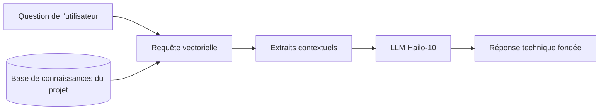

<!-- =============================================================================
HYDRA-UMC-DOCS-QA - Document search assistant
Copyright (C) JuanenRac (Electro Hobby 3D) <electrohobby3d@gmail.com>
GPL-3.0-or-later - see LICENSE
============================================================================= -->

<p align="center">
  
</p>

# 🔎 HYDRA-UMC-DOCS-QA

<p align="center"><a href="README.md">🇺🇸 English</a> | <a href="README_spa.md">🇪🇸 Español</a> | 🇫🇷 <b>Français</b> | <a href="README_ita.md">🇮🇹 Italiano</a> | <a href="README_deu.md">🇩🇪 Deutsch</a> | <a href="README_zho.md">🇨🇳 简体中文</a> | <a href="README_jpn.md">🇯🇵 日本語</a> | <a href="README_por.md">🇵🇹 Português</a></p>

### 🤖 Assistant IA basé sur le RAG pour la maintenance et la documentation du matériel

<p align="center">
  
  
  
  
  
  
</p>

---

> **État de la sûreté et de la cybersécurité :** cet écosystème n'est pas un système de sécurité certifié. Il n'existe pas encore de chaîne d'E-STOP matérielle, ni de limites ou de verrouillages imposés par le firmware, ni de commande de mouvement vérifiée ; les images de firmware sont contrôlées par CRC-32 et une signature Ed25519, et une compilation de version refuse les clés de développement publiées (les têtes d'outil et les cartes d'extension derrière le relais utilisent encore les chargeurs d'URTC, qui prennent un HMAC-SHA256 à clé partagée au lieu d'une signature) ; TLS et TLS mutuel sont optionnels et désactivés par défaut ; aucune carte propre n'a encore été assemblée ni testée. Lisez la [base de sécurité](https://github.com/JuanenRac/HYDRA-UMC-DOCS/blob/main/docs/SECURITY_BASELINE.md) et le [modèle de menaces](https://github.com/JuanenRac/HYDRA-UMC-DOCS/blob/main/docs/THREAT_MODEL.md) avant de vous fier à une affirmation d'ici pour la sécurité d'une personne.

---

## 📋 En un coup d'œil

| | |
|---|---|
| Version | `0.1.5` |
| Maturité | Fonctionnel |
| Tests | 109 (`python -m pytest -q tests`) |
| Technologie | Python / TF-IDF lexical retrieval |
| Cible | Le Raspberry Pi CM5 d'une cellule HYDRA-UMC |
| Sur matériel réel | Pas encore : aucune exécution sur du matériel réel n'est consignée pour cette version |

**Aller à :** [Présentation](#-présentation) · [Architecture](#-architecture) · [Fonctionnalités](#-fonctionnalités) · [Sécurité et protection](#-sécurité-et-protection) · [Interfaces](#-interfaces) · [Configuration](#-configuration) · [Démarrage rapide](#-démarrage-rapide) · [Tests](#-tests) · [Dépannage](#-dépannage) · [Structure du dépôt](#-structure-du-dépôt) · [Projets liés](#-projets-liés)

## 🚦 État du projet

Chaque ligne est une partie de ce dépôt et le feu dit où elle en est aujourd'hui. Elle est écrite d'après ce que le dépôt peut montrer (tests, compilations, exécutions), pas d'après ce qui est prévu.

🟢 Fait et vérifié · 🟡 Fonctionne, avec des limites connues · 🟠 À moitié fait ou pas encore vérifié · 🔴 Pas fait ou ne fonctionne pas

| Domaine | État | Ce que cela veut dire ici |
|---|---|---|
| Logiciel | 🟡 | Fonctionne pour son usage principal ; la vérification d'honnêteté ci-dessus liste ce qui manque encore |
| Tests | 🟢 | 109 tests automatiques, exécutés à chaque modification |
| Matériel réel | 🔴 | Pas encore : aucune exécution sur du matériel réel n'est consignée pour cette version |
| Documentation | 🟢 | README en huit langues, vérifié par rapport au manifeste à chaque modification |

## 🎯 Présentation

**HYDRA-UMC-DOCS-QA** est un assistant spécialisé de génération augmentée par récupération (RAG) conçu pour les techniciens et les développeurs sur site. Il fournit des réponses instantanées et fondées aux questions techniques sur l'écosystème HYDRA-UMC.

Il ne répond qu'à partir des documents Markdown qu'on lui donne avec `--docs`, en local et sans connexion Internet, et cite toujours le passage utilisé. Lire tous les manuels, la documentation des schémas et le code source de l'écosystème pour le dépannage, le brochage et la compilation du micrologiciel est l'objectif, prévu mais pas encore atteint.

## 🧩 Rôle dans HYDRA-UMC

**HYDRA-UMC-DOCS-QA** répond à une question sur l'écosystème à partir de ses propres documents : il trouve les passages qui conviennent le mieux et les cite avec leur fichier et leur numéro de morceau. Il appartient à la famille cognitive Hailo-10, mais c'est aujourd'hui une simple recherche lexicale (TF-IDF ou BM25) sans modèle de langage ; ce qu'il rend est une citation, jamais une réponse générée.

## 🏛️ Architecture

<p align="center">
  
</p>

<details>
<summary>Version texte du diagramme (Mermaid)</summary>



</details>

**Pourquoi il est construit ainsi**

Ce dépôt est un **enfant** de la famille Cognitive AI Node - son parent,
[HYDRA-UMC-COGNITIVE-NODE](https://github.com/JuanenRac/HYDRA-UMC-COGNITIVE-NODE),
détient l'image HydraOS partagée et les poids de modèles quantifiés, et
relie ce service dans son `docker-compose.yml` aux côtés de ses trois
frères (VLA-Engine, Voice-UI, Semantic-Planner) :

* **Pourquoi cet enfant n'a pas de matériel/firmware/`os/`/`models/`
  propres.** Il fonctionne entièrement sur le module CM5 + Hailo-10 M.2
  déjà détenu par le parent - centraliser les poids de modèles et
  l'image HydraOS à un seul endroit évite quatre copies divergentes de
  plusieurs gigaoctets au sein de la famille.
* **Pourquoi une structure `src/`.** Sépare le paquet installable
  (`hydra_umc_docs_qa`) de l'outillage à la racine du dépôt
  (`bump_version.py`), conformément au reste des projets Python de
  l'écosystème.
* **Pourquoi l'invocation nue (sans sous-commande) se contente encore
  d'afficher identité/version/rôle.** C'était le comportement d'origine
  de l'étape d'échafaudage, prouvant que le paquet s'installe, se
  compile et s'importe correctement avant qu'aucune vraie logique
  n'existe - cela reste le comportement par défaut aujourd'hui comme
  vérification rapide que « c'est bien installé et ça fonctionne »,
  aux côtés des vraies sous-commandes `query` (recherche TF-IDF) et
  `serve` (API JSON/HTTP) pour lesquelles cet échafaudage était un
  prérequis.
* **Comment cela s'intègre dans le reste de l'écosystème.** Cet
  assistant fonde ses réponses sur la documentation propre de
  l'écosystème, donnant à son frère HYDRA-UMC-SEMANTIC-PLANNER une
  source de connaissances techniques qu'il peut consulter pendant son
  raisonnement, et offrant aux techniciens sur site un support mains
  libres aux côtés de HYDRA-UMC-VOICE-UI.
* **Pourquoi la récupération d'`index.py` est du vrai TF-IDF, pas un
  modèle d'embeddings.** La recherche sémantique par embeddings a besoin
  d'une vraie dépendance de modèle (idéalement le Hailo-10 que ce README
  cible déjà) - un index TF-IDF/similarité cosinus pur stdlib est réel,
  testable, et ne nécessite rien au-delà de Python lui-même, donnant à
  ce projet un noyau de récupération fonctionnel dès aujourd'hui qu'un
  futur index à base d'embeddings pourra remplacer derrière le même
  contrat `search()`, sans toucher à la CLI ni à l'étape d'ingestion.
* **Pourquoi une requête sans correspondance renvoie un échec honnête,
  pas une réponse de repli.** v0 n'a pas d'étape de synthèse par LLM -
  une question dont les mots ne recoupent pas le corpus ingéré reçoit
  `No relevant passages found` (voir `main.py`), jamais une réponse
  inventée ou hallucinée déguisée en vrai résultat de récupération.
* **Pourquoi un chemin `--docs` non autorisé est rejeté, et non ignoré
  ou ingéré silencieusement.** Un assistant de QA censé être « fondé
  sur la documentation propre de l'écosystème » ne doit pas lire et
  citer silencieusement n'importe quel fichier pointé par l'appelant -
  un chemin manquant ou un fichier non-Markdown (un `.env` égaré, un
  binaire de firmware) reçoit une ligne réelle et distincte
  `REJECTED ... : <raison>` (voir `validate_doc_path` dans
  `ingest.py`) au lieu d'un « rien trouvé » agrégé qui masque
  *pourquoi*.
* **Pourquoi la similarité cosinus trie les termes partagés avant de
  les additionner.** `dict.keys() & dict.keys()` est un ensemble (set),
  et l'ordre d'itération des sets sous CPython dépend de la
  randomisation du hachage de chaînes par processus - additionner des
  termes en virgule flottante dans cet ordre ferait dépendre un score
  du processus ayant exécuté la requête, et non uniquement du corpus
  et du texte de la requête. Trier d'abord rend le score une fonction
  pure et reproductible de ses véritables entrées.
* **Pourquoi les citations portent un `#index`, pas seulement un nom de
  fichier.** Un simple nom de fichier ne peut pas désambiguïser deux
  sections partageant un titre (ou, plus tard, deux fichiers ingérés
  partageant un nom) - `DocChunk.index` est la position ordinale
  réelle de chaque fragment au sein de sa propre source, donnant à
  chaque citation une clé stable permettant de récupérer de manière
  déterministe le même passage.

## ✨ Fonctionnalités

* 🔍 **Recherche vectorielle locale (v0) :** Récupération lexicale réelle TF-IDF, stdlib pur, sur des documents Markdown locaux. *(implémenté comme recherche lexicale réelle - pas encore de recherche sémantique par embeddings, et l'ingestion PDF reste un travail futur ; voir BUILD ET EXÉCUTION ci-dessous)*
* 🔒 **Liste blanche réelle des documents :** seuls les fichiers `.md`/`.markdown` réellement existants sont ingérés et cités - tout autre chemin `--docs` (manquant, ou d'un type de fichier non autorisé) est rejeté avec une raison distincte et affichée, au lieu d'être ignoré silencieusement ou lu comme s'il s'agissait de documentation réelle. *(implémenté)*
* 🔗 **Citations traçables :** chaque résultat cite `source#index` - un pointeur stable et non ambigu vers le passage exact ingéré, récupérable de manière déterministe en réanalysant la même source. *(implémenté)*
* 🎯 **Score déterministe :** le classement est une fonction pure du corpus et du texte de la requête, indépendante de la graine de hachage propre au processus de l'interpréteur. *(implémenté)*
* 🗄️ **Cache d'index qui ne peut pas exécuter de code :** le `query` de la CLI met l'index construit en cache dans le répertoire de cache de l'utilisateur (`HYDRA_UMC_DOCS_QA_CACHE_DIR`, sinon `XDG_CACHE_HOME`, sinon `~/.cache/hydra-umc-docs-qa`), avec une clé formée du chemin, de la taille et de la date de modification de chaque document. C'est maintenant un JSON validé ; c'était un `pickle`, qui exécute tout code que porte le fichier, si bien que n'importe quel autre processus du même utilisateur pouvait y déposer un fichier et le faire exécuter par le `query` suivant. Un fichier déposé, tronqué ou de forme incorrecte est un simple échec de cache. *(implémenté)*
* 🌐 **Vraie API JSON/HTTP :** la sous-commande `serve` exécute exactement la même recherche TF-IDF comme un service local de longue durée (par défaut `127.0.0.1:8110`) via `GET /query?q=...&top_k=N` et `GET /stats` - le corpus est ingéré et indexé UNE seule fois au démarrage, pas à chaque requête. Voir [`docs/CLI_REFERENCE.md`](docs/CLI_REFERENCE.md) pour des exemples réels capturés. *(implémenté)*
* 📚 **Manifeste de corpus, BM25, « pas de réponse », rechargement et citations vérifiables :** `--corpus FICHIER` (JSON : `roots`, motifs `exclude` et `documents` épinglés par SHA-256) remplace le `--docs` libre : seules les racines sont lues, un document épinglé dont les octets ont changé est écarté, et avec des épingles un nouveau fichier dans une racine n'est pas citable tant que personne ne l'épingle. Chaque section porte le hachage de son fichier, si bien qu'un résultat cite `source#section@sha256`. `--scorer bm25`, `--stem` (un suppresseur de suffixes prudent) et `--heading-boost N` améliorent le classement sur les textes courts (les valeurs par défaut sont ce que l'index a toujours été). Le service peut refuser de répondre : `--min-score` et `--min-coverage` (la part des mots de la question que contient une section) font répondre à `GET /query` `answerable: false` sans contexte, au lieu d'une section qui ne partage qu'un mot avec la question (une requête peut exiger plus, jamais moins). `POST /reload` (jeton porteur exigé ; aussi SIGHUP) reconstruit l'index depuis le disque sans redémarrer et garde l'ancien si cela échoue ; `GET /stats` indique le nombre de fragments, quand l'index a été construit et la dernière erreur de rechargement. *(essayé sur du Markdown synthétique et réel ; les seuils demandent un réglage avec de vraies questions)*
* 🤖 **Raisonnement fondé :** Les réponses sont strictement basées sur la documentation du projet fournie.
* 🎙️ **Intégration vocale :** Intégré à VOICE-UI pour un support de maintenance mains libres.
* 🛠️ **Connaissance du code :** Peut expliquer les modules du micrologiciel et les spécificités du protocole CAN.
* 👨‍👩‍👧 **Enfant du Cognitive AI Node :** Fonctionne comme l'un des
  quatre services frères sous [HYDRA-UMC-COGNITIVE-NODE](https://github.com/JuanenRac/HYDRA-UMC-COGNITIVE-NODE)
  (aux côtés de VLA-Engine, Voice-UI et Semantic-Planner), partageant
  l'image HydraOS et les poids de modèles de son parent au lieu de
  conserver ses propres copies.
* 📦 **Versionnage compteur kilométrique :** La version de `pyproject.toml` n'est augmentée que par la commande `bump` explicite (`python tools/hydra_project_tool.py bump`, qui exécute `bump_version.py`) - compiler ne la change jamais.

## 🔒 Sécurité et protection

| Menace | Défense | Où |
|---|---|---|
| N'importe qui interrogeant ou rechargeant le corpus | Un jeton Bearer optionnel d'au moins 16 caractères (`--token-file` ou `HYDRA_UMC_DOCS_QA_TOKEN`) protège `GET /query` et `POST /reload` ; le service écoute sur `127.0.0.1:8110` par défaut | `access.py`, `main.py` |
| Documents énormes, arborescences immenses, fichiers hostiles | Seuls `.md` et `.markdown` sont lus, 4 MiB au plus chacun, 5000 fichiers développés au plus et 12 niveaux de profondeur ; le manifeste du corpus fait 256 KiB au plus et peut figer chaque document par son SHA-256 ; un chemin refusé est signalé, jamais ignoré en silence | `ingest.py`, `corpus.py` |
| Des résultats absurdes et un cache empoisonné | `top_k` vaut 50 au plus ; `--min-score` et `--min-coverage` (de 0 à 1) décident quand une question compte comme répondue ; le cache d'index garde 20 entrées au plus | `api.py`, `cache.py` |

**Ce qu'il ne fait jamais :** aucun modèle de langage ni Hailo-10 ne tourne ici : l'étiquette « Hailo-10 » du rôle désigne le matériel auquel cette famille est destinée.

## 🔌 Interfaces

HTTP sur `127.0.0.1:8110` par défaut et une ligne de commande. La référence complète est `docs/CLI_REFERENCE.md`.

| Topic ou route | Ce qu'il porte |
|---|---|
| `GET /query?q=...&top_k=N` | les meilleurs passages, chacun cité comme `fichier#morceau` |
| `GET /stats`, `POST /reload` | santé et taille de l'index ; recharger le corpus (exige le jeton s'il y en a un) |
| `query QUESTION` | `--docs`, `--top-k 5`, `--scorer tfidf\|bm25` (BM25 k1 1,5, b 0,75), `--stem`, `--heading-boost 1..10`, `--corpus MANIFESTE` |
| `serve` | `--docs ... --addr 127.0.0.1 --port 8110 [--token-file FICHIER] [--min-score 0.0] [--min-coverage 0.0]` |

## ⚙️ Configuration

| Variable | Par défaut | Ce qu'elle définit |
|---|---|---|
| `HYDRA_UMC_DOCS_QA_TOKEN`, `--token-file` | pas de jeton | le jeton Bearer optionnel, 16 caractères au minimum |
| `HYDRA_UMC_DOCS_QA_CACHE_DIR` | le dossier de cache de la plateforme | où vit le cache d'index |
| `--corpus MANIFEST` | le README et le CHANGELOG de ce dépôt | le manifeste du corpus : racines, exclusions et documents figés par SHA-256 |
| `--min-score`, `--min-coverage` | `0.0` | quand une question compte comme répondue (de 0 à 1) |

## 🚀 Démarrage rapide

Nécessite Python >= 3.10.

```bash
# Linux / macOS / Git Bash
./build.sh   # crée .venv, installe le paquet (éditable), vérifie l'import
./run.sh     # exécute le point d'entrée

# Windows (cmd)
build.bat
run.bat
```

`build.sh`/`build.bat` ne changent jamais la version (seule `python tools/hydra_project_tool.py bump` la fait monter), et
exécutent la vraie suite de tests (`pytest tests/`). Sortie attendue d'un
`run.sh` sans argument :

```text
HYDRA-UMC-DOCS-QA v0.1.5
Docs-QA (Hailo-10) - retrieval-augmented technical assistant grounded in the ecosystem's own documentation.
```

La vraie sous-commande `query` recherche dans du Markdown ingéré - par
défaut les propres `README.md`/`CHANGELOG.md` de ce dépôt, ou tout
fichier réel passé via `--docs` :

```bash
./run.sh query "câblage du bus CAN" --top-k 3
./run.sh query "recherche vectorielle récupération" --docs docs/manual.md docs/spec.md

# Windows
run.bat query "câblage du bus CAN" --top-k 3
```

Une question dont les mots ne recoupent pas le corpus ingéré affiche un
`No relevant passages found` honnête - v0 est une récupération lexicale
réelle, pas une réponse générative.

Chaque résultat cite `source#index` (ex. `manual.md#1`) - un pointeur
stable et traçable vers ce fragment exact. Un chemin `--docs` manquant
ou qui n'est pas `.md`/`.markdown` est rejeté et signalé, non ignoré
silencieusement :

```text
$ ./run.sh query "firmware flashing" --docs manual.md ghost.md secret.env
REJECTED ghost.md: file not found (no source)
REJECTED secret.env: disallowed extension .env - only .markdown, .md are ingested
Top 1 passage(s) for: "firmware flashing"

1. [0.289] manual.md#1 - Firmware Flashing
   Flash URTC firmware over SWD or JTAG using URTC-FLASHER.
```

La même recherche est aussi accessible comme une API JSON/HTTP de longue durée via `./run.sh serve --docs manual.md` (par défaut `127.0.0.1:8110`). Voir [`docs/CLI_REFERENCE.md`](docs/CLI_REFERENCE.md) pour la référence complète des commandes et endpoints, avec chaque exemple capturé d'une exécution réelle.

## 🧪 Tests

109 tests automatiques s'exécutent avec `python -m pytest -q tests`. Ils couvrent l'ingestion, l'index TF-IDF et BM25, le déterminisme, le cache, le manifeste du corpus, les entrées hostiles, la ligne de commande et l'interface HTTP ; ni matériel ni réseau extérieur.

La CI exécute `HYDRA_UMC_CI=1 python tools/ci_validate.py`, qui vérifie le manifeste, les documents, les huit README et les images.

## 🏗️ Compilation et publication

Il n'y a rien à compiler pour une publication : `build.sh` / `build.bat` créent l'environnement virtuel, installent le paquet en mode éditable et lancent les tests, et `build-test` ne fait que vérifier. Construire ne change jamais la version ; seul `python tools/hydra_project_tool.py bump` la monte, et il fait avancer aussi le journal des modifications. La version du paquet, du manifeste et du journal doit concorder, sinon `ci_validate.py` échoue.

## 🩺 Dépannage

* **`python : commande introuvable` / le build échoue à l'étape 1.**
  Nécessite Python >= 3.10 dans le `PATH`. Sous Windows, installez-le
  depuis [python.org](https://python.org) et cochez "Add to PATH" lors de
  l'installation ; sous Linux/macOS, c'est généralement `python3`.
* **`build.sh` n'arrive pas à activer le venv.** `python3 -m venv .venv`
  place le script d'activation à un emplacement différent selon la
  plateforme : `.venv/bin/activate` sous Linux/macOS,
  `.venv/Scripts/activate` sous Windows (également pour un venv Python
  Windows utilisé depuis Git Bash). `build.sh` vérifie déjà les deux
  chemins - si cela échoue toujours, supprimez `.venv/` et relancez
  `./build.sh` pour le reconstruire entièrement.
* **`pip install -e .` échoue.** Généralement dû à un `.venv/` obsolète.
  Supprimez le dossier `.venv/` et relancez `./build.sh`/`build.bat` pour
  le recréer.
* **`import OK` ne s'affiche jamais.** Signifie que `python -c "import
  hydra_umc_docs_qa"` a lui-même échoué - relancez avec le venv actif
  pour voir la vraie trace d'erreur.

## 📂 Structure du dépôt

<p align="center">
  
</p>

<details>
<summary>Version texte de l'arborescence</summary>

```text
HYDRA-UMC-DOCS-QA/
├── src/hydra_umc_docs_qa/
│   ├── ingest.py                                découpe le Markdown en morceaux par titre
│   ├── index.py                                 recherche TF-IDF et BM25
│   ├── corpus.py                                à partir de quels documents répondre
│   ├── cache.py                                 cache d'index sur disque
│   ├── api.py access.py                         interface HTTP et jeton optionnel
│   └── main.py highlight.py                     ligne de commande et mise en évidence
├── tests/                                       100 tests
├── docs/                                        la référence de la ligne de commande
├── systemd/                                     unité de service pour la CM5
├── tools/                                       exécuteur de build et de tests, montée de version, validateur CI, générateurs et vérifications des README et des images
├── images/                                      bannière et images du README
├── .github/                                     workflow CI et modèles de tickets
├── pyproject.toml                               métadonnées du paquet et dépendances
├── hydra-umc.project.json                       manifeste : version, maturité, famille
├── CHANGELOG.md                                 ce qui a changé à chaque version
├── build.sh build.bat                           scripts de build (ils ne changent jamais la version)
├── build-test.sh build-test.bat                 scripts de build (ils ne changent jamais la version)
├── test.sh test.bat                             lancent les tests
├── Dockerfile                                   image de conteneur
├── bump_version.py / bump_manifest_version.py   montée de version explicite
├── run.sh run.bat                               démarrer le service
└── SECURITY.md SUPPORT.md CONTRIBUTING.md CODE_OF_CONDUCT.md LICENSE LICENSE.md
```

</details>

## 🗺️ Feuille de route et limites connues

**Limites connues aujourd'hui**

* **Phase 1 :** Déploiement du moteur VLA et traitement des entrées multimodales sur Hailo-10.
* **Phase 2 :** Intégration du planificateur sémantique avec des modèles de comportement en essaim et une mémoire à long terme.
* **Phase 3 :** Exécution locale à faible latence de l'interface vocale et suppression du bruit industriel.
* **Phase 4 :** Visualisation interactive des schémas liée aux réponses QA et optimisation du RAG pour les appareils de bord.

## 🌍 Langues

Ce README et les documents du dépôt existent en huit langues : anglais, espagnol, allemand, français, italien, japonais, chinois et portugais (Portugal). Ils sont écrits ensemble et la CI vérifie que les huit fichiers ont les mêmes sections et les mêmes liens. Ce dépôt n'a ni écran ni catalogue de messages propre, il n'y a donc aucune chaîne d'interface à traduire.

## 🔗 Projets liés

Ce projet fait partie de l'écosystème robotique HYDRA-UMC du même auteur (JuanenRac / Electro Hobby 3D). Bon à savoir, car une demande pourrait en réalité concerner l'un de ceux-ci plutôt que ce dépôt.

**Projet Parent**
- **[HYDRA-UMC-COGNITIVE-NODE](https://github.com/JuanenRac/HYDRA-UMC-COGNITIVE-NODE)** — hub d'intégration pour le pipeline cognitif Hailo-10 (orchestration LLM/VLA/voix) ; le parent dont ce dépôt est une étape ou un consommateur spécifique, au sein de son propre pipeline cognitif.

**Projets Frères** — les autres étapes/consommateurs du propre pipeline cognitif Hailo-10 de HYDRA-UMC-COGNITIVE-NODE
- **[HYDRA-UMC-VOICE-UI](https://github.com/JuanenRac/HYDRA-UMC-VOICE-UI)** — vrai front-end vocal (VAD + analyseur d'intention) avec un relais Watch borné et soumis à confirmation.
- **[HYDRA-UMC-SEMANTIC-PLANNER](https://github.com/JuanenRac/HYDRA-UMC-SEMANTIC-PLANNER)** — vraie décomposition de tâches basée sur des règles et récupération sémantique d'erreurs sur les codes d'erreur MCU.
- **[HYDRA-UMC-VLA-ENGINE](https://github.com/JuanenRac/HYDRA-UMC-VLA-ENGINE)** — vrai encodage/décodage de jetons d'action et génération de trajectoire pour un modèle Vision-Language-Action.
- **[HYDRA-UMC-LOCAL-TECHNICIAN](https://github.com/JuanenRac/HYDRA-UMC-LOCAL-TECHNICIAN)** — technicien de maintenance IA local et à portes de politique pour l'écosystème lui-même - observe, diagnostique et propose des corrections ; les deux niveaux de risque les plus élevés ne sont délibérément pas encore implémentés.

**Fait Également Partie de l'Écosystème**

*Matériel & Plateforme de Base*
- **[HYDRA-UMC](https://github.com/JuanenRac/HYDRA-UMC)** — la conception de la carte mère du bras robotique : hôte CM5 + coprocesseur STM32H745 double cœur, destinée à coordonner jusqu'à 8 bras-outils via CAN-OTA/SPI-OTA (firmware à un stade précoce ; aucune carte assemblée pour l'instant).
- **[HYDRA-UMC-OS](https://github.com/JuanenRac/HYDRA-UMC-OS)** — couche produit reproductible sur Raspberry Pi OS pour le CM5 : agent en lecture seule, config/profils validés, provisionnement WiFi de premier contact.
- **[HYDRA-UMC-SDK](https://github.com/JuanenRac/HYDRA-UMC-SDK)** — le contrat JSON-Schema partagé et la barrière logicielle de contrôle des jobs contre laquelle chaque bridge valide ses commandes (pas une fonction de sécurité certifiée).
- **[HYDRA-UMC-CONNECTOR-HUB](https://github.com/JuanenRac/HYDRA-UMC-CONNECTOR-HUB)** — registre déclaratif et validateur de manifestes d'adaptateur pour les connecteurs de machines externes ; étend la propre idée de contrat du SDK aux machines externes sans remplacer les projets de passerelle industrielle.

*Backend Central & Clients*
- **[HYDRA-UMC-SERVER](https://github.com/JuanenRac/HYDRA-UMC-SERVER)** — le vrai backend headless (REST/WebSocket) auquel parle réellement chaque client de contrôle.
- **[HYDRA-UMC-STUDIO](https://github.com/JuanenRac/HYDRA-UMC-STUDIO)** — tableau de bord de contrôle web avec visualisation 3D multi-robot en temps réel.
- **[HYDRA-UMC-SUITE](https://github.com/JuanenRac/HYDRA-UMC-SUITE)** — centre de commande d'essaim de bureau (PySide6) pour plusieurs serveurs à la fois, empaqueté en exécutable autonome.
- **[HYDRA-UMC-ANDROID-CONTROL](https://github.com/JuanenRac/HYDRA-UMC-ANDROID-CONTROL)** — application de contrôle Android native avec connexion biométrique et un compagnon Wear OS jumelé.
- **[HYDRA-UMC-IOS-CONTROL](https://github.com/JuanenRac/HYDRA-UMC-IOS-CONTROL)** — application de contrôle iOS/iPadOS (Flutter) avec synchronisation WebSocket en temps réel.
- **[HYDRA-UMC-DSI](https://github.com/JuanenRac/HYDRA-UMC-DSI)** — interface tactile native pour l'écran tactile DSI 7" embarqué, intégrée directement sur le CM5.
- **[HYDRA-UMC-EDITOR-URDF](https://github.com/JuanenRac/HYDRA-UMC-EDITOR-URDF)** — créateur/éditeur graphique de bureau pour URDF qui envoie les modèles terminés vers le propre catalogue de STUDIO.
- **[HYDRA-UMC-EDITOR-STL](https://github.com/JuanenRac/HYDRA-UMC-EDITOR-STL)** — éditeur de bureau de modèles STL, transformant/remplaçant/retirant/ajoutant de vraies pièces dans le même catalogue de modèles qu'édite aussi HYDRA-UMC-EDITOR-URDF.
- **[HYDRA-UMC-BRIDGE-AMR](https://github.com/JuanenRac/HYDRA-UMC-BRIDGE-AMR)** — frontière de coordination pour les flottes AGV/AMR via un éditeur MQTT VDA 5050 (testé uniquement contre une flotte émulée).
- **[HYDRA-UMC-BRIDGE-CNC](https://github.com/JuanenRac/HYDRA-UMC-BRIDGE-CNC)** — coordinateur haut niveau pour cellules CNC avec accès au statut/octets de contrôle GRBL (testé uniquement contre un émulateur).
- **[HYDRA-UMC-BRIDGE-DROIDS](https://github.com/JuanenRac/HYDRA-UMC-BRIDGE-DROIDS)** — frontière de coordination pour droïdes à pattes/humanoïdes, avec un émetteur de commandes Boston Dynamics Spot (testé uniquement contre un émulateur).
- **[HYDRA-UMC-BRIDGE-LASER](https://github.com/JuanenRac/HYDRA-UMC-BRIDGE-LASER)** — coordinateur de cellules laser lisant 3 signaux GPIO de clé/enceinte/verrouillage (testé uniquement contre une puce simulée ; il ne peut ni armer ni tirer un laser).
- **[HYDRA-UMC-BRIDGE-OPENPNP](https://github.com/JuanenRac/HYDRA-UMC-BRIDGE-OPENPNP)** — coordinateur haut niveau sûr pour le flux de cartes du pick-and-place OpenPnP.
- **[HYDRA-UMC-BRIDGE-PRINTER3D](https://github.com/JuanenRac/HYDRA-UMC-BRIDGE-PRINTER3D)** — frontière de coordination sûre pour imprimantes 3D Moonraker/Klipper, avec de vraies commandes de tâche contrôlées.
- **[HYDRA-UMC-BRIDGE-ROS2](https://github.com/JuanenRac/HYDRA-UMC-BRIDGE-ROS2)** — coordinateur avec un transport ROS 2 rclpy à importation paresseuse (pas encore exécuté contre une installation ROS 2).
- **[HYDRA-UMC-BRIDGE-UAV](https://github.com/JuanenRac/HYDRA-UMC-BRIDGE-UAV)** — frontière de coordination pour UAV équipés de caméra, avec un émetteur de commandes MAVLink (testé uniquement contre un émulateur).

*Plateforme d'Outils URTC*
- **[URTC](https://github.com/JuanenRac/URTC)** — firmware pour la carte physique Universal Robot Tool Controller, plus de 25 profils d'outil sur bus CAN.
- **[URTC-FLASHER](https://github.com/JuanenRac/URTC-FLASHER)** — outil de bureau à interface graphique pour flasher les cartes URTC, CAN-OTA plus SWD/JTAG puce complète.
- **[URTC-TESTER](https://github.com/JuanenRac/URTC-TESTER)** — outil de bureau de diagnostic CAN-bus en direct pour cartes URTC, un panneau par profil d'outil.
- **[URTC-WEB-STUDIO](https://github.com/JuanenRac/URTC-WEB-STUDIO)** — alternative basée navigateur à URTC-TESTER via la Web Serial API, sans installation locale.
- **[URTC-GATEWAY](https://github.com/JuanenRac/URTC-GATEWAY)** — passerelle devant le bus CAN d'URTC : liste d'identifiants autorisés, limite de débit et clé de session ; logiciel testé sur ordinateur, pas encore sur un bus réel.

*Nœud IA de Vision (Hailo-8)*
- **[HYDRA-UMC-VISION-NODE](https://github.com/JuanenRac/HYDRA-UMC-VISION-NODE)** — hub d'intégration pour le pipeline de vision Hailo-8, avec une vraie vérification de disponibilité matérielle par étape.
- **[HYDRA-UMC-DETECTION-HEF](https://github.com/JuanenRac/HYDRA-UMC-DETECTION-HEF)** — registre réel de modèles compilés avec vérification de chargement sécurisé par architecture Hailo/checksum.
- **[HYDRA-UMC-VISION-STREAMER](https://github.com/JuanenRac/HYDRA-UMC-VISION-STREAMER)** — générateur réel de pipeline GStreamer + config MediaMTX, avec une vraie frontière d'intégration HailoRT.
- **[HYDRA-UMC-VISUAL-SERVOING-API](https://github.com/JuanenRac/HYDRA-UMC-VISUAL-SERVOING-API)** — loi de correction Position-Based Visual Servoing avec autorisation conditionnée à l'état de zone ; pas encore d'estimation de pose par caméra.
- **[HYDRA-UMC-SAFETY-ZONES](https://github.com/JuanenRac/HYDRA-UMC-SAFETY-ZONES)** — logique v0 de violation de zone, de fraîcheur de calibration et de demande d'E-STOP qui lit les positions d'objets dans un fichier ; aucun détecteur ne l'alimente et aucun E-STOP physique n'y est encore relié.

*Orchestration & Essaim*
- **[HYDRA-UMC-ORCHESTRATOR](https://github.com/JuanenRac/HYDRA-UMC-ORCHESTRATOR)** — hub d'intégration avec un vrai contrat de rapport de santé gRPC/Protobuf et une machine à états de mission.
- **[HYDRA-UMC-JOB-DISPATCHER](https://github.com/JuanenRac/HYDRA-UMC-JOB-DISPATCHER)** — vraie file de tâches basée sur la priorité avec déduplication, via une vraie API HTTP.
- **[HYDRA-UMC-NODE-HEALING](https://github.com/JuanenRac/HYDRA-UMC-NODE-HEALING)** — vrai chien de garde de santé de flotte basé sur gRPC, avec retry/backoff et détection d'incohérence d'identité.
- **[HYDRA-UMC-PATH-PLANNER-3D](https://github.com/JuanenRac/HYDRA-UMC-PATH-PLANNER-3D)** — vrai planificateur de trajectoire 3D basé sur RRT, avec vraie validation des collisions obstacle/espace de travail.
- **[HYDRA-UMC-SWARM-SYNC](https://github.com/JuanenRac/HYDRA-UMC-SWARM-SYNC)** — vraie synchronisation d'état CRDT LWW-Element-Map, testée par propriétés pour la convergence multi-cellule.

*Jumeau Numérique & Simulation*
- **[HYDRA-UMC-TWIN](https://github.com/JuanenRac/HYDRA-UMC-TWIN)** — hub d'intégration pour le moteur de jumeau numérique, avec un vrai contrat de synchronisation par compatibilité de version.
- **[HYDRA-UMC-HIL-BRIDGE](https://github.com/JuanenRac/HYDRA-UMC-HIL-BRIDGE)** — routeur hardware-in-the-loop avec un verrouillage logiciel de collision entre simulation et matériel réel (testé sans matériel réel).
- **[HYDRA-UMC-PHYSICS-REPLICA](https://github.com/JuanenRac/HYDRA-UMC-PHYSICS-REPLICA)** — vraie cinématique directe et validation des limites articulaires sur un vrai sous-ensemble URDF.
- **[HYDRA-UMC-SYNTHETIC-DATA-GEN](https://github.com/JuanenRac/HYDRA-UMC-SYNTHETIC-DATA-GEN)** — vrai générateur procédural de scènes 2D avec export d'annotations YOLO/COCO.

*Données & Analytique*
- **[HYDRA-UMC-DATALAKE](https://github.com/JuanenRac/HYDRA-UMC-DATALAKE)** — vrai magasin de séries temporelles basé sur sqlite3, avec une vraie API HTTP d'ingestion/requête.
- **[HYDRA-UMC-ANOMALY-DETECTOR](https://github.com/JuanenRac/HYDRA-UMC-ANOMALY-DETECTOR)** — vrai détecteur d'anomalies FFT + ligne de base statistique, avec surveillance de dérive.
- **[HYDRA-UMC-PRODUCTION-REPORTS](https://github.com/JuanenRac/HYDRA-UMC-PRODUCTION-REPORTS)** — vrai calcul OEE/disponibilité sur l'historique de DATALAKE, avec export CSV reproductible.
- **[HYDRA-UMC-TELEMETRY-COLLECTOR](https://github.com/JuanenRac/HYDRA-UMC-TELEMETRY-COLLECTOR)** — vrai pipeline d'ingestion CAN/WebSocket vers DATALAKE, avec déduplication par séquence.

*Passerelle Industrielle*
- **[HYDRA-UMC-GATEWAY-INDUSTRIAL](https://github.com/JuanenRac/HYDRA-UMC-GATEWAY-INDUSTRIAL)** — hub d'intégration relayant vers les protocoles industriels, avec une vraie couche de liste blanche de commandes/contre-pression.
- **[HYDRA-UMC-OPCUA-SERVER](https://github.com/JuanenRac/HYDRA-UMC-OPCUA-SERVER)** — vrai espace d'adressage OPC-UA, vérifié avec une vraie session client du protocole binaire.
- **[HYDRA-UMC-MQTT-BROKER](https://github.com/JuanenRac/HYDRA-UMC-MQTT-BROKER)** — vrai broker MQTT avec authentification par client optionnelle et ACL de sujets.
- **[HYDRA-UMC-MTCONNECT-ADAPTER](https://github.com/JuanenRac/HYDRA-UMC-MTCONNECT-ADAPTER)** — vrais points de terminaison XML MTConnect `/probe` et `/current`, avec sortie en mode dégradé.

*Outils Complémentaires & Opérations de l'Écosystème*
- **[HYDRA-UMC-DASHBOARD-AI](https://github.com/JuanenRac/HYDRA-UMC-DASHBOARD-AI)** — panneaux Smart Summaries et Anomaly Highlighting sur DATALAKE/ANOMALY-DETECTOR, avec un repli statistique honnête.
- **[HYDRA-UMC-TOOL-CLI](https://github.com/JuanenRac/HYDRA-UMC-TOOL-CLI)** — CLI de flotte avec un vrai contrat de codes de sortie stable, un vrai client en direct de la propre API de HYDRA-UMC-SERVER.
- **[HYDRA-UMC-WATCH](https://github.com/JuanenRac/HYDRA-UMC-WATCH)** — application compagnon WearOS avec des motifs d'alerte haptique et un relais vocal vers le téléphone jumelé (pas encore exécutée sur une montre physique).
- **[URTC-SMART-RACK](https://github.com/JuanenRac/URTC-SMART-RACK)** — firmware pour un rack de montage de cartes avec décodage réel d'ID d'outil et logique de préchauffage Smart Idle.
- **[URTC-VISION-TOOL](https://github.com/JuanenRac/URTC-VISION-TOOL)** — firmware plus un vrai compagnon de vision Python pour une tête d'outil d'inspection thermique/RGB.
- **[HYDRA-UMC-UPDATER](https://github.com/JuanenRac/HYDRA-UMC-UPDATER)** — outil administratif de bureau qui découvre, clone et met à jour chaque dépôt de cet écosystème.
- **[HYDRA-UMC-OS-REBUILDER](https://github.com/JuanenRac/HYDRA-UMC-OS-REBUILDER)** — outil de bureau Windows/Linux qui construit une image de la CM5 prête à graver, préchargée avec les versions les plus actuelles de l'écosystème, avec une configuration de premier démarrage Wi-Fi/utilisateur/SSH façon Raspberry Pi Imager.
- **[HYDRA-UMC-OPS-AGENT](https://github.com/JuanenRac/HYDRA-UMC-OPS-AGENT)** — coordinateur d'incidents de maintenance : un rôle edge à faible privilège collecte un instantané d'inventaire/santé assaini, un rôle control-plane le rend en lecture seule et demande à un fournisseur d'IA de suggérer un diagnostic - n'applique jamais de correctif ni ne déploie rien.
- **[HYDRA-UMC-DEV-SERVER](https://github.com/JuanenRac/HYDRA-UMC-DEV-SERVER)** — hôte de développement reproductible (Raspberry Pi 5 / CM5) qui héberge le code source de l'écosystème et exécute des tâches de compilation/test délimitées via une file d'attente durable ; un rôle de développement dédié, explicitement distinct d'un CM5 opérationnel.

## 📚 Documentation

Où lire la suite :

* [docs/CLI_REFERENCE.md](docs/CLI_REFERENCE.md) - chaque commande et point d'accès, avec des sorties capturées d'une vraie exécution
* [Base de sécurité de l'écosystème](https://github.com/JuanenRac/HYDRA-UMC-DOCS/blob/main/docs/SECURITY_BASELINE.md)
* [Modèle de menaces de l'écosystème](https://github.com/JuanenRac/HYDRA-UMC-DOCS/blob/main/docs/THREAT_MODEL.md)
* [Journal des modifications de ce dépôt](CHANGELOG.md)
* [Licence de ce dépôt](LICENSE.md)

## 🤝 Contribuer et communauté

* Avant une pull request, exécutez `HYDRA_UMC_CI=1 py -3 tools/ci_validate.py` (ou `HYDRA_UMC_CI=1 python3 tools/ci_validate.py`) : il doit afficher `CI_VALIDATION=PASS`. N'exécutez pas `build.sh` ni `build.bat` pour cette vérification ; compiler n'est pas vérifier.
* Les huit README sont écrits à partir d'une source unique dans HYDRA-UMC-DOCS ; ne les modifiez pas à la main. Changez la source et réécrivez-les avec `tools/make_readmes.py`.
* N'affirmez pas dans un README ce qui n'a pas tourné : écrivez « simulé » ou « non essayé sur matériel » quand c'est la vérité.
* Voir [CONTRIBUTING.md](CONTRIBUTING.md), le [code de conduite](CODE_OF_CONDUCT.md), [SECURITY.md](SECURITY.md) et [SUPPORT.md](SUPPORT.md).

## 👤 AUTEUR

**JuanenRac (Electro Hobby 3D)** · electrohobby3d@gmail.com

## 📜 LICENCE

GPL-3.0-or-later - [LICENSE](LICENSE).
