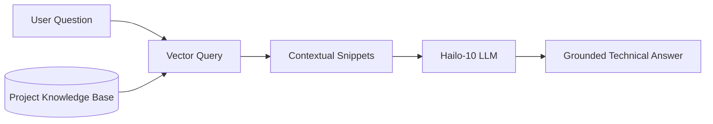

<!-- =============================================================================
HYDRA-UMC-DOCS-QA - Document search assistant
Copyright (C) JuanenRac (Electro Hobby 3D) <electrohobby3d@gmail.com>
GPL-3.0-or-later - see LICENSE
============================================================================= -->

<p align="center">
  
</p>

# 🔎 HYDRA-UMC-DOCS-QA

<p align="center"><a href="README.md">🇺🇸 English</a> | <a href="README_spa.md">🇪🇸 Español</a> | <a href="README_fra.md">🇫🇷 Français</a> | <a href="README_ita.md">🇮🇹 Italiano</a> | <a href="README_deu.md">🇩🇪 Deutsch</a> | <a href="README_zho.md">🇨🇳 简体中文</a> | <a href="README_jpn.md">🇯🇵 日本語</a> | 🇵🇹 <b>Português</b></p>

### 🤖 Assistente de IA baseado em RAG para manutenção de hardware e documentação

<p align="center">
  
  
  
  
  
  
</p>

---

> **Estado de segurança (safety e security):** este ecossistema não é um sistema de segurança certificado. Ainda não existe um caminho de E-STOP por hardware, nem limites ou interlocks impostos pelo firmware, nem um comando de movimento verificado; as imagens de firmware são verificadas com CRC32 e um HMAC-SHA256 de chave partilhada, não com uma assinatura assimétrica; TLS e TLS mútuo são opcionais e estão desativados por defeito; nenhuma placa própria foi ainda montada ou testada. Leia a [base de segurança](https://github.com/JuanenRac/HYDRA-UMC-DOCS/blob/main/docs/SECURITY_BASELINE.md) e o [modelo de ameaças](https://github.com/JuanenRac/HYDRA-UMC-DOCS/blob/main/docs/THREAT_MODEL.md) antes de confiar em qualquer afirmação aqui para a segurança de uma pessoa.

---

## 📋 Num relance

| | |
|---|---|
| Versão | `0.1.5` |
| Maturidade | Funcional |
| Testes | 100 (`python -m pytest -q tests`) |
| Tecnologia | Python / TF-IDF lexical retrieval |
| Destino | O Raspberry Pi CM5 de uma célula HYDRA-UMC |
| Em hardware real | Ainda não: não há registo de execução em hardware real para esta versão |

**Ir para:** [Visão geral](#-visão-geral) · [Arquitetura](#-arquitetura) · [Funcionalidades](#-funcionalidades) · [Segurança e proteção](#-segurança-e-proteção) · [Interfaces](#-interfaces) · [Configuração](#-configuração) · [Início rápido](#-início-rápido) · [Testes](#-testes) · [Resolução de problemas](#-resolução-de-problemas) · [Estrutura do repositório](#-estrutura-do-repositório) · [Projetos relacionados](#-projetos-relacionados)

## 🚦 Estado do projeto

Cada linha é uma parte deste repositório e a luz diz até onde chega hoje. É escrita com o que o repositório consegue demonstrar (testes, compilações, execuções), não com o que está previsto.

🟢 Feito e verificado · 🟡 Funciona, com limites conhecidos · 🟠 Feito a meio ou ainda por verificar · 🔴 Por fazer ou a não funcionar

| Área | Estado | O que significa aqui |
|---|---|---|
| Software | 🟡 | Funciona para o seu propósito principal; a verificação de honestidade acima lista o que ainda falta |
| Testes | 🟢 | 100 testes automáticos, executados a cada alteração |
| Hardware real | 🔴 | Ainda não: não há registo de execução em hardware real para esta versão |
| Documentação | 🟢 | README em oito idiomas, verificado contra o manifesto a cada alteração |

## 🎯 Visão geral

O **HYDRA-UMC-DOCS-QA** é um assistente especializado de Geração Aumentada por Recuperação (RAG) pensado para técnicos no terreno e programadores. Dá respostas instantâneas e fundamentadas a perguntas técnicas sobre o ecossistema HYDRA-UMC.

Só responde com base nos documentos Markdown que lhe são dados com `--docs`, localmente e sem ligação à internet, e cita sempre a passagem que usou. Ler todos os manuais, a documentação de esquemas e o código-fonte de todo o ecossistema para a resolução de problemas, a pinagem e a compilação de firmware é o objetivo, está planeado, mas ainda não foi alcançado.

## 🧩 Papel no HYDRA-UMC

O **HYDRA-UMC-DOCS-QA** responde a uma pergunta sobre o ecossistema com os seus próprios documentos: encontra as passagens que melhor encaixam e cita-as com o ficheiro e o número do bloco. Pertence à família cognitiva Hailo-10, mas hoje é uma simples recuperação lexical (TF-IDF ou BM25) sem modelo de linguagem, por isso o que devolve é uma citação, nunca uma resposta gerada.

## 🏛️ Arquitetura

<p align="center">
  
</p>

<details>
<summary>Versão em texto do diagrama (Mermaid)</summary>



</details>

**Porque é construído assim**

Este repositório é um **filho** da família Cognitive AI Node - o seu pai, o [HYDRA-UMC-COGNITIVE-NODE](https://github.com/JuanenRac/HYDRA-UMC-COGNITIVE-NODE), é dono da imagem HydraOS partilhada e dos pesos de modelo quantizados, e liga este serviço ao `docker-compose.yml` ao lado dos seus três irmãos (VLA-Engine, Voice-UI, Semantic-Planner):

* **Porque é que este filho não tem hardware/firmware/`os/`/`models/` próprios.** Corre inteiramente na CM5 + módulo M.2 Hailo-10 que o pai já possui - manter os pesos dos modelos e a imagem HydraOS centralizados num só sítio evita quatro cópias divergentes de vários gigabytes em toda a família.
* **Porque é que há um layout `src/`.** Mantém o pacote instalável (`hydra_umc_docs_qa`) separado das ferramentas da raiz do repositório (`bump_version.py`), em linha com o layout usado por todos os outros projetos Python do ecossistema.
* **Porque é que a invocação sem subcomando continua a imprimir apenas identidade/versão/papel.** Esse era o comportamento original de andaime, que provava que o pacote instalava, compilava e importava limpamente antes de existir qualquer lógica real - continua a ser o comportamento por defeito hoje como verificação rápida de «isto está mesmo instalado e a funcionar», agora ao lado dos subcomandos reais `query` (pesquisa TF-IDF) e `serve` (API JSON/HTTP) de que o andaime foi pré-requisito.
* **Como isto se encaixa no resto do ecossistema.** Este assistente fundamenta as suas respostas na documentação do próprio ecossistema, dando ao seu irmão HYDRA-UMC-SEMANTIC-PLANNER uma fonte de conhecimento técnico que pode consultar durante o raciocínio, e oferecendo aos técnicos no terreno apoio mãos-livres na resolução de problemas ao lado do HYDRA-UMC-VOICE-UI.
* **Porque é que a recuperação do `index.py` é TF-IDF real e não um modelo de embeddings.** A pesquisa semântica baseada em embeddings precisa de uma dependência real de modelo (e idealmente do Hailo-10 que o próprio README deste projeto já tem como alvo) - um índice TF-IDF/similaridade por cosseno só com a biblioteca padrão é real, testável e não precisa de nada além do Python, dando a este projeto um núcleo de recuperação funcional hoje que um futuro índice baseado em embeddings pode substituir por trás do mesmo contrato `search()` sem tocar na CLI nem no passo de ingestão.
* **Porque é que uma consulta sem correspondência devolve uma falha honesta e não uma resposta de recurso.** A v0 não tem passo de síntese por LLM - uma pergunta cujas palavras não se sobrepõem ao corpus ingerido recebe `No relevant passages found` (ver `main.py`), nunca uma resposta adivinhada ou alucinada vestida de resultado de recuperação real.
* **Porque é que um caminho `--docs` não permitido é recusado, e não saltado em silêncio nem ingerido em silêncio.** Um assistente de perguntas e respostas que deve estar «fundamentado na documentação do próprio ecossistema» não pode ler e citar em silêncio qualquer ficheiro para que um chamador o aponte - um caminho em falta ou um ficheiro que não seja Markdown (um `.env` perdido, um binário de firmware) recebe uma linha real e distinta `REJECTED ... : <motivo>` (ver o `validate_doc_path` do `ingest.py`) em vez de um agregado «não encontrei nada» que esconde *porquê*.
* **Porque é que a similaridade por cosseno ordena os termos partilhados antes de os somar.** `dict.keys() & dict.keys()` é um conjunto, e a ordem de iteração de conjuntos do CPython depende da aleatorização do hash de cadeias por processo - somar termos de vírgula flutuante nessa ordem faria uma pontuação depender de qual processo por acaso executou a consulta, e não apenas do corpus e do texto da consulta. Ordenar primeiro torna a pontuação uma função pura e reproduzível das suas entradas reais.
* **Porque é que as citações levam um `#index` e não apenas um nome de ficheiro.** Um simples nome de ficheiro não distingue duas secções que partilhem um título (ou, mais tarde, dois ficheiros ingeridos que partilhem um nome) - o `DocChunk.index` é a posição ordinal real de cada pedaço dentro da sua própria origem, dando a cada citação uma chave estável que um chamador pode usar para recuperar deterministicamente a passagem exata outra vez.

## ✨ Funcionalidades

* 🔍 **Pesquisa vetorial local (v0):** recuperação lexical TF-IDF real, só com a biblioteca padrão, sobre documentação Markdown local. *(implementado como pesquisa lexical real - ainda não pesquisa semântica baseada em embeddings, e a ingestão de PDF continua a ser trabalho futuro; ver COMPILAÇÃO E EXECUÇÃO abaixo)*
* 🔒 **Lista de permissões real de documentos:** só ficheiros `.md`/`.markdown` existentes são alguma vez ingeridos e citados - qualquer outro caminho `--docs` (em falta ou de um tipo de ficheiro não permitido) é recusado com um motivo distinto e impresso, em vez de ser saltado em silêncio ou lido em silêncio como se fosse documentação real. *(implementado)*
* 🔗 **Citações rastreáveis:** cada resultado cita `source#index` - um ponteiro estável e inequívoco para a passagem ingerida exata, deterministicamente recuperável ao voltar a analisar a mesma origem. *(implementado)*
* 🎯 **Pontuação determinista:** a ordenação é uma função pura do corpus e do texto da consulta, independente da semente de hash por processo do interpretador. *(implementado)*
* 🗄️ **Cache do índice que não pode executar código:** o `query` da CLI guarda o índice construído no diretório de cache do utilizador (`HYDRA_UMC_DOCS_QA_CACHE_DIR`, senão `XDG_CACHE_HOME`, senão `~/.cache/hydra-umc-docs-qa`), com uma chave formada pelo caminho, tamanho e data de modificação de cada documento. Agora é um ficheiro JSON validado; antes era um `pickle`, que executa qualquer código que o ficheiro leve, pelo que qualquer outro processo do mesmo utilizador podia deixar lá um ficheiro e fazer com que o `query` seguinte o executasse. Um ficheiro plantado, truncado ou com forma errada é simplesmente uma falha de cache. *(implementado)*
* 🌐 **API JSON/HTTP real:** o subcomando `serve` executa exatamente a mesma pesquisa TF-IDF como serviço local de longa duração (por defeito `127.0.0.1:8110`) através de `GET /query?q=...&top_k=N` e `GET /stats` - o corpus é ingerido e indexado UMA VEZ no arranque em vez de a cada pedido. Consulte o [`docs/CLI_REFERENCE.md`](docs/CLI_REFERENCE.md) para exemplos reais capturados. *(implementado)*
* 📚 **Manifesto do corpus, BM25, "sem resposta", recarregamento e citações verificáveis:** `--corpus FICHEIRO` (JSON: `roots`, padrões `exclude` e `documents` fixados por SHA-256) substitui o `--docs` livre: só as raízes são lidas, um documento fixado cujos bytes mudaram fica de fora, e com fixados um ficheiro novo numa raiz não é citável até alguém o fixar. Cada secção leva o hash do seu ficheiro, pelo que um resultado cita `fonte#secção@sha256`. `--scorer bm25`, `--stem` (um removedor de sufixos prudente) e `--heading-boost N` melhoram a ordenação em textos curtos (os valores por omissão são o que o índice sempre foi). O serviço pode recusar-se a responder: `--min-score` e `--min-coverage` (a parte das palavras da pergunta que alguma secção contém) fazem `GET /query` responder `answerable: false` sem contexto, em vez de uma secção que só partilha uma palavra com a pergunta (um pedido pode exigir mais, nunca menos). `POST /reload` (exige token; também SIGHUP) reconstrói o índice a partir do disco sem reiniciar e mantém o anterior se falhar; `GET /stats` indica o número de fragmentos, quando o índice foi construído e o último erro de recarregamento. *(experimentado com Markdown sintético e real; os limiares precisam de ajuste com perguntas reais)*
* 🤖 **Raciocínio fundamentado:** as respostas baseiam-se estritamente na documentação do projeto fornecida.
* 🎙️ **Integração de voz:** integrado com o VOICE-UI para apoio à manutenção mãos-livres.
* 🛠️ **Consciência de código:** consegue explicar módulos de firmware e especificidades do protocolo CAN.
* 👨‍👩‍👧 **Filho do Cognitive AI Node:** corre como um de quatro serviços irmãos
  sob o [HYDRA-UMC-COGNITIVE-NODE](https://github.com/JuanenRac/HYDRA-UMC-COGNITIVE-NODE)
  (ao lado do VLA-Engine, Voice-UI e Semantic-Planner), partilhando a imagem
  HydraOS e os pesos de modelo do pai em vez de manter cópias próprias.
* 📦 **Subida de versão explícita:** A versão do `pyproject.toml` só é subida pelo comando `bump` explícito (`python tools/hydra_project_tool.py bump`, que executa o `bump_version.py`) - compilar nunca a altera.

## 🔒 Segurança e proteção

| Ameaça | Defesa | Onde |
|---|---|---|
| Qualquer pessoa a consultar ou recarregar o corpus | Um token Bearer opcional de pelo menos 16 carateres (`--token-file` ou `HYDRA_UMC_DOCS_QA_TOKEN`) protege `GET /query` e `POST /reload`; o serviço escuta em `127.0.0.1:8110` por predefinição | `access.py`, `main.py` |
| Documentos gigantes, árvores enormes, ficheiros hostis | Só se leem `.md` e `.markdown`, no máximo 4 MiB cada, no máximo 5000 ficheiros expandidos e 12 níveis de profundidade; o manifesto do corpus tem no máximo 256 KiB e pode fixar cada documento pelo seu SHA-256; um caminho rejeitado é comunicado, nunca ignorado em silêncio | `ingest.py`, `corpus.py` |
| Resultados absurdos e uma cache envenenada | `top_k` é no máximo 50; `--min-score` e `--min-coverage` (de 0 a 1) decidem quando uma pergunta conta como respondida; a cache do índice guarda no máximo 20 entradas | `api.py`, `cache.py` |

**O que nunca faz:** aqui não corre nenhum modelo de linguagem nem Hailo-10: a etiqueta «Hailo-10» do papel indica o hardware a que esta família se destina.

## 🔌 Interfaces

HTTP em `127.0.0.1:8110` por predefinição e uma linha de comandos. A referência completa é `docs/CLI_REFERENCE.md`.

| Tópico ou rota | O que leva |
|---|---|
| `GET /query?q=...&top_k=N` | as melhores passagens, cada uma citada como `ficheiro#bloco` |
| `GET /stats`, `POST /reload` | saúde e tamanho do índice; recarregar o corpus (precisa do token se houver um) |
| `query QUESTION` | `--docs`, `--top-k 5`, `--scorer tfidf\|bm25` (BM25 k1 1,5, b 0,75), `--stem`, `--heading-boost 1..10`, `--corpus MANIFESTO` |
| `serve` | `--docs ... --addr 127.0.0.1 --port 8110 [--token-file FICHEIRO] [--min-score 0.0] [--min-coverage 0.0]` |

## ⚙️ Configuração

| Variável | Predefinição | O que define |
|---|---|---|
| `HYDRA_UMC_DOCS_QA_TOKEN`, `--token-file` | sem token | o token Bearer opcional, com pelo menos 16 carateres |
| `HYDRA_UMC_DOCS_QA_CACHE_DIR` | a pasta de cache da plataforma | onde vive a cache do índice |
| `--corpus MANIFEST` | o README e o CHANGELOG deste repositório | o manifesto do corpus: raízes, exclusões e documentos fixados por SHA-256 |
| `--min-score`, `--min-coverage` | `0.0` | quando uma pergunta conta como respondida (de 0 a 1) |

## 🚀 Início rápido

Requer Python >= 3.10.

```bash
# Linux / macOS / Git Bash
./build.sh   # cria o .venv, instala o pacote (editável), verifica a importação
./run.sh     # executa o ponto de entrada

# Windows (cmd)
build.bat
run.bat
```

`build.sh`/`build.bat` nunca alteram a versão (só `python tools/hydra_project_tool.py bump` a sobe) e executam a suíte de testes real (`pytest tests/`). Saída esperada de um `run.sh` sem argumentos:

```text
HYDRA-UMC-DOCS-QA v0.1.5
Docs-QA (Hailo-10) - retrieval-augmented technical assistant grounded in the ecosystem's own documentation.
```

O subcomando real `query` pesquisa Markdown ingerido - por defeito o `README.md`/`CHANGELOG.md` deste próprio repositório, ou quaisquer ficheiros reais passados por `--docs`:

```bash
./run.sh query "CAN bus wiring" --top-k 3
./run.sh query "vector search retrieval" --docs docs/manual.md docs/spec.md

# Windows
run.bat query "CAN bus wiring" --top-k 3
```

Uma pergunta cujas palavras não se sobrepõem ao corpus ingerido imprime um honesto `No relevant passages found` - a v0 é recuperação lexical real, não uma resposta generativa.

Cada resultado cita `source#index` (p. ex. `manual.md#1`) - um ponteiro estável e rastreável para esse pedaço exato. Um caminho `--docs` em falta ou que não seja `.md`/`.markdown` é recusado e reportado, não ignorado em silêncio:

```text
$ ./run.sh query "firmware flashing" --docs manual.md ghost.md secret.env
REJECTED ghost.md: file not found (no source)
REJECTED secret.env: disallowed extension .env - only .markdown, .md are ingested
Top 1 passage(s) for: "firmware flashing"

1. [0.289] manual.md#1 - Firmware Flashing
   Flash URTC firmware over SWD or JTAG using URTC-FLASHER.
```

A mesma pesquisa também é acessível como API JSON/HTTP de longa duração através de `./run.sh serve --docs manual.md` (por defeito `127.0.0.1:8110`). Consulte o [`docs/CLI_REFERENCE.md`](docs/CLI_REFERENCE.md) para a referência completa dos comandos e endpoints, com cada exemplo capturado de uma execução real.

## 🧪 Testes

100 testes automáticos correm com `python -m pytest -q tests`. Cobrem a ingestão, o índice TF-IDF e BM25, o determinismo, a cache, o manifesto do corpus, entradas hostis, a linha de comandos e a interface HTTP; sem hardware nem rede externa.

A CI executa `HYDRA_UMC_CI=1 python tools/ci_validate.py`, que verifica o manifesto, os documentos, os oito README e as imagens.

## 🏗️ Compilação e publicação

Não há nada para compilar numa publicação: `build.sh` / `build.bat` criam o ambiente virtual, instalam o pacote em modo editável e executam os testes, e `build-test` apenas verifica. Compilar nunca muda a versão; só a sobe `python tools/hydra_project_tool.py bump`, que também avança o registo de alterações. A versão do pacote, do manifesto e do registo tem de coincidir, senão o `ci_validate.py` falha.

## 🩺 Resolução de problemas

* **`python: command not found` / a compilação falha no passo 1.** Requer Python >= 3.10 no `PATH`. No Windows, instale a partir de [python.org](https://python.org) e confirme que «Add to PATH» ficou marcado durante a instalação; `python3` é o nome habitual em Linux/macOS.
* **O `build.sh` não consegue ativar o venv.** O `python3 -m venv .venv` coloca o script de ativação de forma diferente por plataforma: `.venv/bin/activate` em Linux/macOS, `.venv/Scripts/activate` no Windows (também verdade para um venv de Python do Windows usado a partir do Git Bash). O `build.sh` já verifica ambos os caminhos - se ainda assim falhar, apague o `.venv/` e volte a executar `./build.sh` para o reconstruir de raiz.
* **O `pip install -e .` falha.** Normalmente é um `.venv/` obsoleto. Apague a pasta `.venv/` e volte a executar `./build.sh`/`build.bat` para a recriar.
* **O `import OK` nunca aparece.** Significa que o próprio `python -c "import hydra_umc_docs_qa"` falhou - volte a executar com o venv ativo para ver o traceback real.

## 📂 Estrutura do repositório

<p align="center">
  
</p>

<details>
<summary>Versão em texto da árvore</summary>

```text
HYDRA-UMC-DOCS-QA/
├── src/hydra_umc_docs_qa/
│   ├── ingest.py                                divide o Markdown em blocos por título
│   ├── index.py                                 recuperação TF-IDF e BM25
│   ├── corpus.py                                de que documentos se pode responder
│   ├── cache.py                                 cache do índice em disco
│   ├── api.py access.py                         interface HTTP e o token opcional
│   └── main.py highlight.py                     linha de comandos e realce de correspondências
├── tests/                                       100 testes
├── docs/                                        a referência da linha de comandos
├── systemd/                                     unidade de serviço para o CM5
├── tools/                                       executor de compilação e testes, subida de versão, validador de CI, geradores e verificações de README e imagens
├── images/                                      faixa e imagens do README
├── .github/                                     fluxo de CI e modelos de questões
├── pyproject.toml                               metadados do pacote e dependências
├── hydra-umc.project.json                       manifesto: versão, maturidade, família
├── CHANGELOG.md                                 o que mudou em cada versão
├── build.sh build.bat                           scripts de compilação (nunca mudam a versão)
├── build-test.sh build-test.bat                 scripts de compilação (nunca mudam a versão)
├── test.sh test.bat                             executam os testes
├── Dockerfile                                   imagem de contentor
├── bump_version.py / bump_manifest_version.py   subida de versão explícita
├── run.sh run.bat                               arrancar o serviço
└── SECURITY.md SUPPORT.md CONTRIBUTING.md CODE_OF_CONDUCT.md LICENSE LICENSE.md
```

</details>

## 🗺️ Roteiro e limites conhecidos

**Limites conhecidos hoje**

* **Fase 1:** Implantação do motor VLA e processamento de entrada multimodal no Hailo-10.
* **Fase 2:** Integração do planeador semântico com modelos comportamentais do enxame e memória de longo prazo.
* **Fase 3:** Execução local de baixa latência do Voice UI e cancelamento de ruído industrial.
* **Fase 4:** Visualização interativa de esquemas ligada às respostas de QA e otimização de RAG para dispositivos de periferia.

## 🌍 Idiomas

Este README e os documentos do repositório existem em oito idiomas: inglês, espanhol, alemão, francês, italiano, japonês, chinês e português (Portugal). São escritos em conjunto e a CI verifica que os oito ficheiros têm as mesmas secções e as mesmas ligações. Este repositório não tem ecrã nem catálogo de mensagens próprios, por isso não há textos de interface para traduzir.

## 🔗 Projetos relacionados

Este projeto faz parte do ecossistema de robótica HYDRA-UMC do mesmo autor (JuanenRac / Electro Hobby 3D). Vale a pena conhecê-los, porque um pedido pode ser, na verdade, sobre um destes e não sobre este repositório.

**Projeto-mãe**
- **[HYDRA-UMC-COGNITIVE-NODE](https://github.com/JuanenRac/HYDRA-UMC-COGNITIVE-NODE)** — centro de integração do pipeline cognitivo do Hailo-10 (orquestração de LLM/VLA/voz); o pai de que este repositório é uma etapa ou consumidor específico, dentro do seu próprio pipeline cognitivo.

**Projetos irmãos** — as outras etapas/consumidores do próprio pipeline cognitivo Hailo-10 do HYDRA-UMC-COGNITIVE-NODE
- **[HYDRA-UMC-VOICE-UI](https://github.com/JuanenRac/HYDRA-UMC-VOICE-UI)** — front-end de voz real (VAD + analisador de intenções) com um relé para o relógio limitado e protegido por confirmação.
- **[HYDRA-UMC-SEMANTIC-PLANNER](https://github.com/JuanenRac/HYDRA-UMC-SEMANTIC-PLANNER)** — decomposição real de tarefas baseada em regras e recuperação semântica de erros sobre os códigos de erro do MCU.
- **[HYDRA-UMC-VLA-ENGINE](https://github.com/JuanenRac/HYDRA-UMC-VLA-ENGINE)** — codificação/descodificação real de tokens de ação e geração de trajetórias para um modelo Visão-Linguagem-Ação.
- **[HYDRA-UMC-LOCAL-TECHNICIAN](https://github.com/JuanenRac/HYDRA-UMC-LOCAL-TECHNICIAN)** — técnico de manutenção de IA local, protegido por políticas, para o próprio ecossistema: observa, diagnostica e propõe correções; os dois níveis de maior risco não estão implementados de propósito.

**Também fazem parte do ecossistema**

*Hardware e plataforma centrais*
- **[HYDRA-UMC](https://github.com/JuanenRac/HYDRA-UMC)** — o desenho da placa-mãe do braço robótico: anfitrião CM5 + STM32H745 de dois núcleos, pensado para orquestrar até 8 braços de ferramenta por CAN-OTA/SPI-OTA (firmware numa fase inicial; ainda sem placa montada).
- **[HYDRA-UMC-OS](https://github.com/JuanenRac/HYDRA-UMC-OS)** — camada de produto reproduzível do Raspberry Pi OS para o CM5: agente só de leitura, configuração/perfis validados, aprovisionamento Wi-Fi de primeiro contacto.
- **[HYDRA-UMC-SDK](https://github.com/JuanenRac/HYDRA-UMC-SDK)** — o contrato JSON-Schema partilhado e a fronteira de software de controlo de trabalhos contra a qual cada bridge valida os seus comandos (não é uma função de segurança certificada).
- **[HYDRA-UMC-CONNECTOR-HUB](https://github.com/JuanenRac/HYDRA-UMC-CONNECTOR-HUB)** — registo declarativo de manifestos de adaptador e validador para conectores de máquinas externas; estende a ideia de contrato do SDK a máquinas externas sem substituir os projetos de gateway industrial.

*Backend central e clientes*
- **[HYDRA-UMC-SERVER](https://github.com/JuanenRac/HYDRA-UMC-SERVER)** — o back-end headless real (REST/WebSocket) com que todos os clientes de controlo realmente comunicam.
- **[HYDRA-UMC-STUDIO](https://github.com/JuanenRac/HYDRA-UMC-STUDIO)** — painel web de controlo com visualização 3D em tempo real de vários robôs.
- **[HYDRA-UMC-SUITE](https://github.com/JuanenRac/HYDRA-UMC-SUITE)** — centro de comando de enxame para desktop (PySide6) para vários servidores ao mesmo tempo, empacotado como executável independente.
- **[HYDRA-UMC-ANDROID-CONTROL](https://github.com/JuanenRac/HYDRA-UMC-ANDROID-CONTROL)** — aplicação Android nativa de controlo, com início de sessão biométrico e um companheiro Wear OS emparelhado.
- **[HYDRA-UMC-IOS-CONTROL](https://github.com/JuanenRac/HYDRA-UMC-IOS-CONTROL)** — aplicação de controlo para iOS/iPadOS (Flutter) com sincronização WebSocket em tempo real.
- **[HYDRA-UMC-DSI](https://github.com/JuanenRac/HYDRA-UMC-DSI)** — interface tátil nativa para o ecrã tátil DSI de 7" integrado, executada no próprio CM5.
- **[HYDRA-UMC-EDITOR-URDF](https://github.com/JuanenRac/HYDRA-UMC-EDITOR-URDF)** — criador/editor gráfico de URDF para desktop que envia os modelos concluídos para o catálogo do STUDIO.
- **[HYDRA-UMC-EDITOR-STL](https://github.com/JuanenRac/HYDRA-UMC-EDITOR-STL)** — editor de modelos STL para desktop que transforma/substitui/remove/adiciona peças reais no mesmo catálogo de modelos que o HYDRA-UMC-EDITOR-URDF também edita.
- **[HYDRA-UMC-BRIDGE-AMR](https://github.com/JuanenRac/HYDRA-UMC-BRIDGE-AMR)** — fronteira de coordenação para frotas AGV/AMR através de um publicador MQTT VDA 5050 (testado apenas contra uma frota emulada).
- **[HYDRA-UMC-BRIDGE-CNC](https://github.com/JuanenRac/HYDRA-UMC-BRIDGE-CNC)** — coordenador de células CNC de alto nível com acesso ao estado GRBL e aos bytes de controlo (testado apenas contra um emulador).
- **[HYDRA-UMC-BRIDGE-DROIDS](https://github.com/JuanenRac/HYDRA-UMC-BRIDGE-DROIDS)** — fronteira de coordenação para droides com patas/humanoides, com um emissor de comandos para o Boston Dynamics Spot (testado apenas contra um emulador).
- **[HYDRA-UMC-BRIDGE-LASER](https://github.com/JuanenRac/HYDRA-UMC-BRIDGE-LASER)** — coordenador de células laser que lê 3 sinais GPIO (chave, caixa e interlock) (testado apenas contra um chip simulado; não pode armar nem disparar um laser).
- **[HYDRA-UMC-BRIDGE-OPENPNP](https://github.com/JuanenRac/HYDRA-UMC-BRIDGE-OPENPNP)** — coordenador seguro de fluxo de placa de alto nível para pick-and-place com OpenPnP.
- **[HYDRA-UMC-BRIDGE-PRINTER3D](https://github.com/JuanenRac/HYDRA-UMC-BRIDGE-PRINTER3D)** — fronteira de coordenação segura para impressoras 3D Moonraker/Klipper, com comandos de trabalho reais protegidos por portas.
- **[HYDRA-UMC-BRIDGE-ROS2](https://github.com/JuanenRac/HYDRA-UMC-BRIDGE-ROS2)** — coordenador com um transporte ROS 2 baseado em rclpy importado sob demanda (ainda não executado contra uma instalação ROS 2).
- **[HYDRA-UMC-BRIDGE-UAV](https://github.com/JuanenRac/HYDRA-UMC-BRIDGE-UAV)** — fronteira de coordenação para UAV com câmara, com um emissor de comandos MAVLink (testado apenas contra um emulador).

*Plataforma de ferramentas URTC*
- **[URTC](https://github.com/JuanenRac/URTC)** — firmware da placa física Universal Robot Tool Controller, mais de 25 perfis de ferramenta por barramento CAN.
- **[URTC-FLASHER](https://github.com/JuanenRac/URTC-FLASHER)** — ferramenta gráfica de gravação para desktop das placas URTC, por CAN-OTA e também SWD/JTAG de chip completo.
- **[URTC-TESTER](https://github.com/JuanenRac/URTC-TESTER)** — ferramenta de diagnóstico CAN em tempo real para desktop das placas URTC, com um painel por perfil de ferramenta.
- **[URTC-WEB-STUDIO](https://github.com/JuanenRac/URTC-WEB-STUDIO)** — alternativa no navegador ao URTC-TESTER através da Web Serial API, sem instalação local.
- **[URTC-GATEWAY](https://github.com/JuanenRac/URTC-GATEWAY)** — gateway à frente do barramento CAN do URTC: lista de identificadores permitidos, limite de taxa e chave de sessão; software testado num computador, ainda não num barramento real.

*Nó de IA de visão (Hailo-8)*
- **[HYDRA-UMC-VISION-NODE](https://github.com/JuanenRac/HYDRA-UMC-VISION-NODE)** — centro de integração do pipeline de visão Hailo-8, com uma verificação real de prontidão de hardware por fase.
- **[HYDRA-UMC-DETECTION-HEF](https://github.com/JuanenRac/HYDRA-UMC-DETECTION-HEF)** — registo real de modelos compilados com verificação segura de carga por arquitetura Hailo e soma de verificação.
- **[HYDRA-UMC-VISION-STREAMER](https://github.com/JuanenRac/HYDRA-UMC-VISION-STREAMER)** — pipeline GStreamer real e gerador de configuração MediaMTX com uma fronteira de integração HailoRT real.
- **[HYDRA-UMC-VISUAL-SERVOING-API](https://github.com/JuanenRac/HYDRA-UMC-VISUAL-SERVOING-API)** — lei de correção de servovisão baseada em posição com autorização condicionada ao estado da zona; ainda sem estimativa de pose por câmara.
- **[HYDRA-UMC-SAFETY-ZONES](https://github.com/JuanenRac/HYDRA-UMC-SAFETY-ZONES)** — lógica v0 de violação de zonas, atualidade da calibração e pedido de E-STOP que lê as posições dos objetos de um ficheiro; nenhum detetor a alimenta e ainda não há E-STOP físico ligado.

*Orquestração e enxame*
- **[HYDRA-UMC-ORCHESTRATOR](https://github.com/JuanenRac/HYDRA-UMC-ORCHESTRATOR)** — centro de integração com um contrato real de relatório de saúde gRPC/Protobuf e uma máquina de estados de missões.
- **[HYDRA-UMC-JOB-DISPATCHER](https://github.com/JuanenRac/HYDRA-UMC-JOB-DISPATCHER)** — fila real de trabalhos por prioridade com deduplicação, sobre uma API HTTP real.
- **[HYDRA-UMC-NODE-HEALING](https://github.com/JuanenRac/HYDRA-UMC-NODE-HEALING)** — vigilante real de saúde da frota por gRPC com repetição/recuo e deteção de identidade incoerente.
- **[HYDRA-UMC-PATH-PLANNER-3D](https://github.com/JuanenRac/HYDRA-UMC-PATH-PLANNER-3D)** — planeador real de trajetórias 3D baseado em RRT com validação real de colisões com obstáculos e espaço de trabalho.
- **[HYDRA-UMC-SWARM-SYNC](https://github.com/JuanenRac/HYDRA-UMC-SWARM-SYNC)** — sincronização real de estado CRDT LWW-Element-Map, testada por propriedades para a convergência de várias células.

*Gémeo digital e simulação*
- **[HYDRA-UMC-TWIN](https://github.com/JuanenRac/HYDRA-UMC-TWIN)** — centro de integração do motor de gémeo digital, com um contrato real de sincronização de compatibilidade de versões.
- **[HYDRA-UMC-HIL-BRIDGE](https://github.com/JuanenRac/HYDRA-UMC-HIL-BRIDGE)** — encaminhador hardware-in-the-loop com um interlock de software de colisão entre a simulação e o hardware real (testado sem hardware real).
- **[HYDRA-UMC-PHYSICS-REPLICA](https://github.com/JuanenRac/HYDRA-UMC-PHYSICS-REPLICA)** — cinemática direta real e validação de limites de juntas sobre um subconjunto real de URDF.
- **[HYDRA-UMC-SYNTHETIC-DATA-GEN](https://github.com/JuanenRac/HYDRA-UMC-SYNTHETIC-DATA-GEN)** — gerador procedural real de cenas 2D com exportação de anotações YOLO/COCO.

*Dados e análise*
- **[HYDRA-UMC-DATALAKE](https://github.com/JuanenRac/HYDRA-UMC-DATALAKE)** — armazém real de séries temporais sobre sqlite3 com uma API HTTP real de ingestão/consulta.
- **[HYDRA-UMC-ANOMALY-DETECTOR](https://github.com/JuanenRac/HYDRA-UMC-ANOMALY-DETECTOR)** — detetor real de anomalias por FFT e linha de base estatística, com monitorização de deriva.
- **[HYDRA-UMC-PRODUCTION-REPORTS](https://github.com/JuanenRac/HYDRA-UMC-PRODUCTION-REPORTS)** — cálculo real de OEE/disponibilidade sobre o histórico do DATALAKE, com exportação CSV reprodutível.
- **[HYDRA-UMC-TELEMETRY-COLLECTOR](https://github.com/JuanenRac/HYDRA-UMC-TELEMETRY-COLLECTOR)** — pipeline real de ingestão CAN/WebSocket para o DATALAKE, com deduplicação por sequência.

*Gateway industrial*
- **[HYDRA-UMC-GATEWAY-INDUSTRIAL](https://github.com/JuanenRac/HYDRA-UMC-GATEWAY-INDUSTRIAL)** — centro de integração que retransmite para protocolos industriais, com uma camada real de lista de comandos permitidos e contrapressão.
- **[HYDRA-UMC-OPCUA-SERVER](https://github.com/JuanenRac/HYDRA-UMC-OPCUA-SERVER)** — espaço de endereços OPC-UA real, verificado com uma sessão de cliente real do protocolo binário.
- **[HYDRA-UMC-MQTT-BROKER](https://github.com/JuanenRac/HYDRA-UMC-MQTT-BROKER)** — broker MQTT real com autenticação opcional por cliente e ACL de tópicos.
- **[HYDRA-UMC-MTCONNECT-ADAPTER](https://github.com/JuanenRac/HYDRA-UMC-MTCONNECT-ADAPTER)** — endpoints XML MTConnect `/probe` e `/current` reais com saída em modo degradado.

*Ferramentas complementares e operações do ecossistema*
- **[HYDRA-UMC-DASHBOARD-AI](https://github.com/JuanenRac/HYDRA-UMC-DASHBOARD-AI)** — painéis de Resumos Inteligentes e Realce de Anomalias sobre o DATALAKE/ANOMALY-DETECTOR, com um recurso estatístico honesto.
- **[HYDRA-UMC-TOOL-CLI](https://github.com/JuanenRac/HYDRA-UMC-TOOL-CLI)** — CLI da frota com um contrato de códigos de saída real e estável, um cliente vivo genuíno da API do HYDRA-UMC-SERVER.
- **[HYDRA-UMC-WATCH](https://github.com/JuanenRac/HYDRA-UMC-WATCH)** — aplicação companheira WearOS com padrões de alerta tátil e um relé de voz para o telemóvel emparelhado (ainda não executada num relógio físico).
- **[URTC-SMART-RACK](https://github.com/JuanenRac/URTC-SMART-RACK)** — firmware de um rack de montagem de placas com descodificação real do ID da ferramenta e lógica de pré-aquecimento Smart Idle.
- **[URTC-VISION-TOOL](https://github.com/JuanenRac/URTC-VISION-TOOL)** — firmware mais um companheiro de visão em Python real para uma cabeça de ferramenta de inspeção térmica/RGB.
- **[HYDRA-UMC-UPDATER](https://github.com/JuanenRac/HYDRA-UMC-UPDATER)** — ferramenta administrativa de desktop que descobre, clona e atualiza todos os repositórios deste ecossistema.
- **[HYDRA-UMC-OS-REBUILDER](https://github.com/JuanenRac/HYDRA-UMC-OS-REBUILDER)** — ferramenta de desktop para Windows/Linux que constrói uma imagem do CM5 pronta a gravar com as versões mais recentes do ecossistema, com configuração de primeiro arranque de Wi-Fi/utilizador/SSH ao estilo do Raspberry Pi Imager.
- **[HYDRA-UMC-OPS-AGENT](https://github.com/JuanenRac/HYDRA-UMC-OPS-AGENT)** — coordenador de incidentes de manutenção: um papel de borda de poucos privilégios recolhe um inventário/estado higienizado, um papel de plano de controlo mostra-o só de leitura e pede a um fornecedor de IA que sugira um diagnóstico; nunca aplica um patch nem implanta nada.
- **[HYDRA-UMC-DEV-SERVER](https://github.com/JuanenRac/HYDRA-UMC-DEV-SERVER)** — anfitrião de desenvolvimento reproduzível (Raspberry Pi 5 / CM5) que guarda o código-fonte do ecossistema e executa tarefas limitadas de compilação/teste numa fila durável; um papel de desenvolvimento dedicado, explicitamente não um CM5 operacional.

## 📚 Documentação

Onde ler mais:

* [docs/CLI_REFERENCE.md](docs/CLI_REFERENCE.md) - cada comando e endpoint, com saída capturada de uma execução real
* [Base de segurança do ecossistema](https://github.com/JuanenRac/HYDRA-UMC-DOCS/blob/main/docs/SECURITY_BASELINE.md)
* [Modelo de ameaças do ecossistema](https://github.com/JuanenRac/HYDRA-UMC-DOCS/blob/main/docs/THREAT_MODEL.md)
* [Registo de alterações deste repositório](CHANGELOG.md)
* [Licença deste repositório](LICENSE.md)

## 🤝 Contribuir e comunidade

* Antes de um pull request execute `HYDRA_UMC_CI=1 py -3 tools/ci_validate.py` (ou `HYDRA_UMC_CI=1 python3 tools/ci_validate.py`): tem de imprimir `CI_VALIDATION=PASS`. Não execute `build.sh` nem `build.bat` para esta verificação; compilar não é verificar.
* Os oito README são escritos a partir de uma única fonte em HYDRA-UMC-DOCS; não os edite à mão. Altere a fonte e escreva-os de novo com `tools/make_readmes.py`.
* Não afirme num README o que não foi executado: diga «simulado» ou «não testado em hardware» quando for a verdade.
* Consulte [CONTRIBUTING.md](CONTRIBUTING.md), o [código de conduta](CODE_OF_CONDUCT.md), [SECURITY.md](SECURITY.md) e [SUPPORT.md](SUPPORT.md).

## 👤 AUTOR

**JuanenRac (Electro Hobby 3D)** · electrohobby3d@gmail.com

## 📜 LICENÇA

GPL-3.0-or-later - [LICENSE](LICENSE).
