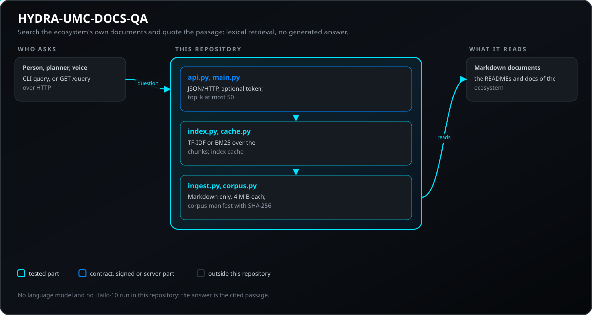
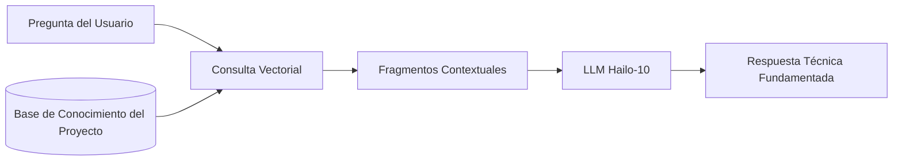
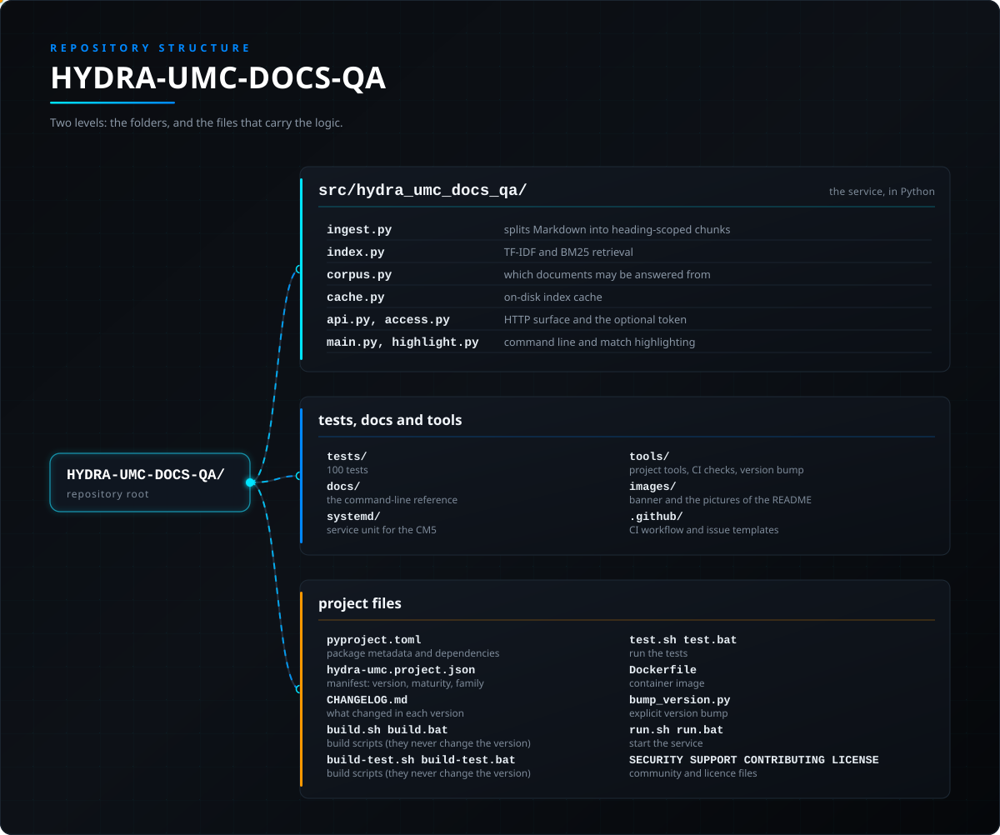

<!-- =============================================================================
HYDRA-UMC-DOCS-QA - Document search assistant
Copyright (C) JuanenRac (Electro Hobby 3D) <electrohobby3d@gmail.com>
GPL-3.0-or-later - see LICENSE
============================================================================= -->

<p align="center">
  
</p>

# 🔎 HYDRA-UMC-DOCS-QA

<p align="center"><a href="README.md">🇺🇸 English</a> | 🇪🇸 <b>Español</b> | <a href="README_fra.md">🇫🇷 Français</a> | <a href="README_ita.md">🇮🇹 Italiano</a> | <a href="README_deu.md">🇩🇪 Deutsch</a> | <a href="README_zho.md">🇨🇳 简体中文</a> | <a href="README_jpn.md">🇯🇵 日本語</a> | <a href="README_por.md">🇵🇹 Português</a></p>

### 🤖 Asistente de IA Basado en RAG para Mantenimiento de Hardware y Documentación

<p align="center">
  
  
  
  
  
  
</p>

---

> **Estado de seguridad física y de ciberseguridad:** este ecosistema no es un sistema de seguridad certificado. Todavía no existe una ruta de E-STOP por hardware, ni límites ni enclavamientos aplicados por el firmware, ni un comando de movimiento verificado; las imágenes de firmware se comprueban con CRC-32 y una firma Ed25519, y una compilación de versión rechaza las claves de desarrollo publicadas (los cabezales de herramienta y las placas de expansión detrás del relé siguen con cargadores de URTC, que usan un HMAC-SHA256 de clave compartida en lugar de una firma); TLS y TLS mutuo son opcionales y están desactivados por defecto; aún no se ha poblado ni probado ninguna placa propia. Lee la [línea base de seguridad](https://github.com/JuanenRac/HYDRA-UMC-DOCS/blob/main/docs/SECURITY_BASELINE.md) y el [modelo de amenazas](https://github.com/JuanenRac/HYDRA-UMC-DOCS/blob/main/docs/THREAT_MODEL.md) antes de fiarte de cualquier afirmación de aquí para la seguridad de una persona.

---

## 📋 De un vistazo

| | |
|---|---|
| Versión | `0.1.5` |
| Madurez | Funcional |
| Tests | 109 (`python -m pytest -q tests`) |
| Tecnología | Python / TF-IDF lexical retrieval |
| Destino | La Raspberry Pi CM5 de una celda HYDRA-UMC |
| En hardware real | Todavía no: no consta ninguna ejecución en hardware real para esta versión |

**Ir a:** [Resumen](#-resumen) · [Arquitectura](#-arquitectura) · [Funciones](#-funciones) · [Seguridad y protección](#-seguridad-y-protección) · [Interfaces](#-interfaces) · [Configuración](#-configuración) · [Inicio rápido](#-inicio-rápido) · [Pruebas](#-pruebas) · [Resolución de problemas](#-resolución-de-problemas) · [Estructura del repositorio](#-estructura-del-repositorio) · [Proyectos relacionados](#-proyectos-relacionados)

## 🚦 Estado del proyecto

Cada línea es una parte de este repositorio y la luz dice hasta dónde llega hoy. Se escribe con lo que el repositorio puede demostrar (pruebas, compilaciones, ejecuciones), no con lo previsto.

🟢 Hecho y verificado · 🟡 Funciona, con límites conocidos · 🟠 Hecho a medias o sin verificar · 🔴 Sin hacer o sin funcionar

| Área | Estado | Qué significa aquí |
|---|---|---|
| Software | 🟡 | Funciona para su propósito principal; la comprobación de honestidad de arriba lista lo que aún falta |
| Pruebas | 🟢 | 109 pruebas automáticas, ejecutadas en cada cambio |
| Hardware real | 🔴 | Todavía no: no consta ninguna ejecución en hardware real para esta versión |
| Documentación | 🟢 | README en ocho idiomas, comprobado contra el manifiesto en cada cambio |

## 🎯 Resumen

**HYDRA-UMC-DOCS-QA** es un asistente especializado de Generación Aumentada por Recuperación (RAG) diseñado para técnicos y desarrolladores in-situ. Proporciona respuestas instantáneas y fundamentadas a preguntas técnicas sobre el ecosistema HYDRA-UMC.

Solo responde a partir de los documentos Markdown que se le dan con `--docs`, en local y sin conexión a internet, y siempre cita el pasaje que usó. Leer todos los manuales, la documentación de esquemas y el código fuente de todo el ecosistema para resolver problemas, consultar pinout y compilar firmware es el objetivo, está planificado pero aún no se ha hecho.

## 🧩 Papel en HYDRA-UMC

**HYDRA-UMC-DOCS-QA** responde a una pregunta sobre el ecosistema con sus propios documentos: encuentra los pasajes que mejor encajan y los cita con su fichero y número de trozo. Pertenece a la familia cognitiva Hailo-10, pero hoy es recuperación léxica sencilla (TF-IDF o BM25) sin modelo de lenguaje, así que lo que devuelve es una cita, nunca una respuesta generada.

## 🏛️ Arquitectura

<p align="center">
  
</p>

<details>
<summary>Versión en texto del diagrama (Mermaid)</summary>



</details>

**Por qué está hecho así**

Este repositorio es un **hijo** de la familia Cognitive AI Node - su
padre, [HYDRA-UMC-COGNITIVE-NODE](https://github.com/JuanenRac/HYDRA-UMC-COGNITIVE-NODE),
posee la imagen HydraOS compartida y los pesos de modelos cuantizados, y
conecta este servicio en su `docker-compose.yml` junto a sus tres
hermanos (VLA-Engine, Voice-UI, Semantic-Planner):

* **Por qué este hijo no tiene hardware/firmware/`os/`/`models/`
  propios.** Corre por completo sobre el módulo CM5 + Hailo-10 M.2 que ya
  posee el padre - centralizar los pesos de modelos y la imagen HydraOS
  en un solo lugar evita cuatro copias divergentes de varios gigabytes
  dentro de la familia.
* **Por qué una estructura `src/`.** Mantiene el paquete instalable
  (`hydra_umc_docs_qa`) separado del tooling en la raíz del repo
  (`bump_version.py`), igual que el resto de proyectos Python del
  ecosistema.
* **Por qué la invocación desnuda (sin subcomando) sigue imprimiendo solo
  identidad/versión/rol.** Ese fue el comportamiento original de la
  etapa de andamiaje, demostrando que el paquete se instala, compila e
  importa correctamente antes de que existiera ninguna lógica real - hoy
  sigue siendo el comportamiento por defecto como comprobación rápida de
  "esto está realmente instalado y funciona", junto a los subcomandos
  reales `query` (búsqueda TF-IDF) y `serve` (API JSON/HTTP) para los que
  ese andamiaje era un requisito previo.
* **Cómo encaja en el resto del ecosistema.** Este asistente fundamenta
  sus respuestas en la documentación propia del ecosistema, dando a su
  hermano HYDRA-UMC-SEMANTIC-PLANNER una fuente de conocimiento técnico
  que puede consultar durante el razonamiento, y ofreciendo a los
  técnicos in-situ soporte manos-libres junto a HYDRA-UMC-VOICE-UI.
* **Por qué la recuperación de `index.py` es TF-IDF real, no un modelo de
  embeddings.** La búsqueda semántica basada en embeddings necesita una
  dependencia real de modelo (idealmente el propio Hailo-10 que ya
  menciona este README) - un índice TF-IDF/similitud coseno puro en
  stdlib es real, testeable, y no necesita nada más allá del propio
  Python, dando a este proyecto un núcleo de recuperación funcional hoy
  que un futuro índice basado en embeddings puede sustituir detrás del
  mismo contrato `search()`, sin tocar la CLI ni el paso de ingesta.
* **Por qué una consulta sin coincidencias devuelve un fallo honesto, no
  una respuesta de respaldo.** v0 no tiene paso de síntesis por LLM - una
  pregunta cuyas palabras no coinciden con el corpus ingerido recibe
  `No relevant passages found` (ver `main.py`), nunca una respuesta
  inventada o alucinada disfrazada de resultado real de recuperación.
* **Por qué una ruta `--docs` no permitida se rechaza, en vez de
  omitirse o ingerirse silenciosamente.** Un asistente de QA que se
  supone "fundamentado en la documentación propia del ecosistema" no
  debe leer y citar en silencio cualquier archivo al que apunte quien lo
  invoque - una ruta inexistente o un archivo que no es Markdown (un
  `.env` suelto, un binario de firmware) recibe una línea real y
  distinta `REJECTED ... : <motivo>` (ver `validate_doc_path` en
  `ingest.py`) en vez de un "no se encontró nada" agregado que oculta
  *por qué*.
* **Por qué la similitud coseno ordena los términos compartidos antes
  de sumarlos.** `dict.keys() & dict.keys()` es un conjunto (set), y el
  orden de iteración de los sets en CPython depende de la
  aleatorización del hash de cadenas por proceso - sumar términos de
  punto flotante en ese orden haría que una puntuación dependiera de
  qué proceso ejecutó la consulta, no solo del corpus y del texto de la
  consulta. Ordenar primero hace que la puntuación sea una función pura
  y reproducible de sus entradas reales.
* **Por qué las citas llevan un `#index`, no solo un nombre de
  archivo.** Un nombre de archivo por sí solo no puede desambiguar dos
  secciones que comparten un encabezado (o, más adelante, dos archivos
  ingeridos que comparten nombre) - `DocChunk.index` es la posición
  ordinal real de cada fragmento dentro de su propia fuente, dando a
  cada cita una clave estable que quien la use puede emplear para
  recuperar de forma determinista el mismo pasaje.

## ✨ Funciones

* 🔍 **Búsqueda Vectorial Local (v0):** Recuperación léxica real TF-IDF, stdlib puro, sobre documentos Markdown locales. *(implementado como búsqueda léxica real - todavía no búsqueda semántica basada en embeddings, y la ingesta de PDF sigue siendo trabajo futuro; ver BUILD Y EJECUCIÓN abajo)*
* 🔒 **Lista blanca real de documentos:** solo los archivos `.md`/`.markdown` que realmente existen se ingieren y citan - cualquier otra ruta `--docs` (inexistente, o de un tipo de archivo no permitido) se rechaza con un motivo distinto e impreso, en vez de omitirse silenciosamente o leerse como si fuera documentación real. *(implementado)*
* 🔗 **Citas trazables:** cada resultado cita `source#index` - un puntero estable y desambiguador que apunta al pasaje exacto ingerido, recuperable de forma determinista volviendo a analizar la misma fuente. *(implementado)*
* 🎯 **Puntuación determinista:** el ranking es una función pura del corpus y del texto de la consulta, independiente de la semilla de hash por proceso del intérprete. *(implementado)*
* 🗄️ **Caché del índice que no puede ejecutar código:** el `query` de la CLI guarda el índice construido en el directorio de caché del usuario (`HYDRA_UMC_DOCS_QA_CACHE_DIR`, si no `XDG_CACHE_HOME`, si no `~/.cache/hydra-umc-docs-qa`), con una clave formada por la ruta, el tamaño y la fecha de modificación de cada documento. Ahora es un JSON validado; antes era un `pickle`, que ejecuta cualquier código que lleve el fichero, de modo que cualquier otro proceso del mismo usuario podía dejar allí un fichero y hacer que el siguiente `query` lo ejecutara. Un fichero plantado, truncado o con forma incorrecta es simplemente un fallo de caché. *(implementado)*
* 🌐 **API JSON/HTTP real:** el subcomando `serve` ejecuta exactamente la misma búsqueda TF-IDF como un servicio local de larga duración (por defecto `127.0.0.1:8110`) vía `GET /query?q=...&top_k=N` y `GET /stats` - el corpus se ingiere e indexa UNA sola vez al arrancar, no en cada petición. Ver [`docs/CLI_REFERENCE.md`](docs/CLI_REFERENCE.md) para ejemplos reales capturados. *(implementado)*
* 📚 **Manifiesto de corpus, BM25, "sin respuesta", recarga y citas comprobables:** `--corpus FICHERO` (JSON: `roots`, patrones `exclude` y `documents` fijados por SHA-256) sustituye al libre `--docs`: solo se leen las raíces, un documento fijado cuyos bytes cambiaron se deja fuera, y con fijados un fichero nuevo en una raíz no es citable hasta que alguien lo fije. Cada sección lleva el hash de su fichero, así que un resultado cita `fuente#sección@sha256`. `--scorer bm25`, `--stem` (un recortador de sufijos prudente) y `--heading-boost N` mejoran el orden en textos cortos (los valores por defecto son lo que el índice siempre fue). El servicio puede negarse a responder: `--min-score` y `--min-coverage` (la parte de las palabras de la pregunta que contiene alguna sección) hacen que `GET /query` responda `answerable: false` sin contexto en lugar de una sección que solo comparte una palabra con la pregunta (una petición puede exigir más, nunca menos). `POST /reload` (exige token; también SIGHUP) reconstruye el índice desde el disco sin reiniciar y conserva el anterior si falla; `GET /stats` informa del número de fragmentos, de cuándo se construyó el índice y del último error de recarga. *(probado con Markdown sintético y real; los umbrales necesitan ajuste con preguntas reales)*
* 🤖 **Razonamiento Fundamentado:** Las respuestas se basan estrictamente en la documentación del proyecto proporcionada.
* 🎙️ **Integración de Voz:** Integrado con VOICE-UI para soporte de mantenimiento manos libres.
* 🛠️ **Conocimiento de Código:** Puede explicar módulos de firmware y detalles específicos del protocolo CAN.
* 👨‍👩‍👧 **Hijo del Cognitive AI Node:** Corre como uno de los cuatro
  servicios hermanos bajo [HYDRA-UMC-COGNITIVE-NODE](https://github.com/JuanenRac/HYDRA-UMC-COGNITIVE-NODE)
  (junto a VLA-Engine, Voice-UI y Semantic-Planner), compartiendo la
  imagen HydraOS y los pesos de modelos de su padre en vez de mantener
  copias propias.
* 📦 **Versionado Cuentakilómetros:** La versión de `pyproject.toml` solo la sube el comando `bump` explícito (`python tools/hydra_project_tool.py bump`, que ejecuta `bump_version.py`) - compilar nunca la cambia.

## 🔒 Seguridad y protección

| Amenaza | Defensa | Dónde |
|---|---|---|
| Cualquiera que consulte o recargue el corpus | Un token Bearer opcional de 16 caracteres como mínimo (`--token-file` o `HYDRA_UMC_DOCS_QA_TOKEN`) protege `GET /query` y `POST /reload`; el servicio escucha en `127.0.0.1:8110` por defecto | `access.py`, `main.py` |
| Documentos gigantes, árboles enormes, ficheros hostiles | Solo se leen `.md` y `.markdown`, de 4 MiB como máximo cada uno, 5000 ficheros expandidos como máximo y 12 niveles de profundidad; el manifiesto del corpus mide como máximo 256 KiB y puede fijar cada documento por su SHA-256; una ruta rechazada se comunica, nunca se ignora en silencio | `ingest.py`, `corpus.py` |
| Resultados absurdos y una caché envenenada | `top_k` vale 50 como máximo; `--min-score` y `--min-coverage` (de 0 a 1) deciden cuándo una pregunta cuenta como respondida; la caché del índice guarda 20 entradas como máximo | `api.py`, `cache.py` |

**Lo que nunca hace:** aquí no se ejecuta ningún modelo de lenguaje ni Hailo-10: la etiqueta «Hailo-10» del papel es el hardware al que se destina esta familia.

## 🔌 Interfaces

HTTP en `127.0.0.1:8110` por defecto y una línea de órdenes. La referencia completa es `docs/CLI_REFERENCE.md`.

| Topic o ruta | Qué lleva |
|---|---|
| `GET /query?q=...&top_k=N` | los mejores pasajes, cada uno citado como `fichero#trozo` |
| `GET /stats`, `POST /reload` | salud y tamaño del índice; recargar el corpus (necesita el token si hay uno) |
| `query QUESTION` | `--docs`, `--top-k 5`, `--scorer tfidf\|bm25` (BM25 k1 1,5, b 0,75), `--stem`, `--heading-boost 1..10`, `--corpus MANIFIESTO` |
| `serve` | `--docs ... --addr 127.0.0.1 --port 8110 [--token-file FICHERO] [--min-score 0.0] [--min-coverage 0.0]` |

## ⚙️ Configuración

| Variable | Por defecto | Qué fija |
|---|---|---|
| `HYDRA_UMC_DOCS_QA_TOKEN`, `--token-file` | sin token | el token Bearer opcional, de 16 caracteres como mínimo |
| `HYDRA_UMC_DOCS_QA_CACHE_DIR` | la carpeta de caché de la plataforma | dónde vive la caché del índice |
| `--corpus MANIFEST` | el README y el CHANGELOG de este repositorio | el manifiesto del corpus: raíces, exclusiones y documentos fijados por SHA-256 |
| `--min-score`, `--min-coverage` | `0.0` | cuándo una pregunta cuenta como respondida (de 0 a 1) |

## 🚀 Inicio rápido

Requiere Python >= 3.10.

```bash
# Linux / macOS / Git Bash
./build.sh   # crea .venv, instala el paquete (editable), verifica la importación
./run.sh     # ejecuta el punto de entrada

# Windows (cmd)
build.bat
run.bat
```

`build.sh`/`build.bat` nunca cambian la versión (solo `python tools/hydra_project_tool.py bump` la sube), y corren la suite de tests
real (`pytest tests/`). Salida esperada de un `run.sh` sin argumentos:

```text
HYDRA-UMC-DOCS-QA v0.1.5
Docs-QA (Hailo-10) - retrieval-augmented technical assistant grounded in the ecosystem's own documentation.
```

El subcomando real `query` busca en Markdown ingerido - por defecto el
propio `README.md`/`CHANGELOG.md` de este repo, o cualquier archivo real
pasado con `--docs`:

```bash
./run.sh query "cableado del bus CAN" --top-k 3
./run.sh query "busqueda vectorial recuperacion" --docs docs/manual.md docs/spec.md

# Windows
run.bat query "cableado del bus CAN" --top-k 3
```

Una pregunta cuyas palabras no coinciden con el corpus ingerido imprime
un `No relevant passages found` honesto - v0 es recuperación léxica real,
no una respuesta generativa.

Cada resultado cita `source#index` (p. ej. `manual.md#1`) - un puntero
estable y trazable a ese fragmento exacto. Una ruta `--docs` inexistente
o que no sea `.md`/`.markdown` se rechaza y se reporta, no se ignora en
silencio:

```text
$ ./run.sh query "firmware flashing" --docs manual.md ghost.md secret.env
REJECTED ghost.md: file not found (no source)
REJECTED secret.env: disallowed extension .env - only .markdown, .md are ingested
Top 1 passage(s) for: "firmware flashing"

1. [0.289] manual.md#1 - Firmware Flashing
   Flash URTC firmware over SWD or JTAG using URTC-FLASHER.
```

La misma búsqueda también se puede usar como una API JSON/HTTP de larga duración vía `./run.sh serve --docs manual.md` (por defecto `127.0.0.1:8110`). Ver [`docs/CLI_REFERENCE.md`](docs/CLI_REFERENCE.md) para la referencia completa de comandos y endpoints, con cada ejemplo capturado de una ejecución real.

## 🧪 Pruebas

109 pruebas automáticas se ejecutan con `python -m pytest -q tests`. Cubren la ingesta, el índice TF-IDF y BM25, el determinismo, la caché, el manifiesto del corpus, entradas hostiles, la línea de órdenes y la interfaz HTTP; sin hardware ni red externa.

El CI ejecuta `HYDRA_UMC_CI=1 python tools/ci_validate.py`, que comprueba el manifiesto, los documentos, los ocho README y las imágenes.

## 🏗️ Compilación y publicación

No hay nada que compilar para publicar: `build.sh` / `build.bat` crean el entorno virtual, instalan el paquete en modo editable y ejecutan las pruebas, y `build-test` solo comprueba. Compilar nunca cambia la versión; solo la sube `python tools/hydra_project_tool.py bump`, que también mueve el registro de cambios. La versión del paquete, la del manifiesto y la del registro de cambios deben coincidir, y `ci_validate.py` falla si no lo hacen.

## 🩺 Resolución de problemas

* **`python: comando no encontrado` / el build falla en el paso 1.**
  Requiere Python >= 3.10 en el `PATH`. En Windows, instálalo desde
  [python.org](https://python.org) y marca "Add to PATH" durante la
  instalación; en Linux/macOS suele llamarse `python3`.
* **`build.sh` no consigue activar el venv.** `python3 -m venv .venv`
  coloca el script de activación en una ruta distinta según la
  plataforma: `.venv/bin/activate` en Linux/macOS, `.venv/Scripts/activate`
  en Windows (también con un venv de Python de Windows usado desde Git
  Bash). `build.sh` ya comprueba ambas rutas - si sigue fallando, borra
  `.venv/` y vuelve a ejecutar `./build.sh` para reconstruirlo desde cero.
* **`pip install -e .` falla.** Normalmente por un `.venv/` obsoleto.
  Borra la carpeta `.venv/` y vuelve a ejecutar `./build.sh`/`build.bat`
  para recrearla.
* **`import OK` nunca se imprime.** Significa que `python -c "import
  hydra_umc_docs_qa"` falló - vuelve a ejecutarlo con el venv activo
  para ver el traceback real.

## 📂 Estructura del repositorio

<p align="center">
  
</p>

<details>
<summary>Versión en texto del árbol</summary>

```text
HYDRA-UMC-DOCS-QA/
├── src/hydra_umc_docs_qa/
│   ├── ingest.py                                divide el Markdown en trozos por encabezado
│   ├── index.py                                 recuperación TF-IDF y BM25
│   ├── corpus.py                                de qué documentos se puede responder
│   ├── cache.py                                 caché del índice en disco
│   ├── api.py access.py                         interfaz HTTP y el token opcional
│   └── main.py highlight.py                     línea de órdenes y resaltado de coincidencias
├── tests/                                       100 pruebas
├── docs/                                        la referencia de la línea de órdenes
├── systemd/                                     unidad de servicio para la CM5
├── tools/                                       ejecutor de compilación y pruebas, subida de versión, validador de CI, generadores y comprobaciones de README e imágenes
├── images/                                      banner y las imágenes del README
├── .github/                                     flujo de CI y plantillas de incidencias
├── pyproject.toml                               metadatos del paquete y dependencias
├── hydra-umc.project.json                       manifiesto: versión, madurez, familia
├── CHANGELOG.md                                 qué cambió en cada versión
├── build.sh build.bat                           scripts de compilación (nunca cambian la versión)
├── build-test.sh build-test.bat                 scripts de compilación (nunca cambian la versión)
├── test.sh test.bat                             ejecutan las pruebas
├── Dockerfile                                   imagen de contenedor
├── bump_version.py / bump_manifest_version.py   subida de versión explícita
├── run.sh run.bat                               arrancar el servicio
└── SECURITY.md SUPPORT.md CONTRIBUTING.md CODE_OF_CONDUCT.md LICENSE LICENSE.md
```

</details>

## 🗺️ Hoja de ruta y límites conocidos

**Límites conocidos hoy**

* **Fase 1:** Despliegue del motor VLA y procesamiento de entrada multi-modal en Hailo-10.
* **Fase 2:** Integración del planificador semántico con modelos de comportamiento de enjambre y memoria a largo plazo.
* **Fase 3:** Ejecución local de baja latencia de Voice UI y cancelación de ruido industrial.
* **Fase 4:** Visualización de esquemas interactivos vinculada a respuestas de QA y optimización de RAG para dispositivos de borde.

## 🌍 Idiomas

Este README y los documentos del repositorio existen en ocho idiomas: inglés, español, alemán, francés, italiano, japonés, chino y portugués (Portugal). Se escriben a la vez y el CI comprueba que los ocho ficheros tengan las mismas secciones y los mismos enlaces. Este repositorio no tiene pantalla ni catálogo de mensajes propios, así que no hay cadenas de interfaz que traducir.

## 🔗 Proyectos relacionados

Este proyecto es parte del ecosistema de robótica HYDRA-UMC del mismo autor (JuanenRac / Electro Hobby 3D). Vale la pena conocerlo, ya que una petición podría en realidad ser sobre alguno de estos en vez de sobre este repositorio.

**Proyecto Padre**
- **[HYDRA-UMC-COGNITIVE-NODE](https://github.com/JuanenRac/HYDRA-UMC-COGNITIVE-NODE)** — nodo de integración para el pipeline cognitivo Hailo-10 (orquestación de LLM/VLA/voz); el padre del que este repositorio es una etapa o consumidor específico, dentro de su propio pipeline cognitivo.

**Proyectos Hermanos** — las demás etapas/consumidores del propio pipeline cognitivo Hailo-10 de HYDRA-UMC-COGNITIVE-NODE
- **[HYDRA-UMC-VOICE-UI](https://github.com/JuanenRac/HYDRA-UMC-VOICE-UI)** — front-end de voz real (VAD + analizador de intención) con un relé a Watch acotado y con confirmación.
- **[HYDRA-UMC-SEMANTIC-PLANNER](https://github.com/JuanenRac/HYDRA-UMC-SEMANTIC-PLANNER)** — descomposición real de tareas basada en reglas y recuperación semántica de errores sobre códigos de error del MCU.
- **[HYDRA-UMC-VLA-ENGINE](https://github.com/JuanenRac/HYDRA-UMC-VLA-ENGINE)** — codificación/decodificación real de tokens de acción y generación de trayectoria para un modelo Vision-Language-Action.
- **[HYDRA-UMC-LOCAL-TECHNICIAN](https://github.com/JuanenRac/HYDRA-UMC-LOCAL-TECHNICIAN)** — técnico de mantenimiento con IA local y con puertas de política para el propio ecosistema - observa, diagnostica y propone arreglos; los dos niveles de riesgo más altos están deliberadamente sin implementar todavía.

**También Forma Parte del Ecosistema**

*Hardware y Plataforma Base*
- **[HYDRA-UMC](https://github.com/JuanenRac/HYDRA-UMC)** — el diseño de la placa madre del brazo robótico: host CM5 + coprocesador STM32H745 de doble núcleo, pensado para coordinar hasta 8 brazos herramienta por CAN-OTA/SPI-OTA (firmware en fase temprana; todavía no hay ninguna placa poblada).
- **[HYDRA-UMC-OS](https://github.com/JuanenRac/HYDRA-UMC-OS)** — capa de producto reproducible sobre Raspberry Pi OS para el CM5: agente de solo lectura, config/perfiles validados, aprovisionamiento WiFi de primer contacto.
- **[HYDRA-UMC-SDK](https://github.com/JuanenRac/HYDRA-UMC-SDK)** — el contrato JSON-Schema compartido y la barrera de software de puerta de trabajos contra la que cada bridge valida sus comandos (no es una función de seguridad certificada).
- **[HYDRA-UMC-CONNECTOR-HUB](https://github.com/JuanenRac/HYDRA-UMC-CONNECTOR-HUB)** — registro declarativo y validador de manifiestos de adaptador para conectores de máquinas externas; extiende la propia idea de contrato del SDK a máquinas externas sin sustituir a los proyectos de pasarela industrial.

*Backend Central y Clientes*
- **[HYDRA-UMC-SERVER](https://github.com/JuanenRac/HYDRA-UMC-SERVER)** — el backend headless real (REST/WebSocket) con el que habla de verdad cada cliente de control.
- **[HYDRA-UMC-STUDIO](https://github.com/JuanenRac/HYDRA-UMC-STUDIO)** — panel de control web con visualización 3D multi-robot en tiempo real.
- **[HYDRA-UMC-SUITE](https://github.com/JuanenRac/HYDRA-UMC-SUITE)** — centro de mando de enjambre de escritorio (PySide6) para varios servidores a la vez, empaquetado como ejecutable independiente.
- **[HYDRA-UMC-ANDROID-CONTROL](https://github.com/JuanenRac/HYDRA-UMC-ANDROID-CONTROL)** — app nativa de control para Android con inicio de sesión biométrico y un compañero Wear OS emparejado.
- **[HYDRA-UMC-IOS-CONTROL](https://github.com/JuanenRac/HYDRA-UMC-IOS-CONTROL)** — app de control para iOS/iPadOS (Flutter) con sincronización en tiempo real por WebSocket.
- **[HYDRA-UMC-DSI](https://github.com/JuanenRac/HYDRA-UMC-DSI)** — interfaz táctil nativa para la pantalla táctil DSI de 7" a bordo, embebida en el propio CM5.
- **[HYDRA-UMC-EDITOR-URDF](https://github.com/JuanenRac/HYDRA-UMC-EDITOR-URDF)** — creador/editor gráfico de URDF de escritorio que envía los modelos terminados al propio catálogo de STUDIO.
- **[HYDRA-UMC-EDITOR-STL](https://github.com/JuanenRac/HYDRA-UMC-EDITOR-STL)** — editor de escritorio de modelos STL, que transforma/reemplaza/quita/añade piezas reales en el mismo catálogo de modelos que también edita HYDRA-UMC-EDITOR-URDF.
- **[HYDRA-UMC-BRIDGE-AMR](https://github.com/JuanenRac/HYDRA-UMC-BRIDGE-AMR)** — barrera de coordinación para flotas AGV/AMR mediante un publicador MQTT VDA 5050 (probado solo contra una flota emulada).
- **[HYDRA-UMC-BRIDGE-CNC](https://github.com/JuanenRac/HYDRA-UMC-BRIDGE-CNC)** — coordinador de alto nivel para celdas CNC con acceso a estado/bytes de control GRBL (probado solo contra un emulador).
- **[HYDRA-UMC-BRIDGE-DROIDS](https://github.com/JuanenRac/HYDRA-UMC-BRIDGE-DROIDS)** — barrera de coordinación para droides con patas/humanoides, con un emisor de comandos para Boston Dynamics Spot (probado solo contra un emulador).
- **[HYDRA-UMC-BRIDGE-LASER](https://github.com/JuanenRac/HYDRA-UMC-BRIDGE-LASER)** — coordinador de celdas láser que lee 3 señales GPIO de llave/carcasa/enclavamiento (probado solo contra un chip simulado; no puede armar ni disparar un láser).
- **[HYDRA-UMC-BRIDGE-OPENPNP](https://github.com/JuanenRac/HYDRA-UMC-BRIDGE-OPENPNP)** — coordinador de alto nivel seguro para el flujo de placas de pick-and-place OpenPnP.
- **[HYDRA-UMC-BRIDGE-PRINTER3D](https://github.com/JuanenRac/HYDRA-UMC-BRIDGE-PRINTER3D)** — barrera de coordinación segura para impresoras 3D Moonraker/Klipper, con comandos de trabajo reales y controlados.
- **[HYDRA-UMC-BRIDGE-ROS2](https://github.com/JuanenRac/HYDRA-UMC-BRIDGE-ROS2)** — coordinador con un transporte ROS 2 rclpy importado de forma perezosa (todavía no ejecutado contra una instalación de ROS 2).
- **[HYDRA-UMC-BRIDGE-UAV](https://github.com/JuanenRac/HYDRA-UMC-BRIDGE-UAV)** — barrera de coordinación para UAV equipados con cámara, con un emisor de comandos MAVLink (probado solo contra un emulador).

*Plataforma de Herramientas URTC*
- **[URTC](https://github.com/JuanenRac/URTC)** — firmware para la placa física del Universal Robot Tool Controller, más de 25 perfiles de herramienta por bus CAN.
- **[URTC-FLASHER](https://github.com/JuanenRac/URTC-FLASHER)** — herramienta de escritorio con GUI para flashear placas URTC, CAN-OTA más SWD/JTAG de chip completo.
- **[URTC-TESTER](https://github.com/JuanenRac/URTC-TESTER)** — herramienta de escritorio de diagnóstico CAN-bus en vivo para placas URTC, un panel por perfil de herramienta.
- **[URTC-WEB-STUDIO](https://github.com/JuanenRac/URTC-WEB-STUDIO)** — alternativa basada en navegador a URTC-TESTER mediante la Web Serial API, sin instalación local.
- **[URTC-GATEWAY](https://github.com/JuanenRac/URTC-GATEWAY)** — pasarela delante del bus CAN de URTC: lista de identificadores permitidos, límite de tasa y clave de sesión; software probado en ordenador, aún no en un bus real.

*Nodo IA de Visión (Hailo-8)*
- **[HYDRA-UMC-VISION-NODE](https://github.com/JuanenRac/HYDRA-UMC-VISION-NODE)** — nodo de integración para el pipeline de visión Hailo-8, con una comprobación real de disponibilidad de hardware por etapa.
- **[HYDRA-UMC-DETECTION-HEF](https://github.com/JuanenRac/HYDRA-UMC-DETECTION-HEF)** — registro real de modelos compilados con verificación de carga segura por arquitectura Hailo/checksum.
- **[HYDRA-UMC-VISION-STREAMER](https://github.com/JuanenRac/HYDRA-UMC-VISION-STREAMER)** — generador real de pipeline GStreamer + config MediaMTX, con una frontera de integración HailoRT real.
- **[HYDRA-UMC-VISUAL-SERVOING-API](https://github.com/JuanenRac/HYDRA-UMC-VISUAL-SERVOING-API)** — ley de corrección Position-Based Visual Servoing con autorización condicionada al estado de zona; todavía sin estimación de pose por cámara.
- **[HYDRA-UMC-SAFETY-ZONES](https://github.com/JuanenRac/HYDRA-UMC-SAFETY-ZONES)** — lógica v0 de invasión de zona, vigencia de calibración y solicitud de E-STOP que toma las posiciones de los objetos de un fichero; ningún detector la alimenta y todavía no hay un E-STOP físico conectado.

*Orquestación y Enjambre*
- **[HYDRA-UMC-ORCHESTRATOR](https://github.com/JuanenRac/HYDRA-UMC-ORCHESTRATOR)** — nodo de integración con un contrato real de informe de salud gRPC/Protobuf y una máquina de estados de misión.
- **[HYDRA-UMC-JOB-DISPATCHER](https://github.com/JuanenRac/HYDRA-UMC-JOB-DISPATCHER)** — cola de trabajos real basada en prioridad con deduplicación, sobre una API HTTP real.
- **[HYDRA-UMC-NODE-HEALING](https://github.com/JuanenRac/HYDRA-UMC-NODE-HEALING)** — watchdog de salud de flota real basado en gRPC, con reintento/backoff y detección de discrepancia de identidad.
- **[HYDRA-UMC-PATH-PLANNER-3D](https://github.com/JuanenRac/HYDRA-UMC-PATH-PLANNER-3D)** — planificador de rutas 3D real basado en RRT, con validación real de colisión de obstáculos/espacio de trabajo.
- **[HYDRA-UMC-SWARM-SYNC](https://github.com/JuanenRac/HYDRA-UMC-SWARM-SYNC)** — sincronización de estado real mediante CRDT LWW-Element-Map, con pruebas de propiedades para convergencia multi-celda.

*Gemelo Digital y Simulación*
- **[HYDRA-UMC-TWIN](https://github.com/JuanenRac/HYDRA-UMC-TWIN)** — nodo de integración para el motor de gemelo digital, con un contrato real de sincronización por compatibilidad de versión.
- **[HYDRA-UMC-HIL-BRIDGE](https://github.com/JuanenRac/HYDRA-UMC-HIL-BRIDGE)** — enrutador hardware-in-the-loop con un enclavamiento de software por colisión entre simulación y hardware real (probado sin hardware real).
- **[HYDRA-UMC-PHYSICS-REPLICA](https://github.com/JuanenRac/HYDRA-UMC-PHYSICS-REPLICA)** — cinemática directa real y validación de límites articulares sobre un subconjunto real de URDF.
- **[HYDRA-UMC-SYNTHETIC-DATA-GEN](https://github.com/JuanenRac/HYDRA-UMC-SYNTHETIC-DATA-GEN)** — generador real de escenas 2D procedurales con exportación de anotaciones YOLO/COCO.

*Datos y Analítica*
- **[HYDRA-UMC-DATALAKE](https://github.com/JuanenRac/HYDRA-UMC-DATALAKE)** — almacén de series temporales real respaldado por sqlite3, con una API HTTP real de ingesta/consulta.
- **[HYDRA-UMC-ANOMALY-DETECTOR](https://github.com/JuanenRac/HYDRA-UMC-ANOMALY-DETECTOR)** — detector de anomalías real basado en FFT + línea base estadística, con monitorización de deriva.
- **[HYDRA-UMC-PRODUCTION-REPORTS](https://github.com/JuanenRac/HYDRA-UMC-PRODUCTION-REPORTS)** — cálculo real de OEE/disponibilidad sobre el histórico de DATALAKE, con exportación CSV reproducible.
- **[HYDRA-UMC-TELEMETRY-COLLECTOR](https://github.com/JuanenRac/HYDRA-UMC-TELEMETRY-COLLECTOR)** — pipeline real de ingesta CAN/WebSocket hacia DATALAKE, con deduplicación por secuencia.

*Pasarela Industrial*
- **[HYDRA-UMC-GATEWAY-INDUSTRIAL](https://github.com/JuanenRac/HYDRA-UMC-GATEWAY-INDUSTRIAL)** — nodo de integración que retransmite a protocolos industriales, con una capa real de lista blanca de comandos/contrapresión.
- **[HYDRA-UMC-OPCUA-SERVER](https://github.com/JuanenRac/HYDRA-UMC-OPCUA-SERVER)** — espacio de direcciones OPC-UA real, verificado con una sesión de cliente real del protocolo binario.
- **[HYDRA-UMC-MQTT-BROKER](https://github.com/JuanenRac/HYDRA-UMC-MQTT-BROKER)** — broker MQTT real con autenticación por cliente opcional y ACL de tópicos.
- **[HYDRA-UMC-MTCONNECT-ADAPTER](https://github.com/JuanenRac/HYDRA-UMC-MTCONNECT-ADAPTER)** — endpoints XML reales `/probe` y `/current` de MTConnect, con salida en modo degradado.

*Herramientas Complementarias y Operaciones del Ecosistema*
- **[HYDRA-UMC-DASHBOARD-AI](https://github.com/JuanenRac/HYDRA-UMC-DASHBOARD-AI)** — paneles de Resúmenes Inteligentes y Resaltado de Anomalías sobre DATALAKE/ANOMALY-DETECTOR, con un respaldo estadístico honesto.
- **[HYDRA-UMC-TOOL-CLI](https://github.com/JuanenRac/HYDRA-UMC-TOOL-CLI)** — CLI de flota con un contrato real y estable de códigos de salida, cliente real y en vivo de la propia API de HYDRA-UMC-SERVER.
- **[HYDRA-UMC-WATCH](https://github.com/JuanenRac/HYDRA-UMC-WATCH)** — app compañera de WearOS con patrones de alerta háptica y un relé de voz al teléfono emparejado (todavía no ejecutada en un reloj físico).
- **[URTC-SMART-RACK](https://github.com/JuanenRac/URTC-SMART-RACK)** — firmware para un rack de montaje de placas con decodificación real de ID de herramienta y lógica de precalentamiento Smart Idle.
- **[URTC-VISION-TOOL](https://github.com/JuanenRac/URTC-VISION-TOOL)** — firmware más un compañero de visión real en Python para un cabezal de inspección térmica/RGB.
- **[HYDRA-UMC-UPDATER](https://github.com/JuanenRac/HYDRA-UMC-UPDATER)** — herramienta administrativa de escritorio que descubre, clona y actualiza cada repositorio de este ecosistema.
- **[HYDRA-UMC-OS-REBUILDER](https://github.com/JuanenRac/HYDRA-UMC-OS-REBUILDER)** — herramienta de escritorio Windows/Linux que construye una imagen de la CM5 lista para grabar, precargada con las versiones más actuales del ecosistema, con configuración de primer arranque de Wi-Fi/usuario/SSH al estilo de Raspberry Pi Imager.
- **[HYDRA-UMC-OPS-AGENT](https://github.com/JuanenRac/HYDRA-UMC-OPS-AGENT)** — coordinador de incidencias de mantenimiento: un rol edge de bajo privilegio recopila un snapshot de inventario/salud saneado, un rol control-plane lo renderiza de solo lectura y pide a un proveedor de IA que sugiera un diagnóstico - nunca aplica un parche ni despliega nada.
- **[HYDRA-UMC-DEV-SERVER](https://github.com/JuanenRac/HYDRA-UMC-DEV-SERVER)** — host de desarrollo reproducible (Raspberry Pi 5 / CM5) que almacena el código del ecosistema y ejecuta tareas acotadas de compilación/pruebas bajo una cola duradera; un rol de desarrollo dedicado, explícitamente distinto de un CM5 operativo.

## 📚 Documentación

Dónde leer más:

* [docs/CLI_REFERENCE.md](docs/CLI_REFERENCE.md) - cada orden y endpoint, con salida capturada de una ejecución real
* [Base de seguridad del ecosistema](https://github.com/JuanenRac/HYDRA-UMC-DOCS/blob/main/docs/SECURITY_BASELINE.md)
* [Modelo de amenazas del ecosistema](https://github.com/JuanenRac/HYDRA-UMC-DOCS/blob/main/docs/THREAT_MODEL.md)
* [Historial de cambios de este repositorio](CHANGELOG.md)
* [Licencia de este repositorio](LICENSE.md)

## 🤝 Contribuir y comunidad

* Antes de un pull request ejecuta `HYDRA_UMC_CI=1 py -3 tools/ci_validate.py` (o `HYDRA_UMC_CI=1 python3 tools/ci_validate.py`): debe imprimir `CI_VALIDATION=PASS`. No ejecutes `build.sh` ni `build.bat` para esta comprobación; compilar no es comprobar.
* Los ocho README se escriben desde una sola fuente en HYDRA-UMC-DOCS; no los edites a mano. Cambia la fuente y vuelve a escribirlos con `tools/make_readmes.py`.
* No afirmes en un README lo que no se ha ejecutado: di «simulado» o «sin probar en hardware» cuando esa sea la verdad.
* Mira [CONTRIBUTING.md](CONTRIBUTING.md), el [código de conducta](CODE_OF_CONDUCT.md), [SECURITY.md](SECURITY.md) y [SUPPORT.md](SUPPORT.md).

## 👤 AUTOR

**JuanenRac (Electro Hobby 3D)** · electrohobby3d@gmail.com

## 📜 LICENCIA

GPL-3.0-or-later - [LICENSE](LICENSE).
