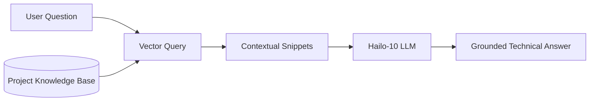

<!-- =============================================================================
HYDRA-UMC-DOCS-QA - Document search assistant
Copyright (C) JuanenRac (Electro Hobby 3D) <electrohobby3d@gmail.com>
GPL-3.0-or-later - see LICENSE
============================================================================= -->

<p align="center">
  
</p>

# 🔎 HYDRA-UMC-DOCS-QA

<p align="center"><a href="README.md">🇺🇸 English</a> | <a href="README_spa.md">🇪🇸 Español</a> | <a href="README_fra.md">🇫🇷 Français</a> | <a href="README_ita.md">🇮🇹 Italiano</a> | <a href="README_deu.md">🇩🇪 Deutsch</a> | 🇨🇳 <b>简体中文</b> | <a href="README_jpn.md">🇯🇵 日本語</a> | <a href="README_por.md">🇵🇹 Português</a></p>

### 🤖 基于 RAG 的硬件维护与文档 AI 助手

<p align="center">
  
  
  
  
  
  
</p>

---

> **安全与安防现状:**本生态系统不是经认证的安全系统。目前尚无硬件 E-STOP 通路,没有由固件强制执行的限位或联锁,也没有经过验证的运动指令;固件映像使用 CRC-32 和 Ed25519 签名校验,发布构建会拒绝已公开的开发密钥(中继之后的工具头和扩展板仍运行 URTC 的引导程序,它们使用共享密钥的 HMAC-SHA256 而不是签名);TLS 与双向 TLS 均为可选项,默认关闭;自制电路板尚未组装或测试。在依赖此处任何说法来保障人身安全之前,请先阅读[安全基线](https://github.com/JuanenRac/HYDRA-UMC-DOCS/blob/main/docs/SECURITY_BASELINE.md)和[威胁模型](https://github.com/JuanenRac/HYDRA-UMC-DOCS/blob/main/docs/THREAT_MODEL.md)。

---

## 📋 速览

| | |
|---|---|
| 版本 | `0.1.5` |
| 成熟度 | 可用 |
| 测试 | 109 (`python -m pytest -q tests`) |
| 技术栈 | Python / TF-IDF lexical retrieval |
| 目标 | HYDRA-UMC 工作单元的 Raspberry Pi CM5 |
| 真实硬件 | 尚未：此版本没有在真实硬件上运行的记录 |

**跳转：** [概述](#-概述) · [架构](#-架构) · [功能](#-功能) · [安全与防护](#-安全与防护) · [接口](#-接口) · [配置](#-配置) · [快速开始](#-快速开始) · [测试](#-测试) · [故障排除](#-故障排除) · [仓库结构](#-仓库结构) · [相关项目](#-相关项目)

## 🚦 项目状态

每一行是本仓库的一个部分，灯号表示它今天做到了哪一步。内容依据仓库能够展示的证据（测试、构建、运行），而不是计划。

🟢 已完成并验证 · 🟡 可用，有已知限制 · 🟠 部分完成或尚未验证 · 🔴 未完成或不可用

| 领域 | 状态 | 在这里的含义 |
|---|---|---|
| 软件 | 🟡 | 主要用途可用；上面的诚实性检查列出了仍然缺少的内容 |
| 测试 | 🟢 | 109 项自动测试，每次变更都会运行 |
| 真实硬件 | 🔴 | 尚未：此版本没有在真实硬件上运行的记录 |
| 文档 | 🟢 | 八种语言的 README，每次变更都会与清单核对 |

## 🎯 概述

**HYDRA-UMC-DOCS-QA** 是一款专为现场技术人员和开发者设计的专用检索增强
生成（RAG）助手。它能为关于 HYDRA-UMC 生态系统的技术问题提供即时、有据
可查的答案。

它只根据通过 `--docs` 提供的 Markdown 文档作答，在本地运行、无需互联网连接，并始终引用所用的段落。
阅读整个生态系统的所有手册、原理图文档和源代码，以协助故障排查、引脚查询和固件编译，是目标，已在计划中，尚未完成。

## 🧩 在 HYDRA-UMC 中的角色

**HYDRA-UMC-DOCS-QA** 用生态系统自己的文档回答问题：找出最匹配的段落，并附上文件和块编号引用。它属于 Hailo-10 认知家族，但目前只是没有语言模型的简单词汇检索（TF-IDF 或 BM25），返回的是引用，绝不是生成的回答。

## 🏛️ 架构

<p align="center">
  
</p>

<details>
<summary>图表的文本版本（Mermaid）</summary>



</details>

**为什么这样构建**

本仓库是 Cognitive AI Node 系列的**子项目**——其父项目
[HYDRA-UMC-COGNITIVE-NODE](https://github.com/JuanenRac/HYDRA-UMC-COGNITIVE-NODE) 拥有共享的 HydraOS 镜像和量化模型权重，并将本服务与其另外 3 个同级项目（VLA-Engine、Voice-UI、Semantic-Planner）一同接入 `docker-compose.yml`：

* **为何本子项目没有自己的硬件/固件/`os/`/`models/`。** 它完全运行在父项目已拥有的 CM5 + Hailo-10 M.2 模块上——将模型权重和 HydraOS 镜像集中保存在一处，可避免整个项目族中出现四份互不一致的、动辄数 GB 的副本。
* **为何采用 `src/` 布局。** 使可安装的包（`hydra_umc_docs_qa`）与仓库根目录的工具（`bump_version.py`）分离，与生态系统中其他每个 Python 项目所使用的布局保持一致。
* **为何裸调用（不带子命令）今天仍然只打印身份/版本/角色。** 这原本是脚手架（scaffolding）阶段的行为：在还没有任何真正的逻辑之前，证明该包在实际目标 Python 版本上能够正确安装、编译并被导入。今天它仍然是默认行为，作为一个快速检查“这确实已安装且能运行”的手段，与真实的 `query`（TF-IDF 搜索）和 `serve`（JSON/HTTP API）子命令并存——而这些子命令正是当初那套脚手架所要铺垫的前提条件。
* **这如何融入生态系统的其余部分。** 本助手将其答案建立在生态系统自身的文档基础上，为其同级项目 HYDRA-UMC-SEMANTIC-PLANNER 提供了一个可在推理过程中查询的技术知识来源，并与 HYDRA-UMC-VOICE-UI 一同为现场技术人员提供免提故障排查支持。
* **为何 `index.py` 的检索是真实的 TF-IDF，而非嵌入模型。** 基于嵌入的语义搜索需要一个真实的模型依赖（理想情况下是本 README 已经提到的 Hailo-10）——一个纯标准库实现的 TF-IDF/余弦相似度索引是真实的、可测试的，除 Python 本身外不需要任何依赖，让本项目今天就拥有一个可工作的检索内核，未来基于嵌入的索引可以在不改动 CLI 或摄取步骤的前提下，替换到同一个 `search()` 契约背后。
* **为何一次没有匹配结果的查询会返回一个诚实的未命中，而非一个兜底答案。** v0 没有 LLM 合成步骤——一个词语与已摄取语料库没有重叠的问题会得到 `No relevant passages found`（见 `main.py`），而绝不会得到一个伪装成真实检索结果的编造或幻觉答案。
* **为何一个不被允许的 `--docs` 路径会被拒绝，而不是被静默跳过或静默摄取。** 一个本应“以生态系统自身文档为依据”的问答助手，绝不能悄悄读取并引用调用者随手指向的任意文件——一个缺失的路径，或一个非 Markdown 文件（一个散落的 `.env`、一个固件二进制文件），都会得到一行真实的、独立的 `REJECTED ... : <原因>`（见 `ingest.py` 的 `validate_doc_path`），而不是一个隐藏了“为何”的笼统“未找到任何内容”。
* **为何余弦相似度在求和之前会先对共享词项排序。** `dict.keys() & dict.keys()` 是一个集合（set），而 CPython 中集合的迭代顺序取决于逐进程的字符串哈希随机化——如果按该顺序对浮点词项求和，得分就会取决于恰好是哪个进程运行了本次查询，而不仅仅取决于语料库和查询文本本身。先排序能让得分成为其真实输入的一个纯粹、可复现的函数。
* **为何引用要带上 `#index`，而不只是文件名。** 单靠文件名无法区分两个共享同一标题的章节（或者，将来两个共享同一文件名的被摄取文件）——`DocChunk.index` 是每个分块在其自身来源中的真实序号位置，为每条引用赋予了一个稳定的键，调用者可据此以确定的方式再次找回同一段落。

## ✨ 功能

* 🔍 **本地向量搜索（v0）：** 真实的、仅依赖标准库的 TF-IDF 词法检索，作用于本地 Markdown 文档。*（已实现为真实的词法搜索——尚非基于嵌入的语义搜索，PDF 摄取仍是未来的工作；见下方“构建与运行”）*
* 🔒 **真实文档白名单：** 只有真实存在的 `.md`/`.markdown` 文件才会被摄取和引用——任何其他 `--docs` 路径（缺失，或文件类型不被允许）都会被拒绝，并打印出明确、独立的原因，而不是被静默跳过或被当作真实文档静默读取。*（已实现）*
* 🔗 **可追溯的引用：** 每条结果都会引用 `source#index`——一个稳定的、可消歧的指针，指回被摄取的确切段落，可通过重新解析同一来源以确定的方式复原。*（已实现）*
* 🎯 **确定性评分：** 排序是语料库和查询文本的纯函数，与解释器逐进程的哈希种子无关。*（已实现）*
* 🗄️ **无法执行代码的索引缓存：** CLI 的 `query` 会把构建好的索引缓存到用户缓存目录（`HYDRA_UMC_DOCS_QA_CACHE_DIR`，否则 `XDG_CACHE_HOME`，否则 `~/.cache/hydra-umc-docs-qa`），缓存键由每个文档的路径、大小和修改时间构成。现在它是经过校验的 JSON 文件；以前是 `pickle`，会执行文件携带的任何代码，因此同一用户的任何其他进程都可以在那里放置文件，并让下一次 `query` 执行它。被放置、被截断或结构错误的文件只会被当作一次缓存未命中。*（已实现）*
* 🌐 **真实的 JSON/HTTP API：** `serve` 子命令将同样的 TF-IDF 搜索作为一个长期运行的本地服务运行(默认 `127.0.0.1:8110`)，通过 `GET /query?q=...&top_k=N` 和 `GET /stats` 提供——语料库只在启动时摄取并建立索引一次，而非每次请求都重来。真实抓取的示例见 [`docs/CLI_REFERENCE.md`](docs/CLI_REFERENCE.md)。*（已实现）*
* 📚 **语料清单、BM25、「无答案」、重新加载以及可核对的引用:** `--corpus 文件`(JSON:`roots`、`exclude` 模式以及按 SHA-256 固定的 `documents`)取代自由的 `--docs`:只读取根目录,字节发生变化的固定文档会被排除,且存在固定项时,根目录里新增的文件在有人固定之前不可引用。每个段落都带有其文件的哈希,因此结果引用 `来源#段落@sha256`。`--scorer bm25`、`--stem`(谨慎的词尾剥离)和 `--heading-boost N` 改善短文本上的排序(默认值就是索引一直以来的样子)。服务可以拒绝回答:`--min-score` 和 `--min-coverage`(某个段落包含的问题词所占比例)会使 `GET /query` 在没有上下文的情况下回答 `answerable: false`,而不是给出只与问题共享一个词的段落(请求可以要求更严,不能更松)。`POST /reload`(需要 Bearer 令牌;也可用 SIGHUP)无需重启即可从磁盘重建索引,失败时保留旧索引;`GET /stats` 报告片段数量、索引构建时间和最近一次重新加载错误。*(已用合成和真实 Markdown 试过,阈值需要用真实问题调整)*
* 🤖 **有据可查的推理：** 答案严格基于所提供的项目文档。
* 🎙️ **语音集成：** 与 VOICE-UI 集成，实现免提维护支持。
* 🛠️ **代码感知：** 能够解释固件模块和 CAN 协议细节。
* 👨‍👩‍👧 **认知 AI 节点子项目：** 作为
  [HYDRA-UMC-COGNITIVE-NODE](https://github.com/JuanenRac/HYDRA-UMC-COGNITIVE-NODE) 下 4 个同级服务之一运行（与 VLA-Engine、Voice-UI 和 Semantic-Planner 并列），共享父项目的 HydraOS 镜像和模型权重，而非各自保留独立副本。
* 📦 **显式的版本提升：** `pyproject.toml` 中的版本只由显式的 `bump` 命令提升（`python tools/hydra_project_tool.py bump`，它会运行 `bump_version.py`）- 构建绝不会更改它。

## 🔒 安全与防护

| 威胁 | 防御 | 位置 |
|---|---|---|
| 任何人都能查询或重新加载语料 | 可选的 Bearer 令牌（至少 16 个字符，`--token-file` 或 `HYDRA_UMC_DOCS_QA_TOKEN`）保护 `GET /query` 和 `POST /reload`；服务默认监听 `127.0.0.1:8110` | `access.py`, `main.py` |
| 巨大文档、巨大目录树、恶意文件 | 只读取 `.md` 和 `.markdown`，每个最大 4 MiB，最多展开 5000 个文件、深 12 层；语料清单最大 256 KiB，可用 SHA-256 固定每个文档；被拒绝的路径会被报告，绝不静默忽略 | `ingest.py`, `corpus.py` |
| 荒谬的结果和被污染的缓存 | `top_k` 最大 50；`--min-score` 和 `--min-coverage`（0 到 1）决定一个问题何时算已回答；索引缓存最多保留 20 项 | `api.py`, `cache.py` |

**它绝不做的事：** 此处不运行语言模型，也不运行 Hailo-10：角色中的“Hailo-10”指这个家族预期使用的硬件。

## 🔌 接口

默认在 `127.0.0.1:8110` 提供 HTTP，并提供命令行。完整参考见 `docs/CLI_REFERENCE.md`。

| 主题或路由 | 内容 |
|---|---|
| `GET /query?q=...&top_k=N` | 最匹配的段落，各以 `文件#块` 引用 |
| `GET /stats`, `POST /reload` | 健康状态与索引大小；重新加载语料（设置了令牌时需要） |
| `query QUESTION` | `--docs`、`--top-k 5`、`--scorer tfidf\|bm25`（BM25 k1 1.5、b 0.75）、`--stem`、`--heading-boost 1..10`、`--corpus 清单` |
| `serve` | `--docs ... --addr 127.0.0.1 --port 8110 [--token-file FILE] [--min-score 0.0] [--min-coverage 0.0]` |

## ⚙️ 配置

| 变量 | 默认值 | 设置内容 |
|---|---|---|
| `HYDRA_UMC_DOCS_QA_TOKEN`, `--token-file` | 无令牌 | 可选的 Bearer 令牌，至少 16 个字符 |
| `HYDRA_UMC_DOCS_QA_CACHE_DIR` | 平台的缓存文件夹 | 索引缓存所在位置 |
| `--corpus MANIFEST` | 本仓库的 README 和 CHANGELOG | 语料清单：根目录、排除项和用 SHA-256 固定的文档 |
| `--min-score`, `--min-coverage` | `0.0` | 问题何时算已回答（0 到 1） |

## 🚀 快速开始

需要 Python >= 3.10。

```bash
# Linux / macOS / Git Bash
./build.sh   # 创建 .venv，安装该包（可编辑模式），验证导入
./run.sh     # 运行入口点

# Windows (cmd)
build.bat
run.bat
```

`build.sh`/`build.bat` 不会更改版本号（只有 `python tools/hydra_project_tool.py bump` 才会提升），并运行真实的测试套件（`pytest tests/`）。不带参数的
`run.sh` 的预期输出：

```text
HYDRA-UMC-DOCS-QA v0.1.5
Docs-QA (Hailo-10) - retrieval-augmented technical assistant grounded in the ecosystem's own documentation.
```

真实的 `query` 子命令会在已摄取的 Markdown 中搜索——默认使用本仓库自身的
`README.md`/`CHANGELOG.md`，或通过 `--docs` 传入的任意真实文件：

```bash
./run.sh query "CAN 总线接线" --top-k 3
./run.sh query "向量搜索 检索" --docs docs/manual.md docs/spec.md

# Windows
run.bat query "CAN 总线接线" --top-k 3
```

一个词语与已摄取语料库没有重叠的问题会打印一个诚实的
`No relevant passages found`——v0 是真实的词法检索，而非生成式回答。

每条结果都会引用 `source#index`（例如 `manual.md#1`）——一个指向该确切分块的稳定、可追溯的指针。一个缺失或不是 `.md`/`.markdown` 的 `--docs` 路径会被拒绝并报告，而不是被静默忽略：

```text
$ ./run.sh query "firmware flashing" --docs manual.md ghost.md secret.env
REJECTED ghost.md: file not found (no source)
REJECTED secret.env: disallowed extension .env - only .markdown, .md are ingested
Top 1 passage(s) for: "firmware flashing"

1. [0.289] manual.md#1 - Firmware Flashing
   Flash URTC firmware over SWD or JTAG using URTC-FLASHER.
```

同样的搜索也可以通过 `./run.sh serve --docs manual.md`（默认 `127.0.0.1:8110`）作为长期运行的 JSON/HTTP API 使用。完整的命令与端点参考（每个示例均来自真实运行）见 [`docs/CLI_REFERENCE.md`](docs/CLI_REFERENCE.md)。

## 🧪 测试

运行 `python -m pytest -q tests` 会执行 109 个自动测试，覆盖导入、TF-IDF 与 BM25 索引、确定性、缓存、语料清单、恶意输入、命令行和 HTTP 接口；不需要硬件和外部网络。

CI 运行 `HYDRA_UMC_CI=1 python tools/ci_validate.py`，检查清单、文档、八个 README 和图片。

## 🏗️ 构建与发布

发布无需编译：`build.sh` / `build.bat` 创建虚拟环境、以可编辑模式安装包并运行测试，`build-test` 只做检查。构建从不改变版本；只有 `python tools/hydra_project_tool.py bump` 会提升版本，并同时推进更新日志。包、清单和更新日志的版本必须一致，否则 `ci_validate.py` 会失败。

## 🩺 故障排除

* **`python: command not found` / 构建在第 1 步失败。** 需要 `PATH` 中存在 Python >= 3.10。在 Windows 上，从 [python.org](https://python.org) 安装，并确保安装过程中勾选了"Add to PATH"；`python3` 是 Linux/macOS 上的常见命令名。
* **`build.sh` 无法激活 venv。** `python3 -m venv .venv` 在不同平台上生成的激活脚本路径不同：Linux/macOS 上是 `.venv/bin/activate`，Windows（从 Git Bash 使用的 Windows Python venv 也是如此）上是 `.venv/Scripts/activate`。`build.sh` 已经检查了这两个路径——如果仍然失败，删除 `.venv/` 并重新运行 `./build.sh` 从头重建。
* **`pip install -e .` 失败。** 通常是 `.venv/` 已过期。删除 `.venv/` 文件夹并重新运行 `./build.sh`/`build.bat` 重新创建它。
* **`import OK` 从未打印。** 意味着 `python -c "import hydra_umc_docs_qa"` 本身失败了——在激活 venv 的情况下重新运行以查看真实的回溯信息。

## 📂 仓库结构

<p align="center">
  
</p>

<details>
<summary>目录树的文本版本</summary>

```text
HYDRA-UMC-DOCS-QA/
├── src/hydra_umc_docs_qa/
│   ├── ingest.py                                按标题把 Markdown 切块
│   ├── index.py                                 TF-IDF 与 BM25 检索
│   ├── corpus.py                                可作为回答依据的文档
│   ├── cache.py                                 磁盘上的索引缓存
│   ├── api.py access.py                         HTTP 接口与可选令牌
│   └── main.py highlight.py                     命令行与匹配高亮
├── tests/                                       100 项测试
├── docs/                                        命令行参考
├── systemd/                                     CM5 的服务单元
├── tools/                                       构建与测试运行器、版本提升、CI 校验、README 与图片的生成和检查
├── images/                                      横幅图与 README 的图片
├── .github/                                     CI 工作流和 Issue 模板
├── pyproject.toml                               包元数据与依赖
├── hydra-umc.project.json                       清单：版本、成熟度、系列
├── CHANGELOG.md                                 每个版本的变化
├── build.sh build.bat                           构建脚本（从不改变版本）
├── build-test.sh build-test.bat                 构建脚本（从不改变版本）
├── test.sh test.bat                             运行测试
├── Dockerfile                                   容器镜像
├── bump_version.py / bump_manifest_version.py   显式的版本提升
├── run.sh run.bat                               启动服务
└── SECURITY.md SUPPORT.md CONTRIBUTING.md CODE_OF_CONDUCT.md LICENSE LICENSE.md
```

</details>

## 🗺️ 路线图与已知限制

**当前已知限制**

* **第一阶段：** 在 Hailo-10 上部署 VLA 引擎并进行多模态输入处理。
* **第二阶段：** 语义规划器与集群行为模型及长期记忆的集成。
* **第三阶段：** 语音 UI 的低延迟本地执行以及工业噪声消除。
* **第四阶段：** 与问答结果关联的交互式原理图可视化，以及针对边缘设备的 RAG 优化。

## 🌍 语言

本 README 和仓库文档提供八种语言：英语、西班牙语、德语、法语、意大利语、日语、中文和葡萄牙语（葡萄牙）。它们同时编写，并由 CI 检查八个文件拥有相同的章节和相同的链接。 本仓库没有自己的界面或消息目录，因此没有需要翻译的界面文字。

## 🔗 相关项目

本项目是同一作者(JuanenRac / Electro Hobby 3D)打造的 HYDRA-UMC 机器人生态系统的一部分。值得了解,因为某个请求实际上可能是关于这些项目之一,而非本仓库本身。

**父项目**
- **[HYDRA-UMC-COGNITIVE-NODE](https://github.com/JuanenRac/HYDRA-UMC-COGNITIVE-NODE)** — 面向 Hailo-10 认知流水线(LLM/VLA/语音编排)的集成中枢;本仓库是其自身认知流水线中一个具体阶段或消费者所属的父项目。

**兄弟项目** —— HYDRA-UMC-COGNITIVE-NODE 自身 Hailo-10 认知流水线中的其他阶段/消费者
- **[HYDRA-UMC-VOICE-UI](https://github.com/JuanenRac/HYDRA-UMC-VOICE-UI)** — 具备受限、需确认的 Watch 中继的真实语音前端(VAD + 意图解析)。
- **[HYDRA-UMC-SEMANTIC-PLANNER](https://github.com/JuanenRac/HYDRA-UMC-SEMANTIC-PLANNER)** — 基于真实规则的任务分解，以及针对 MCU 错误码的语义化错误恢复。
- **[HYDRA-UMC-VLA-ENGINE](https://github.com/JuanenRac/HYDRA-UMC-VLA-ENGINE)** — 面向 Vision-Language-Action 模型的真实动作 token 编解码与轨迹生成。
- **[HYDRA-UMC-LOCAL-TECHNICIAN](https://github.com/JuanenRac/HYDRA-UMC-LOCAL-TECHNICIAN)** — 面向生态系统自身的本地、按策略门控的 AI 维护技师——观察、诊断并提出修复建议;两个最高风险等级目前特意尚未实现。

**生态系统中的其他项目**

*核心硬件与平台*
- **[HYDRA-UMC](https://github.com/JuanenRac/HYDRA-UMC)** — 机器人手臂主板设计——CM5 主机 + 双核 STM32H745,目标是通过 CAN-OTA/SPI-OTA 协调最多 8 条工具臂(固件处于早期阶段,尚无已组装的电路板)。
- **[HYDRA-UMC-OS](https://github.com/JuanenRac/HYDRA-UMC-OS)** — 面向 CM5 的可复现 Raspberry Pi OS 产品层——只读代理、经过验证的配置/配置文件、WiFi 首次配网。
- **[HYDRA-UMC-SDK](https://github.com/JuanenRac/HYDRA-UMC-SDK)** — 每个桥接都据此校验自身指令的共享 JSON-Schema 契约与软件作业门限边界(并非经认证的安全功能)。
- **[HYDRA-UMC-CONNECTOR-HUB](https://github.com/JuanenRac/HYDRA-UMC-CONNECTOR-HUB)** — 面向外部机器连接器的声明式适配器清单注册与校验工具；把 SDK 自身的契约理念扩展到外部机器，而不取代工业网关类项目。

*核心后端与客户端*
- **[HYDRA-UMC-SERVER](https://github.com/JuanenRac/HYDRA-UMC-SERVER)** — 每个控制客户端真正通信的真实无头后端(REST/WebSocket)。
- **[HYDRA-UMC-STUDIO](https://github.com/JuanenRac/HYDRA-UMC-STUDIO)** — 具有实时多机器人 3D 可视化的网页控制面板。
- **[HYDRA-UMC-SUITE](https://github.com/JuanenRac/HYDRA-UMC-SUITE)** — 面向多台服务器的桌面(PySide6)集群指挥中心，打包为独立可执行文件。
- **[HYDRA-UMC-ANDROID-CONTROL](https://github.com/JuanenRac/HYDRA-UMC-ANDROID-CONTROL)** — 具有生物识别登录和配对 Wear OS 伴侣应用的原生 Android 控制应用。
- **[HYDRA-UMC-IOS-CONTROL](https://github.com/JuanenRac/HYDRA-UMC-IOS-CONTROL)** — 具有实时 WebSocket 同步的 iOS/iPadOS 控制应用(Flutter)。
- **[HYDRA-UMC-DSI](https://github.com/JuanenRac/HYDRA-UMC-DSI)** — 面向机载 7 英寸 DSI 触摸屏的原生触控界面，直接嵌入 CM5 本体。
- **[HYDRA-UMC-EDITOR-URDF](https://github.com/JuanenRac/HYDRA-UMC-EDITOR-URDF)** — 将完成的模型推送到 STUDIO 自身目录的桌面版图形化 URDF 创建/编辑工具。
- **[HYDRA-UMC-EDITOR-STL](https://github.com/JuanenRac/HYDRA-UMC-EDITOR-STL)** — 桌面 STL 模型编辑器，在 HYDRA-UMC-EDITOR-URDF 编辑的同一模型目录中变换/替换/移除/添加真实部件。
- **[HYDRA-UMC-BRIDGE-AMR](https://github.com/JuanenRac/HYDRA-UMC-BRIDGE-AMR)** — 通过 VDA 5050 MQTT 发布者为 AGV/AMR 车队提供的协调边界(仅针对仿真车队测试)。
- **[HYDRA-UMC-BRIDGE-CNC](https://github.com/JuanenRac/HYDRA-UMC-BRIDGE-CNC)** — 具备 GRBL 状态/控制字节访问能力的高层 CNC 单元协调器(仅针对模拟器测试)。
- **[HYDRA-UMC-BRIDGE-DROIDS](https://github.com/JuanenRac/HYDRA-UMC-BRIDGE-DROIDS)** — 面向足式/人形机器人的协调边界,带有 Boston Dynamics Spot 指令发送器(仅针对模拟器测试)。
- **[HYDRA-UMC-BRIDGE-LASER](https://github.com/JuanenRac/HYDRA-UMC-BRIDGE-LASER)** — 读取 3 路钥匙/外壳/联锁 GPIO 信号的激光单元协调器(仅针对模拟芯片测试;无法使激光器上膛或发射)。
- **[HYDRA-UMC-BRIDGE-OPENPNP](https://github.com/JuanenRac/HYDRA-UMC-BRIDGE-OPENPNP)** — 面向 OpenPnP 贴片机板级流程的安全高层协调器。
- **[HYDRA-UMC-BRIDGE-PRINTER3D](https://github.com/JuanenRac/HYDRA-UMC-BRIDGE-PRINTER3D)** — 面向 Moonraker/Klipper 3D 打印机的安全协调边界，具备真实的受控作业指令。
- **[HYDRA-UMC-BRIDGE-ROS2](https://github.com/JuanenRac/HYDRA-UMC-BRIDGE-ROS2)** — 带有惰性导入 rclpy ROS 2 传输层的协调器(尚未在 ROS 2 环境中运行)。
- **[HYDRA-UMC-BRIDGE-UAV](https://github.com/JuanenRac/HYDRA-UMC-BRIDGE-UAV)** — 面向搭载摄像头的无人机的协调边界,带有 MAVLink 指令发送器(仅针对模拟器测试)。

*URTC 工具平台*
- **[URTC](https://github.com/JuanenRac/URTC)** — 面向实体 Universal Robot Tool Controller 板卡的固件，通过 CAN 总线支持 25 种以上工具配置。
- **[URTC-FLASHER](https://github.com/JuanenRac/URTC-FLASHER)** — 面向 URTC 板卡的桌面图形烧录工具，支持 CAN-OTA 以及全芯片 SWD/JTAG。
- **[URTC-TESTER](https://github.com/JuanenRac/URTC-TESTER)** — 面向 URTC 板卡的桌面实时 CAN 总线诊断工具，每种工具配置对应一个面板。
- **[URTC-WEB-STUDIO](https://github.com/JuanenRac/URTC-WEB-STUDIO)** — 通过 Web Serial API 实现的浏览器版 URTC-TESTER 替代方案，无需本地安装。
- **[URTC-GATEWAY](https://github.com/JuanenRac/URTC-GATEWAY)** — URTC CAN 总线前的网关：允许的标识符列表、速率限制和会话密钥；软件已在计算机上测试，尚未在真实总线上测试。

*视觉 AI 节点(Hailo-8)*
- **[HYDRA-UMC-VISION-NODE](https://github.com/JuanenRac/HYDRA-UMC-VISION-NODE)** — 面向 Hailo-8 视觉流水线的集成中枢，具备逐阶段的真实硬件就绪检测。
- **[HYDRA-UMC-DETECTION-HEF](https://github.com/JuanenRac/HYDRA-UMC-DETECTION-HEF)** — 具备 Hailo 架构/校验和安全加载验证的真实编译模型注册表。
- **[HYDRA-UMC-VISION-STREAMER](https://github.com/JuanenRac/HYDRA-UMC-VISION-STREAMER)** — 具备真实 HailoRT 集成边界的真实 GStreamer 流水线 + MediaMTX 配置生成器。
- **[HYDRA-UMC-VISUAL-SERVOING-API](https://github.com/JuanenRac/HYDRA-UMC-VISUAL-SERVOING-API)** — 以区域状态为授权条件的 Position-Based Visual Servoing 修正律;尚无摄像头位姿估计。
- **[HYDRA-UMC-SAFETY-ZONES](https://github.com/JuanenRac/HYDRA-UMC-SAFETY-ZONES)** — 从文件读取物体位置的 v0 区域入侵、校准新鲜度与 E-STOP 请求逻辑;没有检测器为其供数,也尚未连接任何物理 E-STOP。

*编排与集群*
- **[HYDRA-UMC-ORCHESTRATOR](https://github.com/JuanenRac/HYDRA-UMC-ORCHESTRATOR)** — 具备真实 gRPC/Protobuf 健康报告契约与任务状态机的集成中枢。
- **[HYDRA-UMC-JOB-DISPATCHER](https://github.com/JuanenRac/HYDRA-UMC-JOB-DISPATCHER)** — 基于真实 HTTP API 的真实优先级任务队列，支持去重。
- **[HYDRA-UMC-NODE-HEALING](https://github.com/JuanenRac/HYDRA-UMC-NODE-HEALING)** — 具备重试/退避与身份不匹配检测的真实基于 gRPC 的车队健康看门狗。
- **[HYDRA-UMC-PATH-PLANNER-3D](https://github.com/JuanenRac/HYDRA-UMC-PATH-PLANNER-3D)** — 具备真实障碍物/工作空间碰撞校验的真实基于 RRT 的三维路径规划器。
- **[HYDRA-UMC-SWARM-SYNC](https://github.com/JuanenRac/HYDRA-UMC-SWARM-SYNC)** — 经过多单元收敛属性测试的真实 CRDT LWW-Element-Map 状态同步。

*数字孪生与仿真*
- **[HYDRA-UMC-TWIN](https://github.com/JuanenRac/HYDRA-UMC-TWIN)** — 面向数字孪生引擎的集成中枢，具备真实的版本兼容性同步契约。
- **[HYDRA-UMC-HIL-BRIDGE](https://github.com/JuanenRac/HYDRA-UMC-HIL-BRIDGE)** — 在仿真与真实硬件之间带有软件碰撞联锁的硬件在环路由器(未在真实硬件上测试)。
- **[HYDRA-UMC-PHYSICS-REPLICA](https://github.com/JuanenRac/HYDRA-UMC-PHYSICS-REPLICA)** — 面向真实 URDF 子集的真实正向运动学与关节限位校验。
- **[HYDRA-UMC-SYNTHETIC-DATA-GEN](https://github.com/JuanenRac/HYDRA-UMC-SYNTHETIC-DATA-GEN)** — 具备 YOLO/COCO 标注导出功能的真实程序化 2D 场景生成器。

*数据与分析*
- **[HYDRA-UMC-DATALAKE](https://github.com/JuanenRac/HYDRA-UMC-DATALAKE)** — 具备真实数据摄入/查询 HTTP API 的真实 sqlite3 时序数据存储。
- **[HYDRA-UMC-ANOMALY-DETECTOR](https://github.com/JuanenRac/HYDRA-UMC-ANOMALY-DETECTOR)** — 具备漂移监测能力的真实 FFT + 统计基线异常检测器。
- **[HYDRA-UMC-PRODUCTION-REPORTS](https://github.com/JuanenRac/HYDRA-UMC-PRODUCTION-REPORTS)** — 基于 DATALAKE 历史数据的真实 OEE/可用率计算，支持可复现的 CSV 导出。
- **[HYDRA-UMC-TELEMETRY-COLLECTOR](https://github.com/JuanenRac/HYDRA-UMC-TELEMETRY-COLLECTOR)** — 面向 DATALAKE 的真实 CAN/WebSocket 数据摄入管道，支持序列去重。

*工业网关*
- **[HYDRA-UMC-GATEWAY-INDUSTRIAL](https://github.com/JuanenRac/HYDRA-UMC-GATEWAY-INDUSTRIAL)** — 中继至工业协议的集成中枢，具备真实的指令白名单/背压控制层。
- **[HYDRA-UMC-OPCUA-SERVER](https://github.com/JuanenRac/HYDRA-UMC-OPCUA-SERVER)** — 经真实二进制协议客户端会话验证的真实 OPC-UA 地址空间。
- **[HYDRA-UMC-MQTT-BROKER](https://github.com/JuanenRac/HYDRA-UMC-MQTT-BROKER)** — 具备可选按客户端认证与主题 ACL 的真实 MQTT 代理。
- **[HYDRA-UMC-MTCONNECT-ADAPTER](https://github.com/JuanenRac/HYDRA-UMC-MTCONNECT-ADAPTER)** — 具备降级模式输出的真实 MTConnect `/probe` 与 `/current` XML 端点。

*辅助工具与生态系统运维*
- **[HYDRA-UMC-DASHBOARD-AI](https://github.com/JuanenRac/HYDRA-UMC-DASHBOARD-AI)** — 基于 DATALAKE/ANOMALY-DETECTOR 的智能摘要与异常高亮面板，具备诚实的统计回退机制。
- **[HYDRA-UMC-TOOL-CLI](https://github.com/JuanenRac/HYDRA-UMC-TOOL-CLI)** — 具备真实、稳定退出码契约的车队 CLI，是 HYDRA-UMC-SERVER 自身 API 的真实在线客户端。
- **[HYDRA-UMC-WATCH](https://github.com/JuanenRac/HYDRA-UMC-WATCH)** — 带有触觉提醒模式与配对手机语音中继的 WearOS 伴侣应用(尚未在实体手表上运行)。
- **[URTC-SMART-RACK](https://github.com/JuanenRac/URTC-SMART-RACK)** — 面向板卡安装机架的固件，具备真实的工具 ID 解码与 Smart Idle 预热逻辑。
- **[URTC-VISION-TOOL](https://github.com/JuanenRac/URTC-VISION-TOOL)** — 面向热成像/RGB 检测工具头的固件及真实 Python 视觉伴侣程序。
- **[HYDRA-UMC-UPDATER](https://github.com/JuanenRac/HYDRA-UMC-UPDATER)** — 发现、克隆并更新本生态系统中每个仓库的管理类桌面工具。
- **[HYDRA-UMC-OS-REBUILDER](https://github.com/JuanenRac/HYDRA-UMC-OS-REBUILDER)** —— 构建即刻可烧录、预装生态系统最新版本的 CM5 镜像的 Windows/Linux 桌面工具,具备类似 Raspberry Pi Imager 风格的首次启动 Wi-Fi/用户/SSH 配置。
- **[HYDRA-UMC-OPS-AGENT](https://github.com/JuanenRac/HYDRA-UMC-OPS-AGENT)** — 维护事件协调器：一个低权限的边缘角色采集经过脱敏的库存/健康快照，一个控制面角色以只读方式渲染它，并请求某个 AI 提供方给出诊断建议——从不应用补丁，也从不部署任何内容。
- **[HYDRA-UMC-DEV-SERVER](https://github.com/JuanenRac/HYDRA-UMC-DEV-SERVER)** — 可复现的开发主机（Raspberry Pi 5 / CM5），保存整个生态系统的源代码，并在持久队列下运行有界的构建/测试任务；这是专用的开发角色，明确区别于运行中的 CM5。

## 📚 文档

更多阅读：

* [docs/CLI_REFERENCE.md](docs/CLI_REFERENCE.md) - 每个命令和端点，附真实运行捕获的输出
* [生态系统的安全基线](https://github.com/JuanenRac/HYDRA-UMC-DOCS/blob/main/docs/SECURITY_BASELINE.md)
* [生态系统的威胁模型](https://github.com/JuanenRac/HYDRA-UMC-DOCS/blob/main/docs/THREAT_MODEL.md)
* [本仓库的更新日志](CHANGELOG.md)
* [本仓库的许可证](LICENSE.md)

## 🤝 参与贡献与社区

* 提交 pull request 之前，请运行 `HYDRA_UMC_CI=1 py -3 tools/ci_validate.py`（或 `HYDRA_UMC_CI=1 python3 tools/ci_validate.py`）：它必须输出 `CI_VALIDATION=PASS`。此检查不要运行 `build.sh` 或 `build.bat`；构建不是检查。
* 八个 README 由 HYDRA-UMC-DOCS 中的同一个源生成；请勿手工编辑。修改源文件，再用 `tools/make_readmes.py` 重新生成。
* 不要在 README 中声称尚未运行过的内容：属实时请写“仅模拟”或“尚未在硬件上试过”。
* 请参阅 [CONTRIBUTING.md](CONTRIBUTING.md)、[行为准则](CODE_OF_CONDUCT.md)、[SECURITY.md](SECURITY.md) 和 [SUPPORT.md](SUPPORT.md)。

## 👤 作者

**JuanenRac (Electro Hobby 3D)** · electrohobby3d@gmail.com

## 📜 许可证

GPL-3.0-or-later - [LICENSE](LICENSE).
